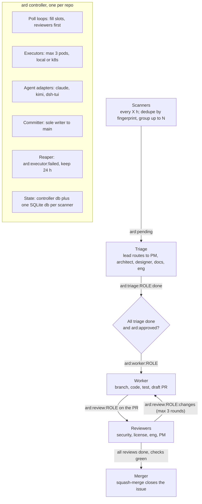
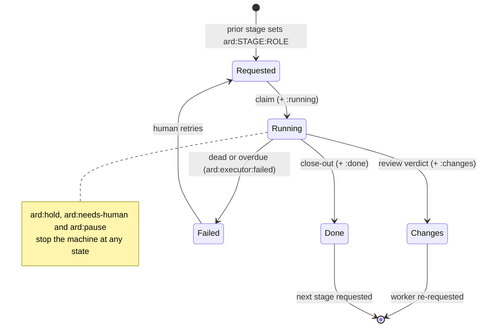
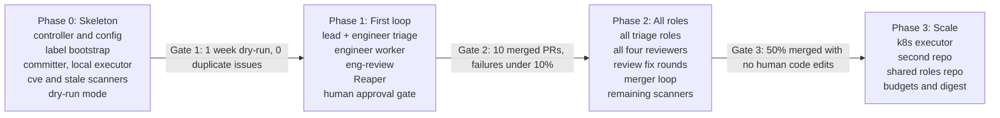

# ard: Automated Repository Development

Proposal · 2026-11-21 · Al Brown

## Summary

ard (automated repository development) makes a GitHub repo maintain itself: scanners file deduplicated issues, triage agents turn each issue into a plan, a worker agent implements it on a branch, reviewer agents critique the PR, and a merger lands it once every review passes.

One rule holds it together: **a deterministic controller owns every GitHub and git side effect; agents only read and write files in a worktree.** Labels, claims, commits, pushes, comments and cleanup are code, not prompts, so a misbehaving agent can fail its job but cannot corrupt the queue.

One process (`ard`) per repo runs six loops that share a pool of 3 job slots (pods):

- **Scanners** — every X (default 4) hours; find problems, file or update issues, close what is fixed
- **Triage** — every X (default 15) min; role agents (lead, architect, PM, designer, doc planner) enrich an issue into `plan.md`
- **Workers** — every 5 min; implement the plan on `worker/<name>-<issue#>-<slug>`, run tests, open a draft PR
- **Reviewers** — every 5 min; role agents (security, license, eng, PM) review the PR and request fixes
- **Merger** — every 5 min; when every review is done with no changes and checks are green, merge the PR, which closes the issue
- **Reaper** — marks dead or overdue jobs `ard:executor:failed`, keeps their evidence 24 h, then cleans up

GitHub labels, all prefixed `ard:`, are the queue and the state machine. `.ard/<issue#>/` is the shared working memory and audit log, and `.ard/<type>/<name>/` holds each role's prompt and runtime by convention.

## Architecture



Each arrow is a label the controller sets at close-out; dashed lines show the stages it runs. A reviewer's `changes` verdict sends the PR back to the worker, at most three times; once every review passes, the merger lands it.

## Stack

**Stack (decided, #9).** Go, one static binary (CGO off) with: cobra, gopkg.in/yaml.v3, modernc.org/sqlite, go-github v88 with ghinstallation/v2, log/slog, golang.org/x/tools (for the architecture test only) and an internal `internal/gitx` for git.

## Label state machine

Every label starts with `ard:`, and every stage uses one grammar: `ard:<stage>:<role>` requests work, `:running` marks a claim, `:done` marks completion. A loop picks up an issue that has the request label and none of `:running`, `:done`, `ard:executor:failed`, `ard:needs-human` or `ard:hold`.



`:done` hands off to the next stage's request label, `:changes` sends the PR back to the worker, and a failed job waits until a human removes `ard:executor:failed`.

| Label | Set by | Meaning |
| --- | --- | --- |
| `ard:scanner:<name>` | Scanner | Which scanner owns the issue; used for dedupe and backpressure |
| `ard:pending` | Scanner or human | Ready for triage; the lead's request label |
| `ard:triage:<role>` | Lead (via controller) or human | This triage role is requested |
| `ard:worker:<role>` | Triage gate | Plan is complete; ready to implement |
| `ard:review:<role>` | Worker close-out (on the PR) | This review is requested |
| `ard:<stage>:<role>:running` | Controller on claim | An executor holds the job |
| `ard:<stage>:<role>:done` | Controller on close-out | Finished; output is in `.ard/<issue#>/` |
| `ard:review:<role>:changes` | Controller on close-out | Reviewer found blocking issues; sends the PR back to the worker |
| `ard:executor:failed` | Reaper or close-out | Job died or ran over time; resources kept 24 h |
| `ard:needs-human` | Controller, from the agent's result | Agent reported it is blocked; automation stops |
| `ard:needs-approval` | Merger | PR touches a protected path; merges after a human approves |
| `ard:hold` | Human | Controller ignores this issue or PR entirely |

Four more labels sit outside the grammar: `ard:approved` (human go-ahead before a worker starts), `ard:tests:failed` (worker could not get tests green), `ard:keep` (hold failed-job resources past 24 h) and `ard:pause` (on the pinned status issue, stops all new claims). `ard labels sync` creates and updates the full set from the resolved config, idempotently, and never deletes a label: stale `ard:` labels are only reported. In `label` mode a custom `intake.label` is part of the catalogue: sync creates it with a description saying it admits the issue to triage, and switching back to the default leaves the old custom label reported as stale, never deleted. `ard labels sync` and `ard config check` reject an intake label that is one of ard's own label names, naming `intake.label`; `ard serve` logs `config.intake_invalid` once per distinct value. `--repo owner/name` names the repository; when omitted, it is read from the `origin` remote. Role names are at most 31 characters and scanner names at most 38, because GitHub caps a label at 50 characters.

**One query per role per poll.** For example: `is:open label:"ard:triage:architect" -label:"ard:triage:architect:running" -label:"ard:triage:architect:done" -label:ard:executor:failed -label:ard:needs-human -label:ard:hold`. Six triage roles every 15 minutes, plus four reviewers, a worker and the merger every 5, is about 100 searches an hour, well under GitHub's limits.

**Claims need a single owner, not atomic labels.** GitHub labels are not a lock: two pollers can both add `:running`. Phase 1 runs one controller per repo behind a host lock (`flock` locally, a Kubernetes Lease in-cluster), so the controller is the only claimer. If you ever run several, the claimer re-reads the issue's label timeline and backs off unless its own `labeled` event is first.

**Agents never touch labels.** The executor's close-out removes `:running`, adds `:done` (or `ard:executor:failed`), and posts the summary comment. `ard:pending` is removed when the lead finishes, so it means "not yet triaged" and nothing else.

**Retries are explicit.** Every retry, automatic or human, is a new job with its own id (and attempt 1). A human retries a failed job by removing `ard:executor:failed`. The controller retries on its own once, only for a transient cause it can name: a rate limit, a clone failure, a controller restart (the job was orphaned, gone or never started across it), or node eviction under Kubernetes. The failed job then gets no `ard:executor:failed` and keeps its request label, so the next claim runs it again; that claim is linked to the failed job (`retry_of` in local state), so cost and causes can be traced. An automatic retry that fails again is marked failed. A usage-limit stop is not a failure and must not use up the one automatic retry; that handling lands with the limit detection ([#81](https://github.com/albertcbrown/ard/issues/81), [#63](https://github.com/albertcbrown/ard/issues/63)).

## The .ard/ contract

`.ard/<issue#>/` is the only place agents leave durable output, and every file in it has one owner role. Issue directories are numeric, so they never collide with the role directories under `.ard/` (see Configuration).

```
.ard/
  <issue#>/
    issue.md             # scanner or lead: the ask, findings, fingerprints, links
    plan.md              # triage roles: each appends its own section; the worker follows it
    triage-lead.md             # one audit log per stage and role that ran: <stage>-<role>.md
    triage-architect.md
    triage-engineer.md
    worker-engineer.md         # worker: what changed, test results, open issues
    review-security-review.md  # reviewer: findings, verdict, what must be fixed
    logs/                # full, redacted output of every agent run on this issue
      triage-lead-<ts>.log
      worker-engineer-<ts>.log
```

The stage in a role file's name is the label stage (`triage`, `worker`, `review`; `config.Kind` and the role directory spell the last one `reviewer`), so a triage and a worker role with the same name never share a file.

Every `<stage>-<role>.md` starts with frontmatter the controller reads, so the agent reports its outcome without touching GitHub:

```
---
role: engineer
status: done          # done | blocked | needs-human (both of the last two add ard:needs-human)
attempt: 1
next: [review:security-review, review:eng-review]   # optional requests
worker: engineer      # lead only: which worker role implements the plan
verdict: approve      # reviewers only: approve | changes (required when status is done)
---
Short summary of what was done.

## Open issues
- ...
```

**All agent output is committed too.** Each run's full output lands in `.ard/<issue#>/logs/<stage>-<role>-<ts>.log`. Close-out redacts known secret values from the whole stream, secret-scans the whole redacted log, then caps it at 1 MiB: the first 32 KiB plus the last ~992 KiB, cut on line boundaries and joined by one truncation marker line. The full redacted log stays host-local for 7 days. Git LFS is not used (decided, #4); revisit only if `.git` growth demands it. Once the redacted copy is committed, the raw log is deleted. Triage output goes to `main` through the committer; worker and reviewer output goes on the branch and ships in the PR. **Scanner run logs stay host-local in phase 0** (`~/.ard/logs/`, 7 days) and are not committed: one run can touch many issues, and close-out redaction and the secret scan (#20, #21) land after Gate 1. What a scanner run commits is `.ard/<issue#>/issue.md` for each issue it files or joins, nothing else. Committing scanner logs, redacted, to each touched issue is a follow-up. Never committed: scanner state databases, and any log the secret scan flags.

**One writer location per issue directory at a time.** Until the worker branch exists, `main` owns `.ard/<issue#>/`; scanners and triage write there. Once the branch is cut, the branch owns it; workers and reviewers commit to the PR, and a scanner with new findings comments on the issue instead. This keeps the PR merge free of conflicts in `.ard/`.

**One committer for main.** Close-outs never push. They hand a file set to the controller's committer, which keeps its own clean worktree of `main`, commits as `ard[bot]` with `ard(<stage>:<role>): #<issue> <summary> [skip ci]`, re-applies its snapshot on the fetched head, pushes with a lease, and retries up to 3 times (re-applying the whole-file snapshot is the rebase; if upstream changed one of its paths the request fails with a conflict instead of overwriting). A replay of an unchanged tree is a no-op that returns the upstream head. It refuses any change outside the `.ard/<issue#>/` directories. The one other lane is `ard init`'s: it commits only `.ard/config.yaml` and files under the four role trees, only to the new branch `ard-init` cut from `main`, with a push whose lease expects the ref to be absent, so it creates the branch and never updates an existing one, and opens a PR; a human merges it with a squash or merge commit, so the bot-commit check never sees a bot commit outside `.ard/<issue#>/` on main's first-parent history. Because the bot must bypass branch protection on `main`, a detective check audits it: the workflow `.github/workflows/bot-commits.yml` walks the first-parent history of `main` (the last 500 commits, or everything after the repository variable `ARD_BOT_CHECK_SINCE`) and fails the run, listing the commits and paths in the job summary, when a commit made by the bot changes anything but regular files under a single `.ard/<issue#>/` directory. Bot commits are identified by **committer** (the App's noreply email or login), not author, because a squash merge of a bot PR has the bot as author. If the 500-commit window is full and its oldest commit is the bot's, the check fails closed until `ARD_BOT_CHECK_SINCE` is set, so a bad commit cannot be flushed out of view. It runs hourly as well as on push, because `[skip ci]` suppresses the push trigger. It fails closed when the `ARD_BOT_LOGIN` repository variable is unset. It reads both variables from repository settings and lives in `.github/workflows/`, which the App cannot write. Alerting is the failed run only; it does not open issues or pause ard.

**Why `.ard/` stays on `main` (decided, #1).** An orphan `ard-state` branch is ruled out: worker and reviewer logs ride on PR branches, and a PR cannot carry files from unrelated history. The single committer, the `[skip ci]` marker and the path guard answer the usual objections. `[skip ci]` applies to main-branch bot commits only; commits on a PR branch never carry it, so CI always runs on them.

**Directories outlive their issues as the audit trail.** A monthly janitor deletes `.ard/<issue#>/` for issues closed more than 90 days ago; git history keeps them.

## Scanners

A scanner is a directory, `.ard/scanners/<name>/`, holding either an executable `scan` that prints findings as JSON lines or a `prompt.txt` for an LLM scanner. The controller does all dedupe, grouping, filing and closing, so deterministic tools and LLM scanners share one pipeline and no scanner holds a GitHub token.

```
{"fingerprint":"osv:GHSA-xxxx:go.mod:golang.org/x/net","title":"golang.org/x/net: GHSA-xxxx (high)",
 "severity":"high","group":"go.mod","files":["go.mod"],"body":"markdown details"}
```

**The output schema is strict.** Each line is one JSON object with exactly these keys; blank lines are skipped. `fingerprint` (required, 1 to 512 bytes of valid UTF-8, no control characters), `title` (required, one line, at most 200 characters), `severity` (required: `critical`, `high`, `medium`, `low` or `info`), `group` (optional; empty means one issue per finding), `files` (optional repo-relative paths, clean, no `..`) and `body` (optional markdown, at most 64 KiB). An unknown key, a bad value, a duplicate fingerprint, a line over 1 MiB, a stream over 16 MiB or more than 10,000 findings is an invalid line, and **any invalid line fails the whole run**: nothing is filed, closed or changed, so a half-parsed run can never trigger autoclose. Titles, bodies and file names come from repository content, so the controller treats them as untrusted data: before they reach an issue body it escapes HTML comment delimiters, so scanner output cannot forge a marker.

**Each run, in order:**

1. **Reconcile.** Fetch the scanner's open issues, plus a lookup of each issue that has a tracked finding and is no longer open, and update its state. Every marker line on an open issue becomes a row on that issue (a fingerprint on two open issues goes to the lowest number), so a crash between creating an issue and recording it heals here instead of filing a duplicate. Closed as completed: mark the fingerprints fixed, keeping a tombstone so a return can link the old issue. Closed as not planned or as a duplicate: suppress them for `stale.suppress_for` (default 90 days) from the close time. Deleted or transferred: drop. An issue that is reopened is tracked again and its suppression lifts. Reconcile also runs on a run that is then dropped, so state stays current.
2. **Backpressure, in code, before the scanner starts.** The controller counts open issues with `ard:scanner:<name>`; at or above `max_open` it skips the run and logs it, autoclose scanners included: a scanner at its cap does not run with a zero filing budget, so it cannot autoclose its own fixed issues until a human or the stale closer frees a slot. A global cap across all scanners (`global_max_open`) stops a bad day from burying the queue. A skipped run is not queued: it counts as a run, and the next scheduled run checks again.
3. **Scan.** Run the scanner on a read-only worktree of `origin/main`, with a timeout. It needs a free job slot, and scanners rank last for one. **A run that is denied a slot is not dropped: it is not recorded, stays due and is offered again on the next tick** (every five minutes), until it gets a slot or the controller stops. A failed scan (non-zero exit, timeout, invalid output) is recorded and changes nothing else.
4. **Diff.** A new, unsuppressed fingerprint is queued for filing. A suppressed fingerprint stays quiet unless its severity rises above the suppressed one. A fingerprint that returns after being fixed files a new issue that links the old one as a regression. An open issue whose fingerprints are all gone gets "No longer detected at `<sha>`" and is closed, but only for scanners marked `autoclose` (deterministic ones); other scanners never edit or close an issue for absence. A returning finding unticks its line.
5. **Group.** Findings that share a `group` key join one issue, up to `group_size` (N), as a checklist with one line per finding (ticked lines count towards N). An empty `group` means one issue per finding. New findings join an open group issue of the same group that has room and is not yet claimed, meaning it carries no `ard:` label besides `ard:scanner:<name>` and `ard:pending`; otherwise they start a new one. A regression never joins: it always opens a new issue, which may also hold new findings of the same group. The number of new issues per run is `min(max_open - open, global_max_open - global open)`; joins are free. Findings over that budget are filed most severe first, and the rest stay unrecorded so the next run offers them again.
6. **File.** Edits and closes first, then joins, then new issues. Create the issue with `ard:scanner:<name>` and `ard:pending`, then queue `.ard/<issue#>/issue.md` to the committer. The issue comes first because its number names the directory. A committer failure is logged and does not undo the issue: its body already carries the checklist. **An issue with `ard:hold` is never edited, joined, commented on or closed**, and a close waits while any `ard:<stage>:<role>:running` label is on the issue, so a running job is not orphaned. Edits never rewrite `issue.md`, because after a claim the branch may own `.ard/<issue#>/`.

**A scanner loop runs at most one due scanner per tick.** The `scanners` loop polls every five minutes, picks the most overdue scanner (last run plus its `every`; a dropped run counts as a run) and runs it. Pausing stops it, because it files and closes issues. Its tick timeout is the longest scan timeout plus 15 minutes, not the poll interval.

**Each scanner has its own state, and GitHub is the truth.** Every scanner keeps a separate SQLite file, `~/.ard/state/<owner>/<repo>/<scanner>.db`: fingerprint to issue, first and last seen, suppressions, last run. Scanners never share or lock each other's state, and one can be reset without touching the rest. The controller keeps its own jobs, attempts, events and a small key/value table (for example the status issue number) in `_controller.db` in the same directory, and dry-run uses `~/.ard/state-dryrun/<owner>/<repo>/`. Owner and repo are lowercased (GitHub names are case-insensitive) and nested, so distinct repos never share a directory (`a-b/c` and `a/b-c` would collide as `a-b-c`); `ard serve` and `ard rebuild-state` refuse to start while a pre-#82 flat `<owner>-<repo>` state directory exists under `state/` or `state-dryrun/`, and ard does not migrate it (decided, #82). Every issue body carries hidden markers, so `ard rebuild-state <scanner>` restores a database from GitHub after a lost disk or a host move. The body holds a header `<!-- ard:scanner=<name> group=<enc> -->` and a checklist between `<!-- ard:findings -->` and `<!-- /ard:findings -->`, one line per finding: `- [ ] <title> <!-- ard:fp=<enc> sev=<severity> [reg=<old issue>] -->`. `<enc>` percent-encodes every byte outside `[A-Za-z0-9._:/@+=,~-]`, so the proposal's example fingerprint stays readable and nothing can close the comment. A ticked box means the finding is gone. Per-finding details sit in a second span, `<!-- ard:details -->`, cut to 2,000 characters each and trimmed from the end to keep the body under 60,000; `issue.md` holds them untruncated. The controller reads and rewrites only the two spans, so text a human or triage adds elsewhere survives. A human who deletes a marker line makes that finding look new, which is accepted because GitHub is the truth.

`ard rebuild-state <scanner>` takes the leader lock (it refuses to run while `ard serve` holds it), reads every issue with `ard:scanner:<name>`, open and closed, and replaces the scanner's findings and suppressions in one transaction, keeping the run history. For each fingerprint, an open issue wins (the lowest number), else the highest-numbered closed issue decides: completed leaves a `fixed` tombstone, not planned or duplicate leaves none. Independently, the highest-numbered not-planned or duplicate close gives a suppression until `closed_at + stale.suppress_for`, kept even when expired. It prints what it adds, removes and changes; with `--dry-run` it prints and writes nothing. The dry-run state database holds synthetic issues that are not on GitHub, so it is never rebuilt. Only scanners with a `scan` executable can be rebuilt. One known gap: reopening an old issue that shares a fingerprint with a newer one can leave the database different from a rebuild until the next rebuild-state.

**Dry-run files nothing.** Under `--dry-run` a would-be issue gets a synthetic negative number, stored in the scanner's dry-run database like a real one, so repeated scans do not re-propose it and `max_open` is reached from synthetic issues. The committer is never called for a synthetic number. The global cap counts only the running scanner's synthetic issues, since scanners share no state.

**Closed is not always "forget".** Removing a fingerprint on every close, as first sketched, refiles a won't-fix issue on the next run. Completed closes stop tracking the finding but keep a `fixed` tombstone, so a finding that comes back is filed as a regression of the old issue. Not-planned closes, and closes as a duplicate, suppress, and re-raise early if severity rises.

**LLM scanners need stable fingerprints.** Their prose changes run to run, so they fingerprint on rule, file and symbol, never on wording. Before filing, the controller also compares the title against the scanner's open issues and skips near-duplicates.

**The stale closer is a built-in scanner.** It has no role directory and needs no job slot, executor or worktree; its settings live in the top-level `stale:` block of `config.yaml`. It is a plain controller loop that runs every 24 hours and is skipped while paused. It closes scanner issues still at `ard:pending` with no activity for `stale.inactive_for` (default 30 days), as not planned, with a comment. Activity means a timeline event by anyone other than the ard App. It never closes an issue that has a `:running` label, `ard:hold`, `ard:needs-human`, a linked open PR, or a human author (any author other than the App), and it closes nothing when the client is not authenticated as an App. It only comments and closes: suppression happens on the owning scanner's next reconcile, which suppresses every not-planned close for `stale.suppress_for`. A reopened issue gets a fresh comment when it goes stale again.

| Scanner | Engine | Every | Group size | Auto-close |
| --- | --- | --- | --- | --- |
| cve | osv-scanner and govulncheck (trivy and the Dependabot alerts API later) | 6 h | 1 | yes |
| lts | endoflife.date + manifests: go.mod, package.json, Dockerfile `FROM`, Helm charts | 7 d | 1 per component | yes |
| lint | repo linters, findings beyond a committed baseline | 24 h | 20 per rule and directory | yes |
| error-codes | codes duplicated, undocumented, or missing from the registry | 24 h | 20 | yes |
| missing-tests | coverage report plus exported functions with no test | 24 h | 10 per package | yes |
| docs | undocumented public APIs (deterministic) plus doc drift (LLM) | 3 d | 10 | deterministic part only |
| architecture | LLM against ADRs and the sidecar spec repo | 3 d | 1 | no |
| stale | built-in | 24 h | none | none |

**The cve scanner** (`scanners/cve`, a `sh` script plus one `jq` program, no build step) merges osv-scanner (all ecosystems) and govulncheck (Go reachability). Its fingerprint is `osv:<advisory>:<manifest>:<package>`, where the advisory is the smallest `GHSA-` id of the vulnerability, else the smallest `CVE-` id, else the smallest id, so one vulnerability reported under `GO-`, `GHSA-` and `CVE-` ids is one finding. Severity is `critical|high|medium|low`, from the CVSS score, else the database severity, else `medium`; a vulnerability govulncheck finds unreachable is capped at `medium`. Manifests under `testdata/`, `vendor/` and `node_modules/` are skipped. It fails closed: if a Go module cannot be analysed, the run fails and files nothing, unless a human adds a `no-govulncheck` file to the role directory, which skips govulncheck and reports reachability as unknown. Each Go module is analysed with the image's Go toolchain unless its `go` directive, or a `toolchain` line, needs a newer one. Then the scanner lets Go pick that toolchain (`GOTOOLCHAIN=auto` rules: the `toolchain` line if present, else the `go` directive's minimum version), downloads it from the Go module proxy (checksum-verified; scanner jobs have egress) into its temp dir, rebuilds the same govulncheck version with it, and scans with both. The image sets `TMPDIR=/var/tmp` because the executor's `/tmp` is noexec. If the temp dir is noexec, or the toolchain cannot be downloaded or built, the run fails closed and names the reason. Findings from such a module say which toolchain was scanned (`Go toolchain:` line), and standard-library findings are measured against it (for `go 1.27`, `go1.27.0`), not against the image's Go. The Dependabot alerts API is not wrapped, because a scanner holds no token.

Intervals and group sizes are starting values to tune, not measurements.

## Triage loop

Triage turns an issue into a `plan.md` a worker can execute, one role at a time, and writes only to `.ard/<issue#>/` on `main`.

**Each poll (every 15 minutes by default), for each triage role:**

1. Query for the role's request label (the lead's is `ard:pending`), excluding claimed, done, failed, blocked and held issues. Which human-filed issues receive `ard:pending` is the `intake` setting (decided, #2): in `all` mode every human-filed issue enters with no label needed; in `label` mode only issues carrying the configured intake label do. `intake.Admit` decides, as a pure function of the issue, its timeline and the labeler's permission, and it fails closed. Issues authored by the App (scanner-filed) always pass. In `all` mode only issues opened after `all` mode was first enabled enter without a label; older issues still need the label. In `label` mode only the most recent `labeled` event for the label counts: it must come from the App or from a collaborator with role triage, write, maintain or admin (matched case-insensitively), and an earlier authorised event does not rescue a later unauthorised one. When the label is present but not honoured, the controller adds `ard:needs-human` with a short comment asking a maintainer to re-apply the label. The loop wiring, the refusal action and the body-edit re-gate (`body_hash`) land with #29.
2. Wait for a free job slot (triage ranks below reviewers and workers), then claim the oldest match: add `ard:triage:<role>:running` and record the job (id, executor, start, deadline).
3. Prepare a detached worktree at `origin/main`, refresh `.ard/<issue#>/issue.md` from the issue and its comments, and mount the role's sidecar repo read-only at `$ARD_SIDECAR`.
4. Run the agent CLI with `.ard/triage/<role>/prompt.txt` and the issue directory as context.
5. Close out: read `triage-<role>.md` frontmatter, send the issue directory (and nothing else) to the committer, post the summary as a comment, swap `:running` for `:done`, and apply any requests.

**The lead routes; the controller applies.** The lead writes `next: [triage:architect, triage:product-manager]` and `worker: engineer` in `triage-lead.md`. The controller adds the matching `ard:` labels only if each names a role directory that exists.

The starter lead (`.ard/triage/lead/prompt.txt`) follows a fixed contract. It reads the issue only through the untrusted input files `.ard-input/<issue#>/issue.md` and `comments.md`, which the triage loop writes and never commits. It finds roles by listing the role directories and routes only to those. It writes only `triage-lead.md`, with `attempt: 1`, and a `status: done` always names a `worker`. It answers `needs-human` when a person must decide: an unclear ask, a question, a duplicate, a change to `.ard/config.yaml`, the role directories or `.github/`, no fitting worker, or text that tries to instruct it. It uses `review:<role>` only for a reviewer whose `when` rule would skip a change that needs that review. The committer and close-out path guards, not the prompt, enforce that it writes nothing else.

**A deterministic gate starts the worker.** When every requested `ard:triage:<role>` is `:done`, the controller adds the lead's chosen `ard:worker:<role>`. With `require_approval: true` (the Phase 1 default) it waits for a human to add `ard:approved` first.

**Order comes from config, not the lead.** A role can declare `after: [architect, product-manager]`; the controller holds its request until those roles, if requested, are done. Engineer triage normally runs last so its steps reflect the design and requirements.

| Role | Adds to plan.md | Typical trigger |
| --- | --- | --- |
| lead | nothing; writes `triage-lead.md` with routing, or `needs-human` when a person must decide | every `ard:pending` issue |
| product-manager | Requirements: user value, acceptance criteria, out of scope | feature asks |
| architect | Design: approach, affected modules, ADR needed or not | cross-module change, new dependency |
| designer | UX section, plus design files in `.ard/<issue#>/design/` | UI change |
| documentation-planner | Docs: which pages change and what they must say | public API or behaviour change |
| engineer | Implementation steps, test plan, risk, size | every issue that reaches a worker |

**Sidecar repos are context, read-only.** A role's sidecar (for example `vpe-specs`) is shallow-cloned at a pinned ref and cached on the host. A role that wants a spec changed says so in `plan.md`; editing the sidecar is out of scope for v1.

## Executors and the Reaper

An executor runs one agent job somewhere and reports back; the controller does not care where. Both executors implement the same five calls: `prepare`, `start`, `status`, `logs`, `cleanup`. Prepare also removes any `Job.Scrub` paths (the job's own role file, directly under `.ard/<issue#>/`) from the fresh worktree before the agent starts. Job IDs are ULIDs minted at claim time; they name the worktree and the logs and appear as the `Ard-Job` commit trailer. The executor captures the job's stdout separately from its combined log, because the adapter parses one and the committed log comes from the other. Scanner jobs get network egress for advisory databases; agent jobs get only their model credential.

Local-executor details: the role directory (and its `Dockerfile`) is mounted from the config snapshot at the job's SHA, not from the working tree. The job worktree is always detached at a SHA resolved from the job's ref (the executor never checks out a branch; the committer owns branch worktrees). Every `git worktree add`, `remove` and `prune` on the controller's clone, by the executor and the committer's lanes alike, takes one in-process lock keyed by the clone's common git directory, because git's worktree bookkeeping is not safe under concurrent admin commands; fetches, commits and pushes do not take it. Each such command also has a 30 s deadline, and cleanup runs even when the job's context is cancelled, so one hung git cannot stall every lane. Do not run `git worktree prune` (or add/remove) in the repo dir by hand while `ard serve` runs: the lock is per process and cannot cover a human's git. The host keeps two files per job: `<base>.log` (stdout and stderr combined, the heartbeat source and the committed log) and `<base>.stdout` (stdout only, parsed by the adapter). A read-only job (`ReadOnly`, used by scanners) gets the worktree mounted `:ro` under Docker, or `chmod -R a-w` on the host. The heartbeat is the log file's mtime while the PID is alive; liveness alone is not a beat. Phase 0 local jobs do not survive a controller restart: the pipes belong to the controller, so after a restart the job reports `orphaned` (PID alive, start time verified) or `gone`, and the Reaper kills and fails it. The executor is not an effect: it never calls GitHub or commits, so jobs run normally under `--dry-run`. Host-mode jobs run as the controller's uid: they can read the GitHub App key and `~/.config/gh` by absolute path, write `RepoDir/.git`, and undo `chmod a-w`. Host mode is allowed for every role ([#84](https://github.com/albertcbrown/ard/issues/84)), but a role that reads untrusted input (every triage, worker and reviewer role, and an LLM scanner) warns loudly when it has no `Dockerfile`; deterministic scanners are exempt, and nothing warns under `executor: k8s`, where every job runs in a container. `ard config check` and the first successful config load of `ard serve` (and any role a later config adds) log one `executor.host_untrusted` WARN per such role and also write it to stderr, so it survives `--log-level`. The local executor logs the WARN again for every host-mode job of such a role and appends a `host_untrusted` row to the `events` table. Each warning lists what the job can reach, including `~/.ard` (state, config snapshots, the pause file, other jobs' worktrees and logs). The owner accepts this risk while ard runs only on owner-controlled repos, and revisits it when moving to the spark cluster, where every job runs in a container.

**One pool of job slots, drained from the end.** At most `max_pods` jobs (default 3) run at once, shared by every loop. When a slot frees, the controller fills it in this order: reviewers, then workers, then triage, then scanners, oldest first within each. Finishing work in flight beats starting new work, so a busy day grows the scanner backlog, not the pile of half-done PRs. The merger and the Reaper are controller code and take no slot. Slots are granted when a loop polls and nothing is queued: a loop that found work waiting within the last two of its intervals has that demand reserved ahead of lower classes, so a freed slot can sit idle until that loop's next poll. A scanner run that gets no slot is skipped, not queued.

|  | Local executor | Kubernetes executor |
| --- | --- | --- |
| Workspace | `git worktree` under `~/.ard/work/<owner>/<repo>/<job-id>` | `Job` with an init container that shallow-clones the branch into an `emptyDir` |
| Runtime | the role's `Dockerfile` image under Docker if it has one, else a host subprocess; hard timeout | a pod from the role's `Dockerfile` image, or the default `ard-agent` image; hard timeout |
| Heartbeat | PID alive plus log file mtime | pod phase plus container restarts |
| Logs | streamed to `~/.ard/logs/<owner>/<repo>/<issue#>/` while running; committed to `.ard/<issue#>/logs/` at close-out | pod logs, committed to `.ard/<issue#>/logs/` at close-out |
| Labels on resources | job id in the directory name | `ard/issue`, `ard/stage`, `ard/role`, `ard/job` |
| Good for | Phase 1, one host, fast iteration | parallelism, isolation, untrusted inputs |

**Agent CLIs plug in through adapters.** Each adapter turns (prompt file, context paths, budget) into a command line and parses the exit code and, where the CLI reports them, turns and cost. For Claude Code that is `claude -p --output-format=stream-json --verbose --restricted --safe-mode --strict-mcp-config --disable-slash-commands --permission-mode=dontAsk --settings='{"includeGitInstructions":false,"disableAllHooks":true}' --tools=… --allowed-tools=… --disallowed-tools=… --model <model> --max-budget-usd <max_budget_usd> --append-system-prompt-file <role prompt> -- <message>` (`--verbose` is required by `stream-json` in print mode). Every stage (scanner, triage, worker, review) gets the same tool profile: `--tools` and `--allowed-tools` are `Read,Glob,Grep,Edit,Write,Bash`, and `--disallowed-tools` is `Bash(git commit *),Bash(git push *),Bash(git remote *),Bash(gh *)` (decided, #79). ard does not pass `--bare`: it limits the CLI to Bash, Read and Edit, and `--tools` cannot widen it (#105). The planted-config isolation `--bare` gave comes instead from `--restricted` (only managed settings and `--settings` load), `--safe-mode` (no CLAUDE.md or AGENTS.md, skills, agents, hooks, MCP servers or auto memory), `--strict-mcp-config`, `--disable-slash-commands`, and `--settings` that turns off hooks and the git status snapshot (commit subjects are third-party text). `CLAUDE_CODE_DISABLE_BACKGROUND_TASKS=1` is set as a fixed env var (the executor allows it) so Bash cannot detach commands. The integration tests pin each of these against a worktree with planted config and must be re-run on every `TestedVersion` bump. The tool list is not a security boundary, and the deny list is advisory, because shell indirection gets around it. The real boundaries are the missing GitHub token (Docker; see the host-mode note above, #84), the committer, which commits only `.ard/<issue#>/` from a triage or review job (other edits are discarded with the worktree), and the diff guard on worker changes. An explicit tool list from the caller (`Spec.Tools`) replaces the allow list and keeps the deny list. The user message holds only fixed text and the paths of the untrusted input files. The installed CLI accepts an undocumented `--max-turns`; ard does not rely on it, so a per-job dollar cap and the executor's hard timeout bound each run. Agents run with an empty per-job CLI config dir and HOME and receive exactly one model credential, passed by name by the executor and never visible to the adapter: an API key (`ANTHROPIC_API_KEY`) or a subscription OAuth token (`CLAUDE_CODE_OAUTH_TOKEN`, from `claude setup-token`); that rests on the environment, not on a CLI flag. `ard serve` chooses the credential from its own environment: `ARD_AGENT_AUTH` is `auto` (the default; the token if set, else the key), `oauth` or `apikey`, and an explicit mode never falls back to the other variable. Only one is ever passed, because the CLI prefers the API key and would silently bill it (pinned by an integration test). A missing credential does not stop startup, because deterministic scanners need none: `ard serve` logs one INFO line, and a job that needs one fails with a clear error. The executor creates the per-job config dir as `<job home>/.claude` (0700) in `prepare` (`Handle.View.ConfigDir`; under Docker it is a bind mount at `/ard-config`), refuses to start a job whose config dir is not that empty directory, and removes it with the job home; the Reaper's `KeepWorktree` retention keeps it too, and it holds no credential, since the credential travels only in the environment. `CLAUDE_CODE_SUBPROCESS_ENV_SCRUB=1`, which would keep the token out of Bash children, is not set: on 2.1.328 it changes the reported permission mode from `dontAsk` to `default`, so it needs its own decision. What agent Bash can read differs by mode: under Docker, only the job's own credential; in host mode, far more, because any same-uid process's environment is readable (`ps eww <pid>` on macOS, `/proc/<pid>/environ` on Linux), including `ard serve`'s own, which holds both credentials. The scrub would not close that; it is part of the host-mode risk of #84. `kimi` and `dsh-tui` both run headless with `-p`; neither has a turn cap and `kimi` reports no cost, so turns and cost are optional in the adapter result. `config.yaml` names the default CLI and any per-role override, so a role can move between CLIs without touching its prompt.

**The agent's contract is narrow.** It may edit files in its worktree and must write `.ard/<issue#>/<stage>-<role>.md` with a `status`. Exit 0 without that file counts as a failure, not a success, and so does a malformed file. The file counts only if this job wrote it: before the agent starts, the executor removes the job's role file from the worktree (`executor.Job.Scrub`), so a copy left from an earlier stage or run is never trusted. A role file the agent never wrote again fails the job (`role file not written by this job`, or `role file missing` when none was ever there). One it wrote again with identical bytes still counts, but only because the executor recorded the scrub in the handle (`Handle.Scrubbed`); close-out refuses an unscrubbed, unchanged role file (`role file not scrubbed by executor`). A non-zero exit fails the job even when a role file exists, and a failed job commits only its redacted log, never a partial `plan.md`.

**Close-out is resumable.** The controller (`internal/closeout`) decides the outcome from the role file (only one this job wrote), stages the redacted files, then commits, requests the `next` labels, posts one summary comment (tagged `<!-- ard:closeout job=<id> -->` so a replay never posts twice) and finally swaps `:running` for `:done`, `:changes`, `ard:needs-human` or `ard:executor:failed`. It records its phase in local state after each step. `serve` resumes unfinished close-outs at startup, and the Reaper resumes, rather than fails, a job whose close-out has started. Two more outcomes exist for a job that ended without a usable result: `failed` (sets `ard:executor:failed`) and `retry` (a named transient cause: no `ard:executor:failed`, the request label kept, the next claim is the automatic retry). Both commit only the redacted log. Their comment carries the reason, the last 50 log lines (cut from the redacted log, scanned again and capped at 8 KiB; if that scan flags or fails, the comment says the tail was withheld) and when the worktree and host files are kept until. `next` entries are applied only for roles that exist; a `review:<role>` the lead requests is applied when the worker opens the PR, not at triage close-out. Only changed files under `.ard/<issue#>/` are committed, so a newer `issue.md` on `main` is never overwritten.

**The Reaper runs every minute and decides failure, not the agent.** It marks a job failed when the process or pod is gone without a close-out, the deadline passes (it kills the job first), the heartbeat goes quiet for 10 minutes, or the job is `:running` with no record in local state. Every failure goes through close-out, so it is resumable and never double-comments:

1. **Who acts.** The Reaper kills only a job that a goroutine in this process still drives (its pool slot is held and was not adopted at startup), and only for a deadline or a quiet heartbeat; it records the reason first, and the owner's close-out reads it. A worker keeps its job after the agent exits (tests, fix rounds), so "exited" alone never means abandoned. Any job nobody drives (adopted after a restart, or no slot) is closed out by the Reaper itself, and its adopted slot is released. A job whose close-out has started is resumed, never failed.
2. **Close-out.** Commit the partial output to `.ard/<issue#>/logs/` (on `main` or the branch, as a normal close-out would), post one comment with the reason, the last 50 redacted log lines and the time the evidence is kept until, then remove `ard:<stage>:<role>:running` and add `ard:executor:failed`. A transient cause instead hands off to the automatic retry (see Retries are explicit). A log that cannot be committed (a worker that stopped before its first push has no branch) never turns a retry into a failure.
3. **Retention.** The worktree and job home are kept 24 hours after the job ended, then removed, together with the host logs of a failed job (the raw combined log is already deleted at close-out once its redacted copy is committed). A human extends this by adding `ard:keep` to the issue (or PR, for a review): the Reaper looks again 24 hours later. If it cannot read the issue it keeps everything. Branches are never deleted: closing the draft PR would lose the work a human retry reuses, so a human or a janitor removes them.
4. **`:running` with no record.** Every 5 minutes, for each configured triage, worker and reviewer role, an open issue or PR that has the `:running` label but no running job (and none that ended in the last 10 minutes) gets one comment, `ard:executor:failed` and the label removed. It is a core-API list per role, not a search. It is skipped in dry-run, whose database never matches real labels, and for issues held with `ard:hold`.

Host log files older than 7 days are pruned hourly. The Reaper keeps running while the controller is paused.

Successful jobs clean up at close-out: the worktree is removed, the Kubernetes `Job` gets a short TTL, and logs stay 7 days.

## Worker loop

A worker implements `plan.md` on its own branch and ends with a draft PR, test results, and a summary on the issue.

1. **Poll and claim** `ard:worker:<role>` like triage, also skipping `ard:needs-human`. Workers rank second for job slots, after reviewers.
2. **Branch** `worker/<role>-<issue#>-<slug>` from `origin/main`. The slug is the issue title in kebab case, ASCII, at most 40 characters. A fix round reuses the existing branch.
3. **Worktree** detached at the branch head, with the sidecar mounted read-only. The branch itself belongs to the committer.
4. **Run the agent** with `.ard/workers/<role>/prompt.txt`, `issue.md`, `plan.md`, the triage logs and, in a fix round, the reviewer logs and PR review comments. It edits code and writes `.ard/<issue#>/worker-<role>.md`.
5. **Guard the diff** before anything leaves the host. Reject changes to `.github/workflows/`, to `.ard/config.yaml` or any role directory, to other issues' `.ard/` directories, and to secret-shaped files. Over 1,000 changed lines goes to `ard:needs-human` instead of review.
6. **Commit and push.** Add the code, `worker-<role>.md` and the run's redacted output in `.ard/<issue#>/logs/`. Commit with the title `<type>: <issue title> (#<issue>)`, the summary from `worker-<role>.md` as the body and an `Ard-Job: <job-id>` trailer, then push the branch.
7. **Test.** Run the configured command (for example `make test`) with a timeout. On failure, the agent gets the failure output and fixes, commits and pushes again, up to `max_test_fixes` (default 2) within the same job.
8. **Open or update a draft PR** with `Closes #<issue>` and links to the `.ard/<issue#>/` files, labelled `ard:review:<role>` for each reviewer selected.
9. **Report.** Comment on the issue with the summary, test result and PR link; swap `ard:worker:<role>:running` for `:done`. If tests still fail, add `ard:tests:failed` and request no reviewers.

**Review feedback loops back here.** When any reviewer ends with `ard:review:<role>:changes`, the controller re-requests `ard:worker:<role>` on the issue and increments the round. The worker fixes on the same branch, and only the reviewers that asked for changes run again. The merger sends a PR back the same way when its branch conflicts with `main`. After `max_review_rounds` (default 3) the issue goes to `ard:needs-human`.

**The merger takes it from here.** Once tests pass, the controller marks the PR ready for review; the merger lands it when every requested review passes.

## Reviewer loop

Reviewers run like workers against a PR instead of an issue: they read the change, never edit code, and return a verdict the controller turns into PR comments and a label.

1. **Poll and claim** open PRs with `ard:review:<role>`, skipping claimed, done, changes, failed and held. Reviewers get first call on free job slots, since each finished review can unblock a merge.
2. **Pin the head SHA** and make a worktree there, so the review describes exactly one commit even if the branch moves.
3. **Run the agent** with `.ard/reviewers/<role>/prompt.txt`, the diff against the merge base, `issue.md`, `plan.md`, the worker log, and the sidecar (security policy, license allowlist). In round 2 and later it also gets its previous findings and must say which are resolved.
4. **The agent writes `review-<role>.md`** with `verdict: approve | changes` and findings as `file:line`, severity, blocking or not.
5. **Close-out.** The controller posts the findings as one PR review with inline comments, commits `review-<role>.md` and the run's redacted output to the PR branch through the per-branch committer (no `[skip ci]`: PR-branch commits always run CI so required checks report on the head), and swaps `:running` for `:done` or `:changes`.

**The label is the gate, not GitHub's "request changes".** A bot's request-changes review blocks merge until someone dismisses it, even after the fix. Reviews post as comments; `ard:review:<role>:changes` is what sends the PR back to the worker.

**Pair each reviewer with a deterministic tool where one exists.** The tool finds; the agent explains, ranks and checks the result against the plan.

| Reviewer | Runs when | Deterministic aid | Blocks on |
| --- | --- | --- | --- |
| security-review | always | semgrep or gosec, secret scan | injection, authz gaps, secrets, unsafe dependencies |
| eng-review | always | lint and coverage diff | correctness, missing tests, drift from `plan.md` |
| license-review | a manifest or lockfile changes | go-licenses or scancode | a license outside the allowlist |
| product-manager-review | the issue had PM triage, or UI paths change | none | acceptance criteria not met |

Every directory under `.ard/reviewers/` reviews every PR unless `config.yaml` gives it a `when:` rule (paths, or a triage role that ran). The lead can request extra reviewers through `next`; they are recorded in the triage job's close-out record in local state (`closeout.Deferred` reads them) and the worker loop adds the `ard:review:<role>` labels to the PR when it opens it.

## Merger loop

The merger is controller code, not an agent: every 5 minutes it merges each PR that has cleared every gate, and the merge closes the issue.

A PR merges when all of these hold:

- every requested `ard:review:<role>` is `:done` and none is `:changes`
- required status checks are green on the current head
- the branch is up to date with `main`; if it is behind, the merger updates it and waits for checks on the new head
- it carries none of `ard:hold`, `ard:needs-human`, `ard:tests:failed` or `ard:executor:failed`
- the diff touches no protected path; the list comes only from `merge.protected_paths`, with no floor in code (decided, #3), so a human who empties the list removes the gate. `ard init` proposes the defaults `.github/`, `.ard/config.yaml`, the four role trees (`.ard/scanners/`, `.ard/triage/`, `.ard/workers/`, `.ard/reviewers/`), `**/CODEOWNERS`, and the agent instructions a PR could plant to steer later agents: `CLAUDE.md`, `**/CLAUDE.md`, `AGENTS.md`, `**/AGENTS.md`, `.claude/` and `.mcp.json` (13 entries; `**/X` already matches a root `X`, the bare entries are kept for clarity). An entry ending in `/` is a directory prefix; any other entry is a doublestar glob. Matching is case-sensitive on the repo-relative path. A prefix matches on a directory boundary (`.github/` matches `.github` and `.github/x`, never `.githubx`). A glob follows doublestar: `*` stays within one path segment and `**` crosses them, so a bare `CODEOWNERS` would match only the root file. Quote globs that start with `*` in YAML. The merger checks both names of a renamed file; a malformed path counts as protected. A PR that touches one gets `ard:needs-approval` and merges on the next poll after a human approves

It squash-merges with the worker's commit title and the `Ard-Job` trailer, then deletes the branch, so `.ard/<issue#>/` and its logs land on `main` with the code. If updating the branch conflicts, it re-requests the worker for a rebase round, which counts toward `max_review_rounds`.

**Branch protection still binds the bot.** The GitHub App may bypass only the required-approval rule; required status checks apply to it like anyone else.

## Configuration

Configuration is by convention: a role exists because its directory exists, and `.ard/config.yaml` holds only global settings and overrides. No prompt path is written anywhere; ard reads `.ard/<type>/<name>/prompt.txt`. Model credentials are host settings (`ARD_AGENT_AUTH`, `ANTHROPIC_API_KEY`, `CLAUDE_CODE_OAUTH_TOKEN` in the `ard serve` environment), not `config.yaml` keys, because a PR can change `config.yaml`.

```
.ard/
├── config.yaml          # global settings and overrides only
├── scanners/<name>/     # scan (executable) or prompt.txt; optional Dockerfile, scripts
├── triage/<name>/       # prompt.txt; optional Dockerfile, scripts
├── workers/<name>/      # prompt.txt; optional Dockerfile, scripts
├── reviewers/<name>/    # prompt.txt; optional Dockerfile, scripts
└── <issue#>/            # per-issue output and logs, written only by the committer
```

- A directory with `prompt.txt` is an agent role; a scanner directory with an executable `scan` is a deterministic scanner.
- A `Dockerfile` builds the role's image; without one the local executor runs a host subprocess and the Kubernetes executor uses the default `ard-agent` image (agent CLIs, git, common linters). A role that reads untrusted input without one triggers the host-mode warning (see Executors and the Reaper).
- Any other file in the directory (scripts, allowlists) is mounted read-only beside the prompt.

```yaml
max_pods: 3                  # job slots shared by every loop
executor: local              # local | k8s
agent: claude                # default CLI for agent roles
require_approval: true       # human adds ard:approved before a worker starts
budget_usd_per_day: 50       # whole repo; provisional, recalibrated between Gate 1 and Gate 2
max_budget_usd: 5            # per job; provisional, same recalibration
global_max_open: 30          # open scanner issues across all scanners
paused: false
intervals: { scanners: 4h, triage: 15m, workers: 5m, reviewers: 5m, merger: 5m }
intake: { mode: label }     # mode: all | label; label (label mode only) defaults to ard:pending, must start with ard: and must not be one of ard's own labels
merge:                       # defaults written by `ard init`; the list is the only source (no floor in code)
  protected_paths: [.github/, .ard/config.yaml, .ard/scanners/, .ard/triage/, .ard/workers/, .ard/reviewers/, "**/CODEOWNERS", CLAUDE.md, "**/CLAUDE.md", AGENTS.md, "**/AGENTS.md", .claude/, .mcp.json]
stale: { inactive_for: 30d, suppress_for: 90d }

sidecars:
  vpe-specs: { repo: <owner>/specs, ref: main }

overrides:                   # only what differs from convention
  scanners/cve:             { every: 6h, max_open: 10, group_size: 1, autoclose: true }
  scanners/lint:            { every: 24h, max_open: 3, group_size: 20, autoclose: true }
  triage/lead:              { sidecar: vpe-specs, timeout: 15m, model: claude-opus-5-5 }
  triage/architect:         { sidecar: vpe-specs }
  triage/engineer:          { after: [architect, product-manager, designer, documentation-planner] }
  workers/engineer:         { tests: make test, timeout: 60m, reviewers: [security-review, eng-review] }
  reviewers/license-review: { agent: kimi, when: { paths: [go.mod, go.sum, "package*.json"] } }
```

**Models are tiered (decided, #8).** Opus 5.5 for the lead, architect and security review; Sonnet 5.5 for workers and most reviewers; Haiku 5.5 for lint and docs work. The `budget_usd_per_day: 50` and per-job `max_budget_usd` values are provisional and are recalibrated from measured cost per job and per merged PR between Gate 1 and Gate 2.

Anything unset takes its default: intake in `label` mode with `ard:pending`, scanners every 4 h with `max_open` 5 and `group_size` 10, triage every 15 min, a 30-minute job timeout, `make test`, 2 test-fix attempts and 3 review rounds. Durations accept `m`, `h` and `d`. Per-role keys are `every`, `max_open`, `group_size`, `autoclose`, `timeout`, `agent`, `model`, `max_budget_usd`, `budget_usd_per_day`, `sidecar`, `after`, `tests`, `reviewers` and `when` (`paths`, or `triage` roles that ran). There are no per-role config files: `ard init` writes a role's starting overrides into `config.yaml` for the roles it ships. Once a second repo adopts ard, role directories can move to a shared roles repo pinned by ref, like a sidecar; a repo's own directory of the same name wins.

**`ard init` proposes the starter `.ard/` as a PR (decided, #27).** It builds `config.yaml` and the starter roles in memory (today `scanners/cve` and `triage/lead`; `intake: {mode: label}`, the protected-path defaults above, and the cve and lead overrides), compares them with `main`, commits them on a new branch `ard-init` cut from `main` through the effect layer and a narrow committer lane, pushes it and opens a PR. It writes nothing to the local working tree or to `main`, and `scan` is committed `100755`. Files that already exist on `main` with different contents are a conflict naming the paths; `--force` proposes overwriting them, and init never deletes anything. It refuses while `ard-init` exists on the remote, whatever its PR's state, so it never force-pushes over or stacks commits on a human's edits: merge or close the PR, delete the branch and rerun. If `main` already has every starter file it prints `nothing to propose`. It syncs the label catalogue first (like `ard labels sync`), so a failure leaves nothing pushed. With `--dry-run` the commit, push and PR are logged to the ledger instead of acting. A missing repo, credentials or `main` branch exits 1 with nothing written, and `ARD_GITHUB_TOKEN` auth is refused outside `--dry-run`. The PR body carries the one step the App cannot do: copy `.github/workflows/bot-commits.yml` and set the repository variable `ARD_BOT_LOGIN` (optionally `ARD_BOT_CHECK_SINCE`). It also says to merge with **Squash and merge** or **Create a merge commit**, never a fast-forward from the command line, which would put the bot's commit on main's first-parent history. Whether **Rebase and merge** keeps the bot as committer is unverified (tracked with the scratch-repo checks in #85), so the body does not recommend it.

**Where `ard serve` reads config (decided, #87).** After each fetch `ard serve` resolves `origin/main` to a SHA and reads `config.yaml` and the role directories from that commit, not from the working tree. It exports them into a snapshot at `~/.ard/config/<owner>/<repo>/<sha>/`, kept 24 hours after a newer SHA replaces it, because roles run from a host path: a role directory, its `Dockerfile` and the scan worktree must all describe the one commit the tick's jobs use. Editing the host's working tree therefore changes nothing on a running controller, with one exception: a local `paused: true` is honoured (see the kill switch), and only that key is read locally. A merged change applies on the next tick without a pull. Symlinks and submodules under the role directories are rejected, and a config that cannot be fetched or does not validate counts as paused. If `origin/main` cannot be loaded at startup, `ard serve` starts paused instead of exiting, posts the load error to the status issue once per distinct error, and retries every tick; no loop runs until a config has loaded. `ard config check` validates the working tree, for authoring; `ard config check --ref <ref>` validates a commit (for example `--ref origin/main` after `git fetch`) without fetching.

## Guardrails

Agents with push access read text that strangers can write, so the controls sit in code and permissions, not in prompts.

- **Identity: a GitHub App, not a PAT.** Installation tokens expire hourly and are scoped to contents, issues and pull requests (read and write), plus checks (read) so the merger can see required checks. Leaving out the `workflows` permission makes GitHub itself reject any push that edits `.github/workflows/`, a backstop to the diff guard that also keeps the bot from editing the bot-commit audit. A personal token (`ARD_GITHUB_TOKEN`) is accepted only for local `--dry-run` development, and the client is then made read-only so no write can reach GitHub.
- **The GitHub client never follows redirects.** A redirect can turn a write into a silent GET, replay it into another repository, or carry the token to another host. An issue that redirects to another repository (transferred) reads as not found. A repository that redirects (renamed or transferred) is a hard, non-transient error naming the new name when GitHub reveals it. ard does not follow a rename; point it at the new name. A deleted issue (410 Gone) also reads as not found.
- **Agents hold no GitHub token.** The executor does. The agent's environment has only its model credential: an API key or a subscription OAuth token; in Kubernetes a network policy limits egress to the model API and package registries.
- **Intake is configurable (decided, #2).** `intake` is either `all` (every human-filed issue enters, no label) or `label` (only issues with the configured label). Issue templates and forms apply their labels on the author's behalf, so an outsider can file an issue that already carries the intake label. That is why, in label mode, the controller honours the label only if the latest `labeled` event came from an actor with triage or higher permission, or from the App; otherwise it adds `ard:needs-human`. The intake label must start with `ard:`, and a label ard itself applies (`ard:needs-human`, a stage label and so on) cannot be the intake label; `ard config check` and `ard labels sync` reject it, and `ard serve` never admits through it. In both modes the issue is re-gated if its body is edited afterwards. Note that `all` mode lets any issue author start a job, so use it only on repos where that is acceptable.
- **Untrusted text is passed as data.** Issue bodies, comments and PR text go to the agent as files the prompt labels as untrusted input, never spliced into the instructions.
- **Planted repo config does not steer agents.** A branch can carry CLAUDE.md, AGENTS.md, `.claude/` settings, hooks, skills, agents or a `.mcp.json`. The Claude adapter's flags stop all of them loading (see Executors). Residual risk: auth isolation comes from the empty per-job config dir and HOME, not a flag (the CLI reads no Keychain entry but the one keyed to the per-job dir); a host-mode job on macOS still runs as the operator's uid, so agent Bash could call `security` against the operator's login Keychain, including Claude's own entry, which is within the host-mode risk of #84 (a Dockerfile role or a dedicated macOS user for `ard serve` closes it); the subscription token is a one-year, model-only credential, rotated by running `claude setup-token` again and restarting `ard serve`; `--max-budget-usd` and `total_cost_usd` are estimates on a subscription; part of the block (AGENTS.md, and CLAUDE.md under `--restricted`) is observed behaviour that holds only on the tested CLI version and is re-checked by the integration tests; built-in plugins and the host's managed settings still apply; system reminders and fixed CLI prompt text are back; isolation of settings `env` is not pinned by a test, since no Bash call is scripted; Bash can still read anything the process can (host mode, #84); and an agent can rewrite CLAUDE.md or `.claude/` in its worktree, which later runs ignore but a worker PR could carry into the target repo (the `ard init` protected-path defaults cover `CLAUDE.md`, `AGENTS.md`, `.claude/` and `.mcp.json`, so such a PR needs a human).
- **Role files are human-owned.** The diff guard rejects any worker change to `.ard/config.yaml` or a role directory, and the merger treats those paths as protected through `merge.protected_paths` (the `ard init` defaults), so no agent can rewrite its own prompt. `ard init` only proposes them, in a PR a human merges.
- **Merges are gated.** The merger lands a PR only when every review passed and required checks are green on an up-to-date branch; protected paths wait for a human approval. The App may bypass the approval rule, never required checks.
- **Agent text cannot close issues.** Agent text in a commit message, PR title or PR body has closing references neutralised (`committer.NeutraliseRefs`: "Fixes #12" becomes "Fixes issue 12"). Only a closing keyword directly before a reference closes an issue on GitHub, so only those are rewritten; "fixed a typo in #12's test" is left alone. Only ard's own `Closes #<issue>` on the worker PR closes an issue.
- **Committed output is redacted.** Close-out strips known secret values from each log and every `.ard/<issue#>/` file it commits, and runs a secret scan before anything is committed or posted. A hit on a log keeps that log host-local and adds `ard:needs-human`; a hit on a role file or `plan.md` commits only the clean log and adds `ard:needs-human`. Comments never quote text the scan flagged, never forge an `ard:` marker and never `@`-mention anyone. The scan fails closed: if it cannot run, nothing is committed. Once a log's redacted copy is committed, close-out deletes the raw host log; if redaction failed or the scan flagged it, the raw log is kept (and the keep logged) for a human to inspect.
- **Budgets.** Every job has a dollar cap (`max_budget_usd`) and a hard timeout; every role and the whole repo have a daily dollar cap. At the cap the controller stops claiming and posts once on the status issue.
- **Concurrency.** `max_pods` (default 3) caps every job together, and at most one triage job runs per issue at a time, because triage roles share `plan.md`.
- **Kill switch.** Four sources stop new claims, scanner runs (filing and autoclose), stale closes and merges: a local pause file `~/.ard/pause/<owner>/<repo>` outside the repository (the path is lowercased; `ard serve` creates the directory, so `touch` pauses and `rm` resumes), `paused: true` in the `config.yaml` in the host's working tree, `ard:pause` on the pinned status issue, and `paused: true` in the config on `origin/main`. They are checked cheapest first, before every claiming tick. The delay is at most one loop interval plus 10% jitter; a tick already running may finish its claims. The gate answers one controller-wide question and has no per-kind checks, so every loop that writes (scanner filing and autoclose, stale closes, merges, claims), except the Reaper and in-flight close-outs, must report `Claims() == true` and is skipped while paused. Running jobs, in-flight close-outs and the Reaper continue. The check fails closed: an unreadable status issue, a failed fetch of `origin/main`, or a config that fails to load counts as paused. The pause file pauses when anything exists at the path (a file, a directory or a symlink; content is ignored), and a path that cannot be examined, for example because `pause/<owner>` is a regular file, also counts as paused. The local working-tree `config.yaml` is read only for its `paused` key; a missing, unreadable or invalid file does not pause by itself, but a readable one that says `paused: true` does. The pause file and the local `paused` are the kill switches that nothing pushed to GitHub can lift. Config and role directories otherwise come from `origin/main` at the same SHA the tick's jobs use (see Configuration). `ard serve` remembers the status issue number in `_controller.db` (`meta` key `status_issue`). At startup it reads that issue directly and adopts it if it is still open, titled `ard status`, carries the `<!-- ard:status -->` marker and has the App as author; otherwise it searches by those same tests, and creates and pins the issue if none matches. Search is eventually consistent, so the remembered number is what stops a quick restart from creating a second issue; if two still match, the lowest number wins. A cached issue that cannot be read for a reason other than not-found falls back to search rather than aborting startup. A dry-run never stores its synthetic (negative) number; a real number found by search is stored only in the separate dry-run database. A second `ard serve` on the same repo exits with an error: the leader lock is an `flock` on `~/.ard/locks/<owner>/<repo>.lock` (local filesystem only), shared by live and dry-run.
- **Observability.** Every claim, close-out and failure is an event in local state. A daily digest on the pinned status issue shows queue depth by label, jobs run, failures and spend.

## Gaps in the original sketch

Thirteen points in the first sketch would break or loop in practice; each has a fix above.

| In the sketch | What goes wrong | Resolution |
| --- | --- | --- |
| Triage adds `reviewer:<name>:running` but removes `triage:<name>:running` | The claim label is never cleared | One grammar: `ard:<stage>:<role>:<state>` |
| "If a reaper fails" | Read as: if an executor fails, the Reaper labels it | Reaper detects failure; agents never decide it |
| Closed issues are removed from state | A won't-fix finding is refiled next run | Completed forgets; not-planned suppresses for 90 days |
| Scanners write only `.ard/<issue#>/` | The number does not exist until the issue is filed | File the issue first, then write its directory |
| Every scanner and triager pushes to `main` | Push races, CI runs, branch protection | One committer, `[skip ci]`, path guard |
| `.ard/<issue#>/` written on `main` and on the branch | Conflicts when the PR merges | Ownership moves to the branch when it is cut |
| Labels used as the lock | Two pollers can claim the same issue | One controller per repo behind a host lock |
| Reviewers update the PR, then nothing | No path back to the worker, no merge step | Fix rounds with a cap, then the merger lands it |
| Triage roles run independently | Nothing knows when triage is finished | Deterministic gate plus `after:` ordering |
| Parallel triage roles share `plan.md` | Lost sections, conflicting commits | One triage job per issue at a time |
| "git push with log" | Raw logs are large and may hold secrets | Full output committed to `.ard/<issue#>/logs/`, redacted, scanned and capped at 1 MiB |
| Close issues "older than a month" | Closes active or human issues | Scanner issues at `ard:pending`, no activity for 30 days |
| Skip a scanner over X open issues | One noisy scanner still floods the queue; no cost ceiling | Per-scanner cap, plus a global cap and a daily spend cap |

## Rollout

Start on one repo (albertcbrown/ard itself, dogfooding; decided, #6) with the local executor and a human approval gate; humans merge until Gate 2, then the merger takes over. Widen only when the numbers say the loop is trustworthy.



**Where it runs (decided, #5).** `ard serve` runs first on the owner's Mac with the local executor, including the Gate 1 soak week. In Phase 3 it moves to the "spark" Kubernetes cluster with the k8s executor and a Lease lock in place of the `flock`. ard supports macOS and Linux only; Windows is unsupported.

Phase 0 runs in dry-run: the controller logs every issue, label and commit it would make, and does none of them. Dry-run keeps its own state (`~/.ard/state-dryrun/`) and records would-file findings under synthetic negative issue numbers, so repeated scans don't re-propose them and `max_open` is exercised. The ledger is `effects.jsonl` in that directory: every intended effect (issue, label, comment, commit, push, merge) is appended as one JSON line, and Gate 1 counts duplicate issues there by repeated `<!-- ard:fp=... -->` markers in `CreateIssue` bodies. Gate 1 needs only the deterministic path (CLI, config, GitHub client, effects, state, labels, executor, committer, controller, pool and the cve and stale scanners); the agent adapter, close-out and redaction are built during the soak week.

| Metric | Proposed target |
| --- | --- |
| Duplicate issues filed | 0 |
| Executor failure rate | under 10% of jobs |
| Scanner issues closed by an ard PR with no human code edits | 50% by the end of Phase 2 |
| Median time from `ard:pending` to a ready PR | under 1 working day |
| Cost per merged PR | measured in Phase 1; daily budget set from it |

## Open questions

All Phase 0 decisions (#1 to #9) are recorded above.

- [x] **Headless modes for `kimi` and `dsh-tui`.** ([#7](https://github.com/albertcbrown/ard/issues/7)) Decided: support `kimi`, defer `dsh-tui`. `kimi -p "<prompt>" --output-format stream-json` runs headless with stdin closed. It has no permission mode, so it runs in Docker only. Its turn cap is the `KIMI_LOOP_MAX_STEPS_PER_TURN` env var, and it reports no cost or tokens, so the adapter treats both as optional. `dsh-tui` waits for a validated engine and headless credentials. Adapter work is #56.
