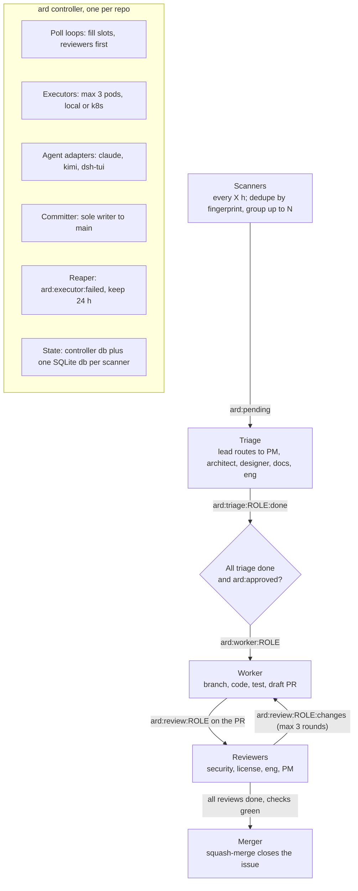
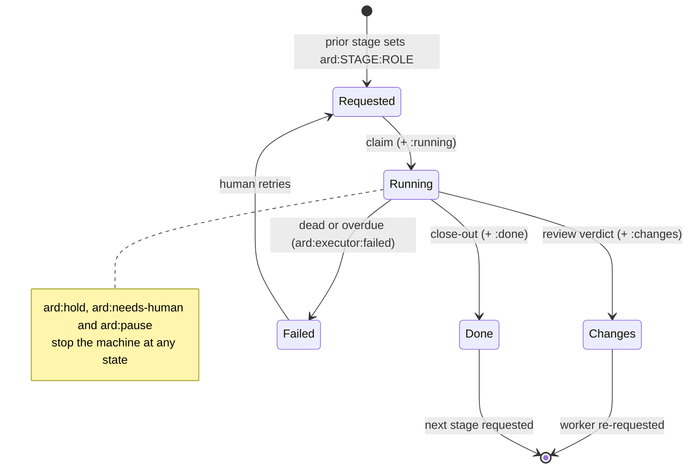
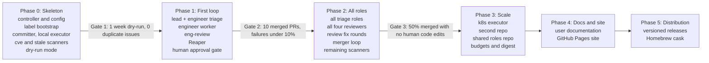

# ard: Automated Repository Development

Proposal · 2026-11-21 · Al Brown

## Summary

ard (automated repository development) makes a GitHub repo maintain itself: scanners file deduplicated issues, triage agents turn each issue into a plan, a worker agent implements it on a branch, reviewer agents critique the PR, and a merger lands it once every review passes.

One rule holds it together: **a deterministic controller owns every GitHub and git side effect; agents only read and write files in a worktree.** Labels, claims, commits, pushes, comments and cleanup are code, not prompts, so a misbehaving agent can fail its job but cannot corrupt the queue.

One process (`ard`) per repo runs six loops that share a pool of 3 job slots (pods):

- **Scanners** — every X (default 4) hours; find problems, file or update issues, close what is fixed
- **Triage** — every X (default 15) min; role agents (lead, architect, PM, designer, doc planner) enrich an issue into `plan.md`
- **Workers** — every 5 min; implement the plan on `worker/<name>-<issue#>-<slug>`, run tests, open a draft PR
- **Reviewers** — every 5 min; role agents (security, license, eng, PM) review the PR and request fixes
- **Merger** — every 5 min; when every review is done with no changes and checks are green, merge the PR, which closes the issue
- **Reaper** — marks dead or overdue jobs `ard:executor:failed`, keeps their evidence 24 h, then cleans up

GitHub labels, all prefixed `ard:`, are the queue and the state machine. `.ard/<issue#>/` is the shared working memory and audit log, and `.ard/<type>/<name>/` holds each role's prompt and runtime by convention.

## Architecture



Each arrow is a label the controller sets at close-out; dashed lines show the stages it runs. A reviewer's `changes` verdict sends the PR back to the worker, at most three times; once every review passes, the merger lands it.

## Stack

**Stack (decided, #9).** Go, one static binary (CGO off) with: cobra, gopkg.in/yaml.v3, modernc.org/sqlite, go-github v88 with ghinstallation/v2, log/slog, golang.org/x/tools (for the architecture test only) and an internal `internal/gitx` for git.

## Label state machine

Every label starts with `ard:`, and every stage uses one grammar: `ard:<stage>:<role>` requests work, `:running` marks a claim, `:done` marks completion. A loop picks up an issue that has the request label and none of `:running`, `:done`, `ard:executor:failed`, `ard:needs-human` or `ard:hold`.



`:done` hands off to the next stage's request label, `:changes` sends the PR back to the worker, and a failed job waits until a human removes `ard:executor:failed`.

| Label | Set by | Meaning |
| --- | --- | --- |
| `ard:scanner:<name>` | Scanner | Which scanner owns the issue; used for dedupe and backpressure |
| `ard:pending` | Scanner or human | Ready for triage; the lead's request label |
| `ard:triage:<role>` | Lead (via controller) or human | This triage role is requested |
| `ard:worker:<role>` | Triage gate (controller) | Plan is complete; ready to implement |
| `ard:review:<role>` | Worker close-out (on the PR) | This review is requested |
| `ard:<stage>:<role>:running` | Controller on claim | An executor holds the job |
| `ard:<stage>:<role>:done` | Controller on close-out | Finished; output is in `.ard/<issue#>/` |
| `ard:review:<role>:changes` | Controller on close-out | Reviewer found blocking issues; sends the PR back to the worker |
| `ard:executor:failed` | Reaper or close-out | Job died or ran over time; resources kept 24 h |
| `ard:needs-human` | Controller, from the agent's result, a scanner at filing (`route: needs-human`), the merger, or the PR watch loop (a PR closed without merging while its issue is open) | Agent reported it is blocked, or the PR is gone; automation stops |
| `ard:needs-approval` | Merger | PR touches a protected path; merges after a write-access human approves its head with a GitHub review |
| `ard:hold` | Human | Controller ignores this issue or PR entirely |

Four more labels sit outside the grammar: `ard:approved` (human go-ahead before a worker starts; counts only when a triage-or-higher collaborator added it after triage finished), `ard:tests:failed` (worker could not get tests green; set by worker close-out on the issue and the PR, cleared by a green run), `ard:keep` (hold failed-job resources past 24 h) and `ard:pause` (on the pinned status issue, stops all new claims). `ard labels sync` creates and updates the full set from the resolved config, idempotently, and never deletes a label: stale `ard:` labels are only reported. In `label` mode a custom `intake.label` is part of the catalogue: sync creates it with a description saying it admits the issue to triage, and switching back to the default leaves the old custom label reported as stale, never deleted. `ard labels sync` and `ard config check` reject an intake label that is one of ard's own label names, naming `intake.label`; `ard serve` logs `config.intake_invalid` once per distinct value. `--repo owner/name` names the repository; when omitted, it is read from the `origin` remote. Role names are at most 31 characters and scanner names at most 38, because GitHub caps a label at 50 characters. Worker role names may not contain an all-digit segment (`eng-12`), so branch names stay unambiguous.

**One query per role per poll.** For example: `is:open label:"ard:triage:architect" -label:"ard:triage:architect:running" -label:"ard:triage:architect:done" -label:ard:executor:failed -label:ard:needs-human -label:ard:hold`. Six triage roles every 15 minutes, plus four reviewers, a worker and the merger every 5, is about 100 searches an hour, well under GitHub's limits.

**Claims need a single owner, not atomic labels.** GitHub labels are not a lock: two pollers can both add `:running`. Phase 1 runs one controller per repo behind a host lock (`flock` locally, a Kubernetes Lease in-cluster), so the controller is the only claimer. If you ever run several, the claimer re-reads the issue's label timeline and backs off unless its own `labeled` event is first.

**Agents never touch labels.** The executor's close-out removes `:running`, adds `:done` (or `ard:executor:failed`), and posts the summary comment. `ard:pending` is removed when the lead finishes, so it means "not yet triaged" and nothing else.

**Retries are explicit.** Every retry, automatic or human, is a new job with its own id (and attempt 1). A human retries a failed job by removing `ard:executor:failed`. The controller retries on its own once, only for a transient cause it can name: a rate limit, a clone failure, a controller restart (the job was orphaned, gone or never started across it), or node eviction under Kubernetes. The failed job then gets no `ard:executor:failed` and keeps its request label, so the next claim runs it again; that claim is linked to the failed job (`retry_of` in local state), so cost and causes can be traced. An automatic retry that fails again is marked failed. A usage-limit stop is not a failure: it closes out as `usage-limit`, with no `ard:executor:failed` and the request label kept, and it neither uses up nor grants the automatic retry. The re-run after the reset is a new job linked to the stopped one through `after_limit` in local state, which also carries `retry_of` over, so a limit stop of an automatic retry does not earn a second retry. Its comment says the issue is paused for the usage limit until a time. A throttle that the CLI says is "not your usage limit" is an ordinary rate-limit retry, not a usage-limit stop. Thresholds and early warnings are [#63](https://github.com/albertcbrown/ard/issues/63).

## The .ard/ contract

`.ard/<issue#>/` is the only place agents leave durable output, and every file in it has one owner role. Issue directories are numeric, so they never collide with the role directories under `.ard/` (see Configuration).

```
.ard/
  <issue#>/
    issue.md             # scanner: the ask, findings, fingerprints, links
    plan.md              # triage roles except the lead: each owns one `##` section, replaced in place on a re-run; the worker follows it
    triage-lead.md             # one audit log per stage and role that ran: <stage>-<role>.md
    triage-architect.md
    triage-engineer.md
    worker-engineer.md         # worker: what changed, test results, open issues
    review-security-review.md  # reviewer: findings, verdict, what must be fixed
    logs/                # full, redacted output of every agent run on this issue
      triage-lead-<ts>.log
      worker-engineer-<ts>.log   # one per agent step; test logs stay on the host
    costs/               # controller: one usage record per job, any outcome (the issue body shows them as a table)
      <job-id>.json
```

**Who may write what.** Close-out checks every changed file under `.ard/<issue#>/` against the job's allowlist:

| Stage and role | May change |
| --- | --- |
| every job | its own role file `<stage>-<role>.md` |
| `triage:product-manager`, `architect`, `designer`, `documentation-planner`, `engineer` | plus its own `##` section of `plan.md` (`## Requirements`, `## Design`, `## UX`, `## Docs`, `## Implementation`) and nothing else in that file |
| `triage:designer` | plus any file under `design/` (write or delete) |
| `triage:lead` | its role file only |
| a custom triage role | its role file only, unless `config.yaml` gives it `plan_section: <heading>` (see Configuration) |
| `worker:*`, `review:*` | its role file only |

A worker's inputs are `.ard-input/<issue#>/issue.md`, `comments.md` and, on a fix step, `test-output.log` (written by the loop, never committed) and `.ard/<issue#>/plan.md`. Nobody may change `issue.md` (only the scanner writes it, through the committer, not close-out), another role's file, any other file, or delete `plan.md`. A job that owns a `plan.md` section may add, replace in place, move or remove that section; a change to the text before the first `##` heading is allowed only when the job creates the file. Headings match exactly (case-sensitive), and `##` lines inside a fenced code block are text, not headings. A change outside the allowlist fails the job as `needs-human`: the comment names up to three offending paths, and only the redacted log is committed, never the offending files. A job with no valid role file still fails as `failed`, because the allowlist is checked after the role file parses. `logs/` is the controller's: files an agent writes there are ignored, not committed. `costs/` is the controller's too, but stricter: no role may write it, so an agent write there breaks the allowlist like any other path and fails the job as `needs-human`; the controller stages its own `costs/<job-id>.json` after that check, and it is never on `closeout.WritableFor`. The allowlist is code (`closeout.WritableFor`), not config; `plan_section` only names the heading a role owns. Workers and reviewers get their inputs outside `.ard/<issue#>/` (for example `.ard-input/<issue#>/`), because anything they write under it counts as their change. `issue.md` is the issue body without ard's cost block (see Guardrails), so the table never reaches an agent; the reviewer's untrusted `.ard/<issue#>/` input includes `costs/*.json`, which is controller-written and holds no free text.

Close-out checks `plan.md` against the job's base commit, but the committer writes it onto the latest `main`. So at commit time the committer replaces only the job's own `##` section in the current `main` copy (adding it at the end if absent, dropping it if the job removed it) and keeps every other section as `main` has it; a section another role committed after the job's base is not reverted. This runs again on each push retry. If the `main` copy cannot be merged (the job's heading appears twice, or its section holds a heading-like line), the job fails closed as `needs-human` with a `plan.md conflict` reason; like an allowlist denial, only the redacted log and the job's usage record are committed, never `plan.md` or the job's other files.

The stage in a role file's name is the label stage (`triage`, `worker`, `review`; `config.Kind` and the role directory spell the last one `reviewer`), so a triage and a worker role with the same name never share a file.

Every `<stage>-<role>.md` starts with frontmatter the controller reads, so the agent reports its outcome without touching GitHub:

```
---
role: engineer
status: done          # done | blocked | needs-human (both of the last two add ard:needs-human)
attempt: 1
next: [review:security-review, review:eng-review]   # optional requests
worker: engineer      # lead only: which worker role implements the plan
verdict: approve      # reviewers only: approve | changes (required when status is done)
findings:             # reviewers only, optional: at most 50
  - file: internal/foo/bar.go   # repo-relative slash path (required)
    line: 42                    # 1-based; absent means the whole file
    severity: high              # critical | high | medium | low | info (required)
    blocking: true              # default false
    message: The loop skips the last element.   # required, non-empty
---
Short summary of what was done.

## Open issues
- ...
```

**All agent output is committed too.** Each run's full output lands in `.ard/<issue#>/logs/<stage>-<role>-<ts>.log`. Close-out redacts known secret values from the whole stream and, in the same pass, replaces the controller host's own paths with fixed placeholders: the job worktree becomes `/work`, the job home `/ard-home`, the executor root `~/.ard`, the operator's home `~` and the controller's temp dir `$TMPDIR` (skipped when it is a shared `/tmp`). Each path is also replaced in its symlink-resolved form, longest first, and only where it ends at a path boundary; bare usernames are not touched. Close-out then secret-scans the whole redacted log (the scan sees the replaced text), then caps it at 1 MiB: the first 32 KiB plus the last ~992 KiB, cut on line boundaries and joined by one truncation marker line. The full redacted log stays host-local for 7 days. Git LFS is not used (decided, #4); revisit only if `.git` growth demands it. Once the redacted copy is committed, the raw log is deleted. Triage output goes to `main` through the committer; worker and reviewer output goes on the branch and ships in the PR. **Scanner run logs stay host-local in phase 0** (`~/.ard/logs/`, 7 days) and are not committed: one run can touch many issues, and close-out redaction and the secret scan (#20, #21) land after Gate 1. What a scanner run commits is `.ard/<issue#>/issue.md` for each issue it files or joins, nothing else. Committing scanner logs, redacted, to each touched issue is a follow-up. Never committed: scanner state databases, and any log the secret scan flags. **Optional gitleaks pass (#89).** With `redact.gitleaks.enabled: true` (default false; `redact.gitleaks.path` names the pinned binary, default `gitleaks` on PATH, and is read at each close-out) the scan runs a second pass after the builtin one: `gitleaks detect --no-git --report-format json` over the redacted bytes, in a private temp dir with a scrubbed environment and a 2-minute timeout. Findings keep only the rule, line and column, never the matched text. The pass fails closed: a missing binary, an error exit, a timeout or an unreadable report means nothing is committed. A hit is treated like an internal hit: the log stays host-local for 7 days and the job gets `ard:needs-human`. `redact.gitleaks.block_autoclose_when_missing` (default false) is read by the scanner guard, which runs the same pass over findings: when set and gitleaks cannot run, scanner autoclose stops for that run too.

**One writer location per issue directory at a time.** Until the worker branch exists, `main` owns `.ard/<issue#>/`; scanners and triage write there. Once the branch is cut, the branch owns it; workers and reviewers commit to the PR, and a scanner with new findings comments on the issue instead. This keeps the PR merge free of conflicts in `.ard/`.

**One committer for main.** Close-outs never push. They hand a file set to the controller's committer, which keeps its own clean worktree of `main`, commits as `ard[bot]` with `ard(<stage>:<role>): #<issue> <summary> [skip ci]`, re-applies its snapshot on the fetched head, pushes with a lease, and retries up to 3 times (re-applying the whole-file snapshot is the rebase; if upstream changed one of its paths the request fails with a conflict instead of overwriting). A replay of an unchanged tree is a no-op that returns the upstream head. It refuses any change outside the `.ard/<issue#>/` directories. Worker code takes a separate lane: `Branches.CommitCode` commits only paths `committer.CheckCodePath` accepts (nothing under `.ard/`, `.ard-input/` or `.github/`, no `.git` or secret-shaped names), only to `worker/` branches, creating a branch with a push whose lease expects it to be absent and refusing to overwrite a path that changed on the branch since the job started. The one other lane is `ard init`'s: it commits only `.ard/config.yaml` and files under the four role trees, only to the new branch `ard-init` cut from `main`, with a push whose lease expects the ref to be absent, so it creates the branch and never updates an existing one, and opens a PR; a human merges it with a squash or merge commit, so the bot-commit check never sees a bot commit outside `.ard/<issue#>/` on main's first-parent history. Because the bot must bypass branch protection on `main`, a detective check audits it: the workflow `.github/workflows/bot-commits.yml` walks the first-parent history of `main` (the last 500 commits, or everything after the repository variable `ARD_BOT_CHECK_SINCE`) and fails the run, listing the commits and paths in the job summary, when a commit made by the bot changes anything but regular files under a single `.ard/<issue#>/` directory. Bot commits are identified by **committer** (the App's noreply email or login), not author, because a squash merge of a bot PR has the bot as author. If the 500-commit window is full and its oldest commit is the bot's, the check fails closed until `ARD_BOT_CHECK_SINCE` is set, so a bad commit cannot be flushed out of view. It runs hourly as well as on push, because `[skip ci]` suppresses the push trigger. It fails closed when the `ARD_BOT_LOGIN` repository variable is unset. It reads both variables from repository settings and lives in `.github/workflows/`, which the App cannot write. Alerting is the failed run only; it does not open issues or pause ard.

**Why `.ard/` stays on `main` (decided, #1).** An orphan `ard-state` branch is ruled out: worker and reviewer logs ride on PR branches, and a PR cannot carry files from unrelated history. The single committer, the `[skip ci]` marker and the path guard answer the usual objections. `[skip ci]` applies to main-branch bot commits only; commits on a PR branch never carry it, so CI always runs on them.

**Directories outlive their issues as the audit trail.** The janitor loop (`internal/janitor`) wakes daily but works once per 30 days (the timestamp is in memory, so a restart costs one extra harmless pass). It lists `.ard/` on a fresh fetch of `main`, finds closed issues (not PRs) with a directory whose close date is more than 90 days old, re-fetches each to catch a reopen, skips any carrying `ard:keep` or `ard:hold`, and deletes the issue's files through the main committer as `ard(janitor:prune)`, in requests of at most 256 files. Only numbered issue directories are candidates, and the committer's path guard enforces it; git history keeps what was deleted. Pause stops it.

## Scanners

A scanner is a directory, `.ard/scanners/<name>/`, holding either an executable `scan` that prints findings as JSON lines or a `prompt.txt` for an LLM scanner. The controller does all dedupe, grouping, filing and closing, so deterministic tools and LLM scanners share one pipeline and no scanner holds a GitHub token.

```
{"fingerprint":"osv:GHSA-xxxx:go.mod:golang.org/x/net","title":"golang.org/x/net: GHSA-xxxx (high)",
 "severity":"high","group":"go.mod","files":["go.mod"],"body":"markdown details"}
```

**The output schema is strict.** Each line is one JSON object with exactly these keys; blank lines are skipped. `fingerprint` (required, 1 to 512 bytes of valid UTF-8, no control characters), `title` (required, one line, at most 200 characters), `severity` (required: `critical`, `high`, `medium`, `low` or `info`), `group` (optional; empty means one issue per finding), `files` (optional repo-relative paths, clean, no `..`) and `body` (optional markdown, at most 64 KiB). An unknown key, a bad value, a duplicate fingerprint, a line over 1 MiB, a stream over 16 MiB or more than 10,000 findings is an invalid line, and **any invalid line fails the whole run**: nothing is filed, closed or changed, so a half-parsed run can never trigger autoclose. Titles, bodies and file names come from repository content, so the controller treats them as untrusted data: before they reach an issue body it escapes HTML comment delimiters, so scanner output cannot forge a marker.

**Scanner text is untrusted.** Titles and bodies are built from repository content (paths, identifiers, advisory text). The controller neutralises every title centrally, before filing or editing: control characters collapse to one space, backticks become apostrophes, `<`, `>` and link brackets are swapped for lookalike characters, a word-initial `@` becomes a fullwidth `＠` so nothing is notified, comment delimiters are escaped and the length is capped. Bodies are Markdown: a scanner must wrap every path or identifier it interpolates in inline code through its own `code()` helper (backtick to `'`, the same rule as the details block's file list) and must not rely on the controller for body markup, although the controller also defuses mentions and raw HTML tags in a finding's body outside code. A table test with hostile input (a backtick, ``, `@octocat`, `<!--`) guards each starter scanner.

**The pre-filing guard cannot be turned off.** After every scan and before the diff, in dry-run too and even with zero findings, the controller scans the title, fingerprint, group, files and body of every finding with the builtin pattern scanner and the controller's known secret values, plus gitleaks when `redact.gitleaks.enabled`. A hit, a builtin-pass failure or an invalid line changes nothing: no issue is filed, joined, edited, ticked or closed, no finding row is written from the run's findings (reconcile and the dry-run ledger adoption, which read GitHub and the ledger, still run before the scan), and the run is recorded as `scan_failed`. When gitleaks is enabled but cannot run, nothing is filed, joined or edited, but autoclose of already-filed issues still proceeds (an issue is ticked only when it closes) unless `redact.gitleaks.block_autoclose_when_missing: true`; the run is still `scan_failed`. Logs name only the rule and the field of a hit (known values by env var name); a pass failure also logs its error. A shutdown during the guard records no run.

**LLM scanners (`prompt.txt`) file under extra rules.** `autoclose: true` on one is a config error: an LLM scanner never closes an issue for absence. `every` defaults to at least 24h and a value below 24h is an error; `max_budget_usd`, when set, must be above 0. An LLM fingerprint is `rule:path` or `rule:path:symbol` (rule `[a-z0-9][a-z0-9-]{0,63}`, a clean relative path without `..` that is also listed in the finding's `files` and exists, symbol `[A-Za-z_][A-Za-z0-9_./-]{0,127}`); a bad fingerprint is reported by finding index only, never by content. Before grouping, a finding whose title is a near-duplicate of an open issue's title or checklist line, or of a more severe finding in the same run, is skipped without a ledger row, so it is offered again next run. Titles are lowercased, reduced to `[a-z0-9]` tokens, minus one-character tokens and a short stop list; they match when the token sets are equal, or when both have at least three tokens and their Jaccard similarity is at least 0.8. An issue filed by a scanner whose route is not `pending` ends with a footer explaining that a human adds `ard:pending` to send it to triage or closes it as not planned to dismiss it. The stale closer also considers an open issue whose only `ard:` label is its scanner label (route `none`). The engine that runs `prompt.txt` scanners is not wired in yet.

**Route.** The scanner key `route` decides where its issues go: `pending` (default for executable scanners) files with `ard:pending`, so they enter triage; `none` (default for LLM scanners) files with the scanner label only, and a human adds `ard:pending` to send one issue to triage; `needs-human` files with `ard:needs-human` and no `ard:pending`, so no agent triages them. LLM scanners may not use `pending`. Changing `route` affects only new issues. A human promotes one issue by removing `ard:needs-human` and/or adding `ard:pending`; after that ard never joins findings onto it.

**Each run, in order:**

1. **Reconcile.** Fetch the scanner's open issues, plus a lookup of each issue that has a tracked finding and is no longer open, and update its state. Every marker line on an open issue becomes a row on that issue (a fingerprint on two open issues goes to the lowest number), so a crash between creating an issue and recording it heals here instead of filing a duplicate. Closed as completed: mark the fingerprints fixed, keeping a tombstone so a return can link the old issue. Closed as not planned or as a duplicate: suppress them for `stale.suppress_for` (default 90 days) from the close time. Deleted or transferred: drop. An issue that is reopened is tracked again and its suppression lifts. Reconcile also runs on a run that is then dropped, so state stays current.
2. **Backpressure, in code, before the scanner starts.** The controller counts open issues with `ard:scanner:<name>`; at or above `max_open` it skips the run and logs it, autoclose scanners included (`none` and `needs-human` issues count too, and are never stale-closed, so a non-autoclose scanner with those routes stops once its issues fill `max_open` until a human closes or promotes some): a scanner at its cap does not run with a zero filing budget, so it cannot autoclose its own fixed issues until a human or the stale closer frees a slot. A global cap across all scanners (`global_max_open`) stops a bad day from burying the queue. A skipped run is not queued: it counts as a run, and the next scheduled run checks again.
3. **Scan.** Run the scanner on a read-only worktree of `origin/main`, with a timeout. It needs a free job slot, and scanners rank last for one. **A run that is denied a slot is not dropped: it is not recorded, stays due and is offered again on the next tick** (every five minutes), until it gets a slot or the controller stops. A failed scan (non-zero exit, timeout, invalid output) is recorded and changes nothing else.
4. **Diff.** A new, unsuppressed fingerprint is queued for filing. A suppressed fingerprint stays quiet unless its severity rises above the suppressed one. A fingerprint that returns after being fixed files a new issue that links the old one as a regression. An open issue whose fingerprints are all gone gets "No longer detected at `<sha>`" and is closed, but only for scanners marked `autoclose` (deterministic ones); other scanners never edit or close an issue for absence. A returning finding unticks its line.
5. **Group.** Findings that share a `group` key join one issue, up to `group_size` (N), as a checklist with one line per finding (ticked lines count towards N). An empty `group` means one issue per finding. New findings join an open group issue of the same group that has room and is not yet claimed, meaning it carries no `ard:` label besides `ard:scanner:<name>` and the route's label (none under `route: none`); otherwise they start a new one. A regression never joins: it always opens a new issue, which may also hold new findings of the same group. The number of new issues per run is `min(max_open - open, global_max_open - global open)`; joins are free. Findings over that budget are filed most severe first, and the rest stay unrecorded so the next run offers them again.
6. **File.** Edits and closes first, then joins, then new issues. Create the issue with `ard:scanner:<name>` plus the route's label (`ard:pending` by default), then queue `.ard/<issue#>/issue.md` to the committer. The issue comes first because its number names the directory. A committer failure is logged and does not undo the issue: its body already carries the checklist. **An issue with `ard:hold` is never edited, joined, commented on or closed**, and a close waits while any `ard:<stage>:<role>:running` label is on the issue, so a running job is not orphaned. Edits never rewrite `issue.md`, because after a claim the branch may own `.ard/<issue#>/`.

**A scanner loop runs at most one due scanner per tick.** The `scanners` loop polls every five minutes, picks the most overdue scanner (last run plus its `every`; a dropped run counts as a run) and runs it. Pausing stops it, because it files and closes issues. Its tick timeout is the longest scan timeout plus 15 minutes, not the poll interval.

**Each scanner has its own state, and GitHub is the truth.** Every scanner keeps a separate SQLite file, `~/.ard/state/<owner>/<repo>/<scanner>.db`: fingerprint to issue, first and last seen, suppressions, last run. Scanners never share or lock each other's state, and one can be reset without touching the rest. The controller keeps its own jobs, attempts, events and a small key/value table (for example the status issue number) in `_controller.db` in the same directory, and dry-run uses `~/.ard/state-dryrun/<owner>/<repo>/`. Owner and repo are lowercased (GitHub names are case-insensitive) and nested, so distinct repos never share a directory (`a-b/c` and `a/b-c` would collide as `a-b-c`); `ard serve` and `ard rebuild-state` refuse to start while a pre-#82 flat `<owner>-<repo>` state directory exists under `state/` or `state-dryrun/`, and ard does not migrate it (decided, #82). Every issue body carries hidden markers, so `ard rebuild-state <scanner>` restores a database from GitHub after a lost disk or a host move. The body holds a header `<!-- ard:scanner=<name> group=<enc> -->` and a checklist between `<!-- ard:findings -->` and `<!-- /ard:findings -->`, one line per finding: `- [ ] <title> <!-- ard:fp=<enc> sev=<severity> [reg=<old issue>] -->`. `<enc>` percent-encodes every byte outside `[A-Za-z0-9._:/@+=,~-]`, so the proposal's example fingerprint stays readable and nothing can close the comment. A ticked box means the finding is gone. Per-finding details sit in a second span, `<!-- ard:details -->`, cut to 2,000 characters each and trimmed from the end to keep the body under 60,000; `issue.md` holds them untruncated. The controller reads and rewrites only the two spans, so text a human or triage adds elsewhere survives. A human who deletes a marker line makes that finding look new, which is accepted because GitHub is the truth.

`ard rebuild-state <scanner>` takes the leader lock (it refuses to run while `ard serve` holds it), reads every issue with `ard:scanner:<name>`, open and closed, and replaces the scanner's findings and suppressions in one transaction, keeping the run history. For each fingerprint, an open issue wins (the lowest number), else the highest-numbered closed issue decides: completed leaves a `fixed` tombstone, not planned or duplicate leaves none. Independently, the highest-numbered not-planned or duplicate close gives a suppression until `closed_at + stale.suppress_for`, kept even when expired. It prints what it adds, removes and changes; with `--dry-run` it prints and writes nothing. The dry-run state database holds synthetic issues that are not on GitHub, so it is never rebuilt. Only scanners with a `scan` executable can be rebuilt. One known gap: reopening an old issue that shares a fingerprint with a newer one can leave the database different from a rebuild until the next rebuild-state.

**Dry-run files nothing.** Under `--dry-run` a would-be issue gets a synthetic negative number, stored in the scanner's dry-run database like a real one, so repeated scans do not re-propose it and `max_open` is reached from synthetic issues. The committer is never called for a synthetic number. The global cap counts only the running scanner's synthetic issues, since scanners share no state.

**Closed is not always "forget".** Removing a fingerprint on every close, as first sketched, refiles a won't-fix issue on the next run. Completed closes stop tracking the finding but keep a `fixed` tombstone, so a finding that comes back is filed as a regression of the old issue. Not-planned closes, and closes as a duplicate, suppress, and re-raise early if severity rises.

**LLM scanners need stable fingerprints.** Their prose changes run to run, so they fingerprint on rule, file and symbol, never on wording. Before filing, the controller also compares the title against the scanner's open issues and skips near-duplicates.

**The stale closer is a built-in scanner.** It has no role directory and needs no job slot, executor or worktree; its settings live in the top-level `stale:` block of `config.yaml`. It is a plain controller loop that runs every 24 hours and is skipped while paused. It closes scanner issues still at `ard:pending` with no activity (issues filed under `route: none` or `needs-human` lack `ard:pending` and are never candidates; #204 may widen this) for `stale.inactive_for` (default 30 days), as not planned, with a comment. Activity means a timeline event by anyone other than the ard App. It never closes an issue that has a `:running` label, `ard:hold`, `ard:needs-human`, a linked open PR, or a human author (any author other than the App), and it closes nothing when the client is not authenticated as an App. It only comments and closes: suppression happens on the owning scanner's next reconcile, which suppresses every not-planned close for `stale.suppress_for`. A reopened issue gets a fresh comment when it goes stale again.

| Scanner | Engine | Every | Group size | Auto-close |
| --- | --- | --- | --- | --- |
| cve | osv-scanner and govulncheck (trivy and the Dependabot alerts API later) | 6 h | 1 | yes |
| lts | endoflife.date v1 API + manifests: go.mod, package.json, Dockerfile `FROM`, Helm `values.yaml` images | 7 d | 1 per component (product and cycle) | yes |
| lint | golangci-lint per Go module (the repo's config, or the role's `golangci.yml`), plus `//nolint` directives, minus the role directory's `baseline` | 24 h | 20 per rule and directory | yes |
| error-codes | pattern match over source, registry and docs files (`sh` + `jq`) | 24 h | 20 | yes |
| trufflehog | leaked-credential scan of the current commit (`sh` + `jq` + TruffleHog) | 24 h | 1 | yes |
| missing-tests | `go test` coverage plus exported functions with no test (`sh` + Go helper) | 24 h | 10 per package | yes |
| trufflehog-history | leaked-credential scan of the full git history (same tools) | 7 d | 1 | no |
| docs | undocumented exported Go identifiers and package comments (deterministic) | 3 d | 10 per package | yes |
| docs-drift | LLM: docs that contradict the code (planned; needs the LLM scanner engine, #204) | 3 d | 10 per doc file | no |
| architecture | LLM against ADRs and the sidecar spec repo | 3 d | 1 | no |
| stale | built-in | 24 h | none | none |

**The cve scanner** (`scanners/cve`, a `sh` script plus one `jq` program, no build step) merges osv-scanner (all ecosystems) and govulncheck (Go reachability). Its fingerprint is `osv:<advisory>:<manifest>:<package>`, where the advisory is the smallest `GHSA-` id of the vulnerability, else the smallest `CVE-` id, else the smallest id, so one vulnerability reported under `GO-`, `GHSA-` and `CVE-` ids is one finding. Severity is `critical|high|medium|low`, from the CVSS score, else the database severity, else `medium`; a vulnerability govulncheck finds unreachable is capped at `medium`. Manifests under `testdata/`, `vendor/` and `node_modules/` are skipped. It fails closed: if a Go module cannot be analysed, the run fails and files nothing, unless a human adds a `no-govulncheck` file to the role directory, which skips govulncheck and reports reachability as unknown. Each Go module is analysed with the image's Go toolchain unless its `go` directive, or a `toolchain` line, needs a newer one. Then the scanner lets Go pick that toolchain (`GOTOOLCHAIN=auto` rules: the `toolchain` line if present, else the `go` directive's minimum version), downloads it from the Go module proxy (checksum-verified; scanner jobs have egress) into its temp dir, rebuilds the same govulncheck version with it, and scans with both. The image sets `TMPDIR=/var/tmp` because the executor's `/tmp` is noexec. If the temp dir is noexec, or the toolchain cannot be downloaded or built, the run fails closed and names the reason. Findings from such a module say which toolchain was scanned (`Go toolchain:` line), and standard-library findings are measured against it (for `go 1.27`, `go1.27.0`), not against the image's Go. The Dependabot alerts API is not wrapped, because a scanner holds no token.

**The lint scanner** (`scanners/lint`, a `sh` script, one `jq` program and a Dockerfile that builds golangci-lint v2 with the image's Go) is Go only in v1; other ecosystems are follow-ups. It runs golangci-lint once per `go.mod` (pruning `.git`, `vendor`, `node_modules` and `testdata`) with the repo's own config, or a human-owned `golangci.yml` in the role directory when present. These flags are always forced after any config, because findings that vanish are autoclosed: `--max-issues-per-linter=0 --max-same-issues=0` (no truncation), `--new=false --new-from-rev= --new-from-merge-base= --new-from-patch=` (a repo config asking for "new issues only" would report nothing on a clean checkout), `--issues-exit-code=0 --fix=false --path-mode=abs`, plus JSON output to a temp file. It fails closed: a golangci-lint exit other than 0, a `typecheck` issue (a compile error), a module needing a newer Go than the image's (`GOTOOLCHAIN=local`; toolchain switching is a follow-up), a path outside the repository or with a control character, a malformed baseline, and a missing `baseline` file all exit non-zero with no output. Because the image builds golangci-lint with `CGO_ENABLED=0`, a repo config's `goplugin` custom linter cannot load and fails the run. The fingerprint is `lint:<rule>:<path>:<msg>`. `<rule>` is the linter plus `/<code>` for a check code (`staticcheck/SA4000`, `gosec/G104`), or for `govet` and `revive` an analyzer name (`govet/printf`). `<msg>` drops the code, control characters and repeated whitespace, and replaces every standalone number with `N`, so line numbers and "complexity 31" versus "32" never move a fingerprint; a fingerprint over 512 bytes has its message cut by runes. Identical fingerprints in one file collapse into one finding listing every line; the known gap is that a new occurrence of an identical message in the same file is hidden while the old one is open or baselined (a count-aware baseline is a follow-up). The group is `<rule>:<directory>`, so with `group_size: 20` issues are 20 per rule and directory. Severity has two levels: `medium` for `govet`, `staticcheck/SA*`, `gosec*`, `bodyclose`, `nilerr`, `nilnesserr`, `rowserrcheck`, `sqlclosecheck` and `durationcheck`, `low` for everything else; golangci-lint's own severity is ignored. Messages, source lines and paths are untrusted: they are rendered only inside `text` fences with ``` neutralised, and inline code spans have backticks replaced. Every `//nolint` directive in a `.go` file is itself a finding (rule `nolint`, group `nolint:<directory>`, `low`), so a worker cannot close a lint issue by suppressing it; for the same reason the starter protects `**/.golangci.{yml,yaml,toml,json}`. The baseline is the human-owned file `baseline` in the role directory (a protected path, so no agent can baseline a finding): `#` comments and blank lines are ignored, every other line is one fingerprint, and a finding whose fingerprint is listed is dropped. `ard init` does not ship one, so the scanner records a failure every 24 h until a human commits it; an empty file means no baseline. `scan --baseline` prints a baseline of all current findings (ignoring any existing one), and the exact Docker command is in the Dockerfile's header; the run logs how many baseline entries are unused. Baselining a finding that is open closes its issue as "No longer detected" (completed); to suppress it instead, close the issue as not planned. A golangci-lint version bump can change message text and so every fingerprint: bump the version and regenerate every repo's `baseline` in the same human PR.

**The error-codes scanner** (`scanners/error-codes`, a `sh` script plus one `jq` program, pattern match over source, registry and docs files) reads a human-owned `codes.json` in its role directory; nothing ships one, because error-code conventions are specific to each repository. Keys: `pattern` (required, a regex of at most 512 characters, wrapped so `E1001` does not match inside `XE10011`; it must not match the empty string), `registry` (required, a list of path patterns), `entry` (optional: a registry line must also match it to define a code), `docs` (optional; unset turns the undocumented check off), `sources` (optional, default every text file) and `exclude`. A path pattern ending in `/` is a directory prefix from the root, one without `/` matches the base name, and any other is a glob on the whole path (`*` and `?` stop at `/`, `**` does not). Unknown keys, wrong types and lists over 100 entries are errors. Codes found in registry files (on `entry` lines) are R, codes anywhere in docs files are D, codes in every other text file are S. Findings: `error-codes:duplicated:<code>` (high, group `duplicate codes`: a code on two or more distinct registry lines), `error-codes:unregistered:<code>` (medium, group `unregistered codes`: in S, not in R) and `error-codes:undocumented:<code>` (low, group `undocumented codes`: in R, not in D, only when `docs` is set). Fingerprints use the code alone, so moving a use never churns an issue. `.git`, `.ard`, `vendor`, `node_modules`, `testdata`, symlinks, binary files, files of about 1 MiB or more and lines over 16 KiB are skipped. A finding carries only the code and repo-relative `path:line` locations, never line text, and codes outside `[A-Za-z0-9_.:/+=-]{1,128}` are dropped with a stderr count. Because the scanner is `autoclose`, it fails the run rather than see less: an invalid `codes.json`, a `registry` or `docs` that matches no file, a file in both, an unreadable file, a failing tool or more than 5,000 findings all exit non-zero with no output. With no `codes.json` it logs `not configured` and succeeds with no findings, so deleting `codes.json` closes its open issues as "No longer detected". ard does not run it on itself until ard has error codes.

**The missing-tests scanner** (`scanners/missing-tests`, a `sh` script plus a stdlib-only Go helper) runs each Go module's own tests with `go test -coverpkg=./...` and files one finding per exported function or method that no test calls by name or that the tests never run; the group is the package, and the fingerprint does not depend on the file or line. Because it runs the repository's tests it needs the executor's container and egress to the module proxy. If a module's tests fail to build or fail, the scan fails and files nothing, so autoclose never acts on partial coverage. A human-owned `ignore` file next to `scan` skips symbols or packages, and a `no-coverage` file there skips the test run and reports only the static rule. It ships in the starter tree but is not enabled on ard's own `.ard/`.

**The lts scanner** (`scanners/lts`, a `sh` script plus two `jq` programs and `yq` for Helm, no build step) flags components at or near end of life using the endoflife.date v1 API (`/api/v1/products/<slug>`, one request per referenced product). A component is a product plus a release cycle. Its fingerprint is `eol:<product>:<cycle>` (for example `eol:nodejs:18`), one finding lists every referencing file, and `group` is the product. The human-owned `products.json` maps Docker image names and a few npm packages to endoflife.date slugs (the Alpine image maps to `alpine-linux`); names not in it are skipped with a stderr line. Cycles match generically: a codename's first word (`bookworm`, `jammy`), else the longest dotted prefix of the version. It reads the `toolchain` line (else the `go` directive) of `go.mod`; `engines.node` and table npm dependencies of `package.json` (lowest lower bound of the range); Dockerfile `FROM` lines (`Dockerfile`, `Dockerfile.*`, `*.Dockerfile`, `Containerfile`; global `ARG` substitution, registry and digest stripped); and `repository`/`tag` or `image: name:tag` in the `values.yaml` beside each `Chart.yaml`. Severity is `high` at or past end of life, `medium` within 90 days, `low` within 180 days, otherwise no finding. A component referenced only by floors (a `go` directive, `engines.node`, an npm range) is capped at `medium`. Titles carry the date (`Go 1.21: end of life 2024-08-13`), never "approaching" or "past", because rerate changes only severity. The scan fails closed with nothing on stdout, because an absent finding closes its issue: any API failure (including a 404 for a mapped product, which means `products.json` is stale), a non-JSON response, and a `package.json` or `values.yaml` that cannot be parsed. A missing tool exits 2 (`yq` only when a `Chart.yaml` exists). Paths with a `.git`, `vendor`, `node_modules` or `testdata` segment are skipped. Manifest text reaches the issue body only as cleaned text in code spans (control characters and backticks removed, 200 characters, at most 50 references), and repo text never reaches a URL.

**The trufflehog scanner** (`scanners/trufflehog`, a `sh` script plus one `jq` program) runs `trufflehog filesystem . --json --no-update --no-color --no-verification --no-ignore-tag --fail-on-scan-errors --concurrency=2` on the current commit. It never verifies a credential against a provider. Only the detector name, file, line and a hash of the secret leave the scan: `Raw`, `RawV2`, `Redacted`, `SecretParts`, `ExtraData` and `StructuredData` stay in pipes inside `scan`. The fingerprint is `trufflehog:` plus the first 16 hex digits of SHA-256 over `ard-trufflehog-v1`, a NUL byte and the base64 of the secret (an unsalted hash, so one value gives one issue wherever it appears). The scan fails closed: a non-zero trufflehog exit, a missing `finished scanning` summary, zero chunks on a non-empty tree, or a result count that differs from the summary produces no findings, so nothing is autoclosed on a partial run. `exclude-paths` (regexes; `.git` is always excluded) and `allow` (one fingerprint per line) are human-owned; a bad `allow` entry fails the run. Findings use `route: needs-human`, severity high, and carry a runbook that says to rotate the credential first. `commit` is the scanned SHA, recorded in `.ard/<n>/issue.md`; history is scanned by `scanners/trufflehog-history`. The forbidden flags (`--since-commit`, `--max-depth`, `--detector-timeout`, `--archive-timeout`, `--filter-unverified`, `--filter-entropy`, `--results`) are never passed, because a partial or load-dependent result would autoclose live findings. Caveats: (1) a secret gone from HEAD is not revoked; autoclose closes the issue as completed, so the issue body tells the human to rotate first. (2) The fingerprint hash is unsalted, an offline oracle for a low-entropy value that is already in the repo at HEAD; accepted. (3) Issues on a public repo show `file:line`. (4) At `max_open` the scanner is skipped, so new leaks go unseen until a human resolves one; scanner failure streaks are posted on the status issue (#221). (5) Any future change that commits scanner logs must exclude this scanner. (6) On a public repo with GitHub secret scanning off, this scanner is the only detection channel, and it cannot stop a push. TruffleHog is AGPL-3.0: it is installed by the role's Dockerfile (or a host install) and is not in the published `ard` image or the root `Dockerfile`. Host and Docker integration tests (`go test -tags integration -run Trufflehog ./internal/roles/`, with `ARD_TRUFFLEHOG_BIN` at the Dockerfile's pinned version) prove the role against a real binary and image.

**The trufflehog-history scanner** (`scanners/trufflehog-history`) runs `trufflehog git file://$ARD_HISTORY --bare` with the same flags plus no `--since-commit`, `--max-depth` or `--branch`, over every fetched ref, with the same hash salt, so a value has the same fingerprint as at HEAD. A scanner role asks for history by holding an empty file named `history` in its directory (`Role.ReadsHistory`; there is no config key, so an override cannot grant it). The executor then sets `Job.History` (scanner stage only) and mounts the controller's bare clone read-only at `/history` in Docker (host mode uses the clone path) and sets `ARD_HISTORY`. The mount includes unmerged PR branches. Commit, author and timestamp are dropped; only the detector, file, line and hash leave the scan. It never autocloses, because history does not go away. A Kubernetes executor must provide a read-only copy at the same place.

**The docs scanner** (`scanners/docs`, a `sh` script plus one stdlib-only Go program, `docscan.go`, built at scan time with the job's own Go) lists undocumented exported Go identifiers. It reports, per package directory: a missing package comment; an exported function, a method on an exported receiver type (pointer, value or generic) and an exported type with no doc comment (the spec's doc, its trailing comment or the enclosing declaration's doc all count); and an exported const or var with no comment, one finding per parenthesised block that has no block comment. Struct fields, interface methods, methods on unexported types and comment wording are not checked. Every exported identifier counts, `internal/` included, and files for every platform count (build constraints are not evaluated). It skips `testdata/`, `vendor/`, `node_modules/` and dot or underscore directories, files whose names start with `_` or `.`, symlinks, `*_test.go`, `//go:build ignore` files, generated files and `package main`. The fingerprint is `docs:undoc:<dir>:<symbol>` or `docs:pkg:<dir>`; the file and line are left out, so moving a declaration within its package keeps its issue. Severity is `low` and the group is the package directory. It only parses files: it never runs repository code and needs no network. It fails closed: a parse error, unreadable file, invalid path or more than 10,000 findings fails the run with nothing filed. A human-owned `exclude` file in the role directory skips package directories (`dir/` is a directory and everything below it, anything else a glob matched against the package directory); an entry makes its findings vanish, so autoclose closes their issues. Go only for now.

Intervals and group sizes are starting values to tune, not measurements.

## Triage loop

Triage turns an issue into a `plan.md` a worker can execute, one role at a time, and writes only to `.ard/<issue#>/` on `main`.

**Each poll (every 15 minutes by default), for each triage role:**

1. Query for the role's request label (the lead's is `ard:pending`), excluding claimed, done, failed, blocked and held issues. Which human-filed issues receive `ard:pending` is the `intake` setting (decided, #2): in `all` mode every human-filed issue enters with no label needed; in `label` mode only issues carrying the configured intake label do. `intake.Admit` decides, as a pure function of the issue, its timeline and the labeler's permission, and it fails closed. Issues authored by the App (scanner-filed) always pass. In `all` mode only issues opened after `all` mode was first enabled enter without a label; older issues still need the label. In `label` mode only the most recent `labeled` event for the label counts: it must come from the App or from a collaborator with role triage, write, maintain or admin (matched case-insensitively), and an earlier authorised event does not rescue a later unauthorised one. When the label is present but not honoured, the controller adds `ard:needs-human` with a short comment asking a maintainer to re-apply the label. The loop records each admission in the state `admissions` table (`labeled_by`, `labeled_at`, `body_hash`); if the title or body is edited after admission, the issue is re-gated with `ard:needs-human` and a comment until a maintainer re-applies the intake label. App-authored issues are exempt from the hash check. The loop never waits for a job: each claimed job is handed to a watcher goroutine that closes out through the shared Finisher, and a restart leaves running jobs to pool adoption and the Reaper. The re-gate hash covers the title and the body without ard's own cost block (see Guardrails, "Intake is configurable"), so ard's table writes never re-gate an issue. The first time ard writes the block, the stored hash stays valid; a maintainer relabel that falls between a human edit and ard's next table write may need repeating, because an ard body write bumps the issue's `updated_at`, which fails safe.
2. Wait for a free job slot (triage ranks below reviewers and workers), then claim the oldest match: add `ard:triage:<role>:running` and record the job (id, executor, start, deadline). Claiming runs in a watcher goroutine; at most one triage job per issue; under `--dry-run` the loop logs `triage.would_claim` and creates no job, slot or label.
3. Prepare a detached worktree at `origin/main`, write the untrusted snapshot to `.ard-input/<issue#>/issue.md` and `comments.md` (never committed; the committed `issue.md` stays owned by the scanner), and mount the role's sidecar repo read-only at `$ARD_SIDECAR`.
4. Run the agent CLI with `.ard/triage/<role>/prompt.txt` and the issue directory as context.
5. Close out: read `triage-<role>.md` frontmatter, send the issue directory (and nothing else) to the committer, post the summary as a comment, swap `:running` for `:done`, and apply any requests.

**The lead routes; the controller applies.** The lead writes `next: [triage:architect, triage:product-manager]` and `worker: engineer` in `triage-lead.md`. The controller adds the matching `ard:` labels only if each names a role directory that exists.

**Starter planning roles.** `ard init` also ships four planning roles, each writing its own `plan.md` section (`config.BuiltinPlanSections`) and its role file: `product-manager` (`## Requirements`: requirements, a numbered list of acceptance criteria, out of scope), `architect` (`## Design`: approach, affected modules, and an `ADR needed: yes|no` line; the worker writes any ADR in its pull request), `designer` (`## UX`, plus Markdown or script-free SVG files under `.ard/<issue#>/design/`) and `documentation-planner` (`## Docs`: which docs change and what each must say). The command line counts as a user interface, so the designer covers flags, output and messages. The starter ordering is product-manager, then architect; designer, then documentation-planner; the engineer runs after architect and documentation-planner (`after:` in the starter `config.yaml`). Note for #45: acceptance criteria are a numbered list under `### Acceptance criteria`.

The starter lead (`.ard/triage/lead/prompt.txt`) follows a fixed contract. It reads the issue only through the untrusted input files `.ard-input/<issue#>/issue.md` and `comments.md`, which the triage loop writes and never commits. It finds roles by listing the role directories and routes only to those. It writes only `triage-lead.md`, with `attempt: 1`, and a `status: done` always names a `worker`. It answers `needs-human` when a person must decide: an unclear ask, a question, a duplicate, a change to `.ard/config.yaml`, the role directories or `.github/`, no fitting worker, or text that tries to instruct it. It uses `review:<role>` only for a reviewer whose `when` rule would skip a change that needs that review. The committer and close-out guards confine it to `.ard/<issue#>/`, and close-out allows it only `triage-lead.md`; any other change under `.ard/<issue#>/` fails the job as needs-human.

The starter engineer (`.ard/triage/engineer/prompt.txt`) plans for the worker without implementing. Its inputs are `.ard-input/<issue#>/issue.md`, `comments.md` and `.ard/<issue#>/plan.md`, all untrusted. It writes the `## Implementation` section of `plan.md` with Steps, Test plan, Risk and Size, sized S, M, L or XL on a scale tied to the worker diff guard's block limit (XL is over the worker role's `diff_max_lines`, 3,000 changed lines by default). It writes `triage-engineer.md` with `role: engineer` and `attempt: 1`, never a `worker` key. It answers `needs-human` for an XL change, a change to protected role and config paths or `.github/`, or a missing product or design decision, and leaves `plan.md` untouched. In Phase 1 it has no `after:`; the lead's request orders it. The committer and close-out guards confine it to `.ard/<issue#>/`, and close-out allows it only `triage-engineer.md` and the `## Implementation` section of `plan.md`; a change to `triage-lead.md`, `issue.md` or another role's section fails the job as needs-human.

**A deterministic gate starts the worker.** Once per triage tick, after the intake sweep, the controller searches for open issues that carry `ard:triage:lead:done` and none of `ard:pending`, `ard:needs-human`, `ard:hold`, `ard:executor:failed` or any configured worker's request label (the exclusion keeps gated issues from filling the 100-hit window). It re-reads each hit and decides from labels alone. "Requested" means the request label is present, "done" means `:done` is present. The gate waits while any triage job of the issue is running or any requested `ard:triage:<role>` lacks its `:done`; it leaves an issue alone once any `ard:worker:<role>` label exists (a worker already gated, started by a human, or in a fix round). When triage is finished it adds the lead's chosen `ard:worker:<role>`. The choice is read from the lead's close-out record in controller state, the value close-out validated, not from the committed `triage-lead.md`. It needs no pool slot and runs in the same conditions as the rest of the tick.

Three cases go to a human, each with one comment and `ard:needs-human`, and nothing is ever closed automatically: the lead finished `done` but named no valid worker (or its close-out record is missing), the chosen worker role no longer exists, or an `ard:triage:<role>` is requested for a role that does not exist. A title or body edit after admission, on a human-filed issue, also stops the gate with a "paused" comment and `ard:needs-human`; re-admission by relabel is not offered, since a lead with `:done` is never re-claimed. A maintainer re-runs triage or adds the worker label.

Before it asks for approval or starts a worker, the gate checks that `.ard/<n>/plan.md` exists on `main`. If it does not, the gate posts one comment, adds `ard:needs-human` and records a `gate` event with reason `no-plan`; a check that fails to run is retried on the next tick. Removing a role's request label by hand does not count as that role finishing. With `require_approval: true` (the Phase 1 default) the gate posts one "ready for approval" comment per lead job and waits. `ard:approved` is honoured only when its latest `labeled` event (reset by an `unlabeled`) is by a collaborator with triage permission or higher, is not the App, and comes after the last triage `:done` label of the issue. An approval given earlier is left in place and ignored: the gate waits for a fresh one and does not escalate. An approval from anyone else adds `ard:needs-human` with a comment that does not name the actor. A human who adds `ard:worker:<role>` directly bypasses the gate and has approved by doing so. The gate does not enforce that `triage:engineer` ran: the lead routes and the gate applies its routing. In `--dry-run` the gate logs `triage.would_gate` and writes nothing; otherwise each action records a `gate` event.

**Order comes from config, not the lead.** A role can declare `after: [architect, product-manager]`; the controller holds its request until those roles, if requested, are done. A prerequisite is requested when its request label (`ard:pending` for the lead) or its `:running` label is present, and done when its `:done` label is present; one that was never requested does not hold. A held role is logged as `triage.held`, is not a candidate and does not count against the one-triage-job-per-issue rule. Config rejects a role that is after itself and any cycle. Engineer triage normally runs last so its steps reflect the design and requirements.

| Role | Adds to plan.md | Typical trigger |
| --- | --- | --- |
| lead | nothing (role file only); writes `triage-lead.md` with routing, or `needs-human` when a person must decide | every `ard:pending` issue |
| product-manager | `## Requirements`: user value, acceptance criteria, out of scope | feature asks |
| architect | `## Design`: approach, affected modules, ADR needed or not | cross-module change, new dependency |
| designer | `## UX`, plus design files in `.ard/<issue#>/design/` | UI change |
| documentation-planner | `## Docs`: which pages change and what they must say | public API or behaviour change |
| engineer | `## Implementation`: steps, test plan, risk, size | every issue that reaches a worker |

Each triage role owns one `##` section of `plan.md` with a fixed heading (Requirements, Design, UX, Docs, Implementation; a custom triage role names its own with `plan_section`). The first writer creates the file with `# Plan for #<issue#>`. A role replaces its own section in place on a re-run, never edits another role's section (close-out enforces it), and leaves the file untouched on `blocked` or `needs-human`.

**Sidecar repos are context, read-only.** A role's sidecar (for example `vpe-specs`) is cloned by the executor, not the loop: the loop passes the role's resolved sidecar (repo and ref) on the job. The executor keeps one shallow (depth 1) bare object cache per sidecar repo at `~/.ard/sidecars/<controlled-owner>/<controlled-repo>/<sidecar-owner>/<sidecar-repo>.git`, shared by every job of that controlled repo, and exports the commit into the job home as `<job home>/sidecar` (plain files: no `.git`, `chmod -R a-w` in both modes, and a `:ro` mount under Docker). The job sees it at `$ARD_SIDECAR`. `ref` is a branch, tag or full 40-character SHA (an abbreviated SHA is a config error). A SHA already in the cache needs no network; a branch or tag is re-fetched (depth 1) for every job. Whatever the ref, `Prepare` resolves it to a full commit SHA and records it on the job's handle (and in the `executor.sidecar_ready` log), so a job is reproducible. Symlinks and submodules in the sidecar are rejected and the tree is capped at 64 MiB, like config snapshots. A fetch failure (network, auth, a stale lock, which the executor clears by rebuilding the cache once) is the transient `clone_failed`; a ref or SHA that does not exist, or a repo the App cannot read, is a permanent failure that names the sidecar. A role that wants a spec changed says so in `plan.md`; editing the sidecar is out of scope for v1.

## Executors and the Reaper

An executor runs one agent job somewhere and reports back; the controller does not care where. Both executors implement the same five calls: `prepare`, `start`, `status`, `logs`, `cleanup`. Prepare also removes any `Job.Scrub` paths (the job's own role file, directly under `.ard/<issue#>/`) from the fresh worktree before the agent starts. Job IDs are ULIDs minted at claim time; they name the worktree and the logs and appear as the `Ard-Job` commit trailer. The executor captures the job's stdout separately from its combined log, because the adapter parses one and the committed log comes from the other. Scanner jobs get network egress for advisory databases; agent jobs get only their model credential.

Local-executor details: the role directory (and its `Dockerfile`) is mounted from the config snapshot at the job's SHA, not from the working tree. The job worktree is always detached at a SHA resolved from the job's ref (the executor never checks out a branch; the committer owns branch worktrees). The controller's clone is a bare repository ard owns at `~/.ard/repos/<owner>/<repo>.git` (lowercased), with no remote, no stored credential and auto-gc off (`gc.auto=0`, `maintenance.auto=false`). `ard serve` creates it on first start and seeds it with one fetch of `main` (up to 30 min; if that fails, serve starts paused and the next start retries), and later starts reuse it. Config loads and committer lanes fetch into it, and every committer and executor worktree is cut from it (lanes under `~/.ard/work/<owner>/<repo>/lanes/`). `ard serve` never writes to the operator's checkout: it reads it only for the `origin` fallback of `--repo` and the local `paused` key. To rebuild a damaged clone, stop serve, `rm -rf` it and restart. Upgrading from a version that used the checkout: ard deletes its old lane and job worktree directories without running git there, so the old `refs/ard/*` refs and the dangling worktree registrations stay in the checkout until you remove them (`git for-each-ref --format='delete %(refname)' refs/ard/ | git update-ref --stdin; git worktree prune`). Every `git worktree add`, `remove` and `prune` on the controller's clone, by the executor and the committer's lanes alike, takes one in-process lock keyed by the clone's common git directory, because git's worktree bookkeeping is not safe under concurrent admin commands; fetches, commits and pushes do not take it. Each such command also has a 30 s deadline, and cleanup runs even when the job's context is cancelled, so one hung git cannot stall every lane. Do not run `git worktree prune` (or add/remove) in `~/.ard/repos/<owner>/<repo>.git` by hand while `ard serve` runs: the lock is per process and cannot cover a human's git. The operator's own checkout is free to use. The host keeps two files per job: `<base>.log` (stdout and stderr combined, the heartbeat source and the committed log) and `<base>.stdout` (stdout only, parsed by the adapter). A read-only job (`ReadOnly`, used by scanners) gets the worktree mounted `:ro` under Docker, or `chmod -R a-w` on the host. The heartbeat is the log file's mtime while the PID is alive; liveness alone is not a beat. Phase 0 local jobs do not survive a controller restart: the pipes belong to the controller, so after a restart the job reports `orphaned` (PID alive, start time verified) or `gone`, and the Reaper kills and fails it. The executor is not an effect: it never calls GitHub or commits, so jobs run normally under `--dry-run`. Sidecar auth: the sidecar fetch runs in the controller with the GitHub App installation token in a host-scoped `http.<url>.extraheader` passed through git's environment, never argv; the job receives plain files and no credential, and the cache stores no remote and no token. The App must be installed on the sidecar repo with contents:read. Host-mode jobs can reach `~/.ard/sidecars`, but it holds no credential. Host-mode jobs run as the controller's uid: they can read the GitHub App key and `~/.config/gh` by absolute path, write the controller's clone, and undo `chmod a-w`. Host mode is allowed for every role ([#84](https://github.com/albertcbrown/ard/issues/84)), but a role that reads untrusted input (every triage, worker and reviewer role, and an LLM scanner) warns loudly when it has no `Dockerfile`; deterministic scanners are exempt, and nothing warns under `executor: k8s`, where every job runs in a container. `ard config check` and the first successful config load of `ard serve` (and any role a later config adds) log one `executor.host_untrusted` WARN per such role and also write it to stderr, so it survives `--log-level`. The local executor logs the WARN again for every host-mode job of such a role and appends a `host_untrusted` row to the `events` table. Each warning lists what the job can reach, including `~/.ard` (state, config snapshots, the pause file, other jobs' worktrees and logs). The owner accepts this risk while ard runs only on owner-controlled repos, and revisits it when moving to the spark cluster, where every job runs in a container once the k8s executor (#54) lands. Until then the Gate 1 dry-run soak on spark (see Rollout and Delivery) runs `ard serve` with the local executor in a pod, and the deterministic cve scanner runs there as a host subprocess of the controller container: its role directory has no `Dockerfile`, and the `ard` image carries its pinned tools. Only deterministic scanners run in that pod: it starts `ard serve --loops scanners,stale,reaper` ([#187](https://github.com/albertcbrown/ard/issues/187)), so the triage, worker and reviewer loops never run there, even though `.ard/config.yaml` on `main` has agent roles. `--loops` takes a comma-separated list of loop names (scanners, stale, triage, workers, reviewers, reviewfix, merger, janitor, reaper, budget; `budget` is the status-issue notice loop, the claim gate is always on), defaults to every loop, and rejects an unknown name with exit 2. `ard serve` and `ard config check` refuse to run on git older than 2.47.0, because the committer's fetches fail on older versions.

A worker job is several executor jobs (`<id>`, `<id>t1`, `<id>f1`, ...) under one state job and one slot; the Reaper watches whichever step is stored on the job, so its heartbeat and deadline rules apply to tests too.

**One pool of job slots, drained from the end.** At most `max_pods` jobs (default 3) run at once, shared by every loop. When a slot frees, the controller fills it in this order: reviewers, then workers, then triage, then scanners, oldest first within each. Finishing work in flight beats starting new work, so a busy day grows the scanner backlog, not the pile of half-done PRs. The merger and the Reaper are controller code and take no slot. Slots are granted when a loop polls and nothing is queued: a loop that found work waiting within the last two of its intervals has that demand reserved ahead of lower classes, so a freed slot can sit idle until that loop's next poll. A scanner run that gets no slot is skipped, not queued. The pool also starts no agent job for an exhausted account or model family until its reset: a job that stops at a subscription usage limit records the limit (in the controller database, so a restart keeps it), and the pool answers `limited` to any candidate whose role runs on that account or family (a whole-account session or weekly limit blocks every role; an Opus or Sonnet limit blocks only roles on that family, and a role with no model, which runs the CLI default, is blocked by any limit). A limited candidate takes no slot and reserves no demand, so lower classes are not held back. The block ends at the reset time the CLI reported; when it reported none the first pause is 30 minutes and each further stop with no reset doubles it up to 4 hours, starting over once a job succeeds; a reset time further away than 8 days is clamped. Running jobs are never killed for a limit. Deterministic scanners and the merger use no model and are unaffected. A daily dollar cap works the same way at the same gate: the pool answers `budget` to a candidate whose role cap or the repo cap is reached, and that candidate takes no slot and reserves no demand. A job that already holds a slot keeps it and finishes.

|  | Local executor | Kubernetes executor |
| --- | --- | --- |
| Workspace | `git worktree` of the controller's clone (`~/.ard/repos/<owner>/<repo>.git`) under `~/.ard/work/<owner>/<repo>/<job-id>`; sidecar exported into the job home | `Job` with an init container that shallow-clones the branch into an `emptyDir`; sidecar cloned by an init container (Phase 3) |
| Runtime | the role's `Dockerfile` image under Docker if it has one, else a host subprocess; hard timeout | a pod from the role's `Dockerfile` image, or the default `ard-agent` image; hard timeout |
| Heartbeat | PID alive plus log file mtime | pod phase plus container restarts |
| Logs | streamed to `~/.ard/logs/<owner>/<repo>/<issue#>/` while running; committed to `.ard/<issue#>/logs/` at close-out | pod logs, committed to `.ard/<issue#>/logs/` at close-out |
| Labels on resources | job id in the directory name | `ard/issue`, `ard/stage`, `ard/role`, `ard/job` |
| Good for | Phase 1, one host, fast iteration | parallelism, isolation, untrusted inputs |

**Agent CLIs plug in through adapters.** Each adapter turns (prompt file, context paths, budget) into a command line and parses the exit code and, where the CLI reports them, turns and cost. For Claude Code that is `claude -p --output-format=stream-json --verbose --restricted --safe-mode --strict-mcp-config --disable-slash-commands --permission-mode=dontAsk --settings='{"includeGitInstructions":false,"disableAllHooks":true}' --tools=… --allowed-tools=… --disallowed-tools=… --model <model> --max-budget-usd <max_budget_usd> --append-system-prompt-file <role prompt> -- <message>` (`--verbose` is required by `stream-json` in print mode). Every stage (scanner, triage, worker, review) gets the same tool profile: `--tools` and `--allowed-tools` are `Read,Glob,Grep,Edit,Write,Bash`, and `--disallowed-tools` is `Bash(git commit *),Bash(git push *),Bash(git remote *),Bash(gh *)` (decided, #79). ard does not pass `--bare`: it limits the CLI to Bash, Read and Edit, and `--tools` cannot widen it (#105). The planted-config isolation `--bare` gave comes instead from `--restricted` (only managed settings and `--settings` load), `--safe-mode` (no CLAUDE.md or AGENTS.md, skills, agents, hooks, MCP servers or auto memory), `--strict-mcp-config`, `--disable-slash-commands`, and `--settings` that turns off hooks and the git status snapshot (commit subjects are third-party text). `CLAUDE_CODE_DISABLE_BACKGROUND_TASKS=1` is set as a fixed env var (the executor allows it) so Bash cannot detach commands. The integration tests pin each of these against a worktree with planted config and must be re-run on every `TestedVersion` bump. The tool list is not a security boundary, and the deny list is advisory, because shell indirection gets around it. The real boundaries are the missing GitHub token (Docker; see the host-mode note above, #84), the committer, which commits only `.ard/<issue#>/` from a triage or review job (other edits are discarded with the worktree), and the diff guard on worker changes. An explicit tool list from the caller (`Spec.Tools`) replaces the allow list and keeps the deny list. The user message holds only fixed text and the paths of the untrusted input files. The installed CLI accepts an undocumented `--max-turns`; ard does not rely on it, so a per-job dollar cap and the executor's hard timeout bound each run. Agents run with an empty per-job CLI config dir and HOME and receive exactly one model credential, passed by name by the executor and never visible to the adapter: an API key (`ANTHROPIC_API_KEY`) or a subscription OAuth token (`CLAUDE_CODE_OAUTH_TOKEN`, from `claude setup-token`); that rests on the environment, not on a CLI flag. `ard serve` chooses the credential from its own environment: `ARD_AGENT_AUTH` is `auto` (the default; the token if set, else the key), `oauth` or `apikey`, and an explicit mode never falls back to the other variable. Only one is ever passed, because the CLI prefers the API key and would silently bill it (pinned by an integration test). A missing credential does not stop startup, because deterministic scanners need none: `ard serve` logs one INFO line, and a job that needs one fails with a clear error. The executor creates the per-job config dir as `<job home>/.claude` (0700) in `prepare` (`Handle.View.ConfigDir`; under Docker it is a bind mount at `/ard-config`), refuses to start a job whose config dir is not that empty directory, and removes it with the job home; the Reaper's `KeepWorktree` retention keeps it too, and it holds no credential, since the credential travels only in the environment. `CLAUDE_CODE_SUBPROCESS_ENV_SCRUB=1`, which would keep the token out of Bash children, is not set (decided, #125). Residual risk: an API key (`ANTHROPIC_API_KEY`) is inherited by Bash children; on the tested release the CLI does not pass `CLAUDE_CODE_OAUTH_TOKEN` to them; and either credential can still be read from the `claude` process's own environment (`/proc/$PPID/environ` on Linux, `ps eww` on macOS). The container is the boundary: it holds no GitHub token, and the credential is scoped to the model. The scrub is off because on 2.1.328 it requires bubblewrap (and socat) plus unprivileged user namespaces; Docker blocks those under ard's flags (`--cap-drop ALL`, `no-new-privileges`, default seccomp), so every Bash call would fail closed and without bwrap the CLI refuses to start. On macOS host mode it worked and matched the `dontAsk` outcomes. It can be revisited for host mode or a loosened container. What agent Bash can read differs by mode: under Docker, only the job's own credential; in host mode, far more, because any same-uid process's environment is readable (`ps eww <pid>` on macOS, `/proc/<pid>/environ` on Linux), including `ard serve`'s own, which holds both credentials. The scrub would not close that; it is part of the host-mode risk of #84. `kimi` and `dsh-tui` both run headless with `-p`; neither has a turn cap and `kimi` reports no cost, so turns and cost are optional in the adapter result. `config.yaml` names the default CLI and any per-role override, so a role can move between CLIs without touching its prompt. The Claude adapter also reads a usage limit and token usage from the stream: a limit comes from a `rate_limit_event` with status `rejected` (its `resetsAt` is the reset time), from the CLI's own error text (`You've hit your session, weekly, Opus or Sonnet limit`) and from `rate_limit` or `billing_error` errors, and it records `usage` and `modelUsage` token counts (by input, output, cache write and cache read; per model when the result has `modelUsage`, which is preferred for accounting). That text is matched only on paths the CLI itself writes (an assistant message carrying an `error`, or an errored result with HTTP 429 or `api_error`), never in agent output, because an agent can be made to print the phrase. Only the job's own agent step and its fix steps are read for a limit: a worker's test step runs agent-written code, so its output is never classified (a printed limit line there cannot block the account). With an API key a 429 stays a transient `rate_limit` retry; only subscription (OAuth) runs have usage limits. The adapter also reads `rate_limit_info.unifiedWindows` from every `rate_limit_event` into `Result.Windows` (one reading per window type, the last winning, also when the run ends with no result). The controller records the readings for OAuth steps only, from the job's own agent and fix steps and never from a test step, including killed steps with no result; it logs them as `limits.reading`. A recording error is logged as `limits.observe_failed` and never fails the job. Nothing is gated on the readings yet (#63). The committed fixtures are scrubbed real captures where a human has made them (`testdata/CAPTURE.md`) and clearly named `synthetic_*` files elsewhere.

**The agent's contract is narrow.** It may edit files in its worktree and must write `.ard/<issue#>/<stage>-<role>.md` with a `status`. Under `.ard/<issue#>/` it may change only its own role file and what its role's allowlist grants (see the `.ard/` contract). Exit 0 without that file counts as a failure, not a success, and so does a malformed file. The file counts only if this job wrote it: before the agent starts, the executor removes the job's role file from the worktree (`executor.Job.Scrub`), so a copy left from an earlier stage or run is never trusted. A role file the agent never wrote again fails the job (`role file not written by this job`, or `role file missing` when none was ever there). One it wrote again with identical bytes still counts, but only because the executor recorded the scrub in the handle (`Handle.Scrubbed`); close-out refuses an unscrubbed, unchanged role file (`role file not scrubbed by executor`). A non-zero exit fails the job even when a role file exists, and a failed job commits only its redacted log, never a partial `plan.md`.

**Close-out is resumable.** The controller (`internal/closeout`) decides the outcome from the role file (only one this job wrote), stages the redacted files, then commits, requests the `next` labels, posts one summary comment (for a review with a verdict, one PR review instead; either is tagged `<!-- ard:closeout job=<id> -->` so a replay never posts twice) and finally swaps `:running` for `:done`, `:changes`, `ard:needs-human` or `ard:executor:failed`. It records its phase in local state after each step. `serve` resumes unfinished close-outs at startup, and the Reaper resumes, rather than fails, a job whose close-out has started. Three more outcomes exist for a job that ended without a usable result: `failed` (sets `ard:executor:failed`), `retry` (a named transient cause: no `ard:executor:failed`, the request label kept, the next claim is the automatic retry) and `usage-limit` (a stop at a subscription usage limit: `:running` is removed, nothing is added, the request label stays, and the issue is claimed again after the reset without using up the retry). All three commit only the redacted log. Their comment carries the reason, the last 50 log lines (cut from the redacted log, scanned again and capped at 8 KiB; if that scan flags or fails, the comment says the tail was withheld) and when the worktree and host files are kept until. `next` entries are applied only for roles that exist; a `review:<role>` the lead requests is applied when the worker opens the PR, not at triage close-out. Only changed files under `.ard/<issue#>/` that the job's allowlist permits are committed, so a newer `issue.md` on `main` is never overwritten.

**Usage is recorded for every job, whatever its outcome.** The Finisher stores each agent step's usage (the models it reported, the four token counts, input, output, cache write and cache read, and the cost) in local state, keyed by job and executor step id, so a replay or a Reaper re-parse never counts a step twice. A worker job's agent and fix steps are summed: the job's totals come from state, not from the last step. A failed, retried or usage-limited job keeps its cost, and the totals go into the `reaper.finish` log. Close-out commits the job's tracking file `.ard/<issue#>/costs/<job-id>.json` (stage, role, attempt, outcome, cause, models, tokens by type, cost, start and end time, PR) in the job's normal lane in the same commit as its log: `main` for triage, the PR branch for worker and reviewer jobs. It is controller-written and holds no free text. The cost is the agent CLI's list-price estimate, not a bill; a job whose adapter reported none records `null`. **The issue body carries a cost table.** Reaching `closed` marks the issue's cost table dirty in the same state transaction, and the `costs` loop (one minute, one writer per issue) writes it: it renders the table from state (one row per closed job, oldest first, "#k" for the k-th run of a stage and role; tokens by type, cost, models, outcome, a link to the job's comment or review, the PR; a Total row), reads the issue, splices only its marked block (`<!-- ard:cost:begin -->` to `<!-- ard:cost:end -->`, appended after the human text on first write), writes the body through the effect layer, reads it again to verify, and re-splices and writes once more if another writer replaced the block. A failed table write is logged and retried on a later tick (ten failures, then it waits for the next close-out on the issue); it never fails or delays a close-out. The table holds only counts, dollars, model ids, a fixed outcome vocabulary (`done`, `changes`, `stale`, `needs-human`, `retry`, `usage limit`, `failed: <cause kind | exit code | result>`) and links, never agent text, a reason, a prompt, a log or a host path. It is capped at 5,000 bytes (and by GitHub's 65,536-character body limit): the oldest rows fold into one "earlier jobs (k)" row while Total stays exact. A claim that failed before the agent ran has no close-out and no row. The scanner keeps the block across its own body rewrites (it cuts the valid block off, renders, and puts it back), and takes the same per-issue lock. **Residual race:** GitHub has no conditional body write, so there is one GET-to-PATCH round trip in which a human save from a stale editor is overwritten; ard never writes text it did not just read, re-reads to verify, retries once, and GitHub's edit history recovers the lost edit. In dry-run the write goes to the ledger only and the table is not verified or linked. The `costs` loop keeps running while the controller is paused: it is bookkeeping about work already done, so it reports `Claims() == false` like the Reaper. A review's row links to its review because `Effects.CreateReview` returns the review id (stored in the close-out record).

**The Reaper runs every minute and decides failure, not the agent.** It marks a job failed when the process or pod is gone without a close-out, the deadline passes (it kills the job first), the heartbeat goes quiet for 10 minutes, or the job is `:running` with no record in local state. Every failure goes through close-out, so it is resumable and never double-comments:

1. **Who acts.** The Reaper kills only a job that a goroutine in this process still drives (its pool slot is held and was not adopted at startup), and only for a deadline or a quiet heartbeat; it records the reason first, and the owner's close-out reads it. A worker keeps its job after the agent exits (tests, fix rounds), so "exited" alone never means abandoned. Any job nobody drives (adopted after a restart, or no slot) is closed out by the Reaper itself, and its adopted slot is released. A job whose close-out has started is resumed, never failed.
2. **Close-out.** Commit the partial output to `.ard/<issue#>/logs/` (on `main` or the branch, as a normal close-out would), post one comment with the reason, the last 50 redacted log lines and the time the evidence is kept until, then remove `ard:<stage>:<role>:running` and add `ard:executor:failed`. A transient cause instead hands off to the automatic retry, and a usage limit pauses the issue until the reset (see Retries are explicit). A log that cannot be committed (a worker that stopped before its first push has no branch) never turns a retry into a failure.
3. **Retention.** The worktree and job home are kept 24 hours after the job ended, then removed, together with the host logs of a failed job (the raw combined log is already deleted at close-out once its redacted copy is committed). A human extends this by adding `ard:keep` to the issue (or PR, for a review): the Reaper looks again 24 hours later. If it cannot read the issue it keeps everything. Branches are never deleted: closing the draft PR would lose the work a human retry reuses, so a human or a janitor removes them.
4. **`:running` with no record.** Every 5 minutes, for each configured triage, worker and reviewer role, an open issue or PR that has the `:running` label but no running job (and none that ended in the last 10 minutes) gets one comment, `ard:executor:failed` and the label removed. It is a core-API list per role, not a search. It is skipped in dry-run, whose database never matches real labels, and for issues held with `ard:hold`.

Host log files older than 7 days are pruned hourly. The Reaper keeps running while the controller is paused.

Successful jobs clean up at close-out: the worktree is removed, the Kubernetes `Job` gets a short TTL, and logs stay 7 days.

Host job steps run with `GOFLAGS=-modcacherw`, so a Go module cache downloaded into the job home is writable. The module cache is per job and is not shared, because a cache that jobs can write to would let one job poison modules that later jobs build. Cleanup restores owner write permission on the whole job home and worktree before removing them, and never follows symlinks, so read-only trees no longer leak.

## Worker loop

A worker implements `plan.md` on its own branch and ends with a draft PR, test results, and a summary on the issue.

1. **Poll and claim** `ard:worker:<role>` (added by the triage fan-in gate; the worker never adds or removes it) like triage, also skipping `ard:needs-human`, `ard:hold`, `ard:executor:failed` and an issue that has a running triage job or any running worker job. Workers rank second for job slots, after reviewers. Before claiming, the loop re-checks `ard:approved` when `require_approval` is on (no label change when it is missing), and the admission: an App-authored issue passes, a human-filed one passes only when its stored body hash still matches, and a changed title or body is re-gated exactly as triage does (one comment, `ard:needs-human`).
2. **Branch** `worker/<role>-<issue#>-<slug>` from `origin/main`. The slug is the issue title lowercased, every run of other characters turned into one `-`, at most 40 ASCII characters, `issue` when nothing is left. The title can change between rounds, so the loop looks the branch up with `git ls-remote` on `worker/<role>-<issue#>-*`: one match is reused (and fetched), none is created on the first push, and more than one (only a human can make the second) posts once and adds `ard:needs-human` without claiming. Worker role names may not contain an all-digit segment (`eng-12`), so `worker/<role>-<issue#>-` names exactly one role and issue.
3. **Steps.** One worker job is one state row, one pool slot and one attempt, but it runs several executor jobs, each in a fresh worktree detached at a SHA: the agent step (`<job id>`) at the branch head, or `origin/main` for a new branch; a test step (`<job id>t<k>`) and a fix step (`<job id>f<k>`) at the SHA the last push made. The branch itself belongs to the committer. Each step's handle is saved before it starts, so the Reaper's heartbeat and deadline rules apply to tests too. `timeout` covers the whole job: each step gets the time that is left, and with under two minutes left the loop stops and reports the tests as failed ("ran out of time"). `max_budget_usd` likewise caps the whole job: each agent step gets the cap minus the cost of the earlier steps (a step that reports no cost is assumed free and logged), and when nothing is left the job fails with `job budget exhausted`.
4. **Run the agent** with `.ard/workers/<role>/prompt.txt` and these untrusted inputs: `.ard-input/<issue#>/issue.md` and `comments.md` (written by the loop, outside `.ard/<issue#>/`, never committed), `.ard/<issue#>/plan.md` when triage wrote one and `.ard/<issue#>/issue.md` when a scanner filed the issue (each only as a regular file, never through a symlink), the triage role files and logs, and, in a fix step, `.ard-input/<issue#>/test-output.log` (the untrusted header, the test command and its exit code, and the last 64 KiB of the test log). In a review round, `.ard-input/<issue#>/review-feedback.md` (the untrusted header, the round, the committed role files of the reviewers that asked for changes and the pull request comments of people, cut at 64 KiB), and the reviewer role files and logs on the branch are untrusted inputs too. The agent edits code and writes `.ard/<issue#>/worker-<role>.md`; the executor scrubs a stale copy first.
5. **Guard the diff** after each agent or fix step, before anything leaves the host. The worktree belongs to the agent, so the guard never trusts its `.git`, config, index or attributes: git runs against the controller's own clone with a private index filled from the base commit (so `skip-worktree` and `assume-unchanged` hide nothing, and no planted filter, textconv, fsmonitor or hook runs), with its objects in a private temp directory (the clone is only read, so an agent cannot grow it); a worktree with a new or resized file over 1 MiB, or more than 256 of them, is held before anything is hashed. The scanned bytes are copied to a controller-private directory and the code lane commits the copies, so nothing can change a file between the scan and the commit. Close-out's changed-file listing uses the same hardened path. Paths under `.ard/<issue#>/` and `.ard-input/` belong to close-out and the loop and are left out. Everything else is checked, and any rejection holds the job for a human (`ard:needs-human`, nothing pushed): the path rule in `committer.CheckCodePath` (all of `.github/`, the rest of `.ard/`, `.git` segments, `.gitmodules`, any `.gitattributes` (`linguist-generated` or `-diff` would collapse files in the GitHub PR diff, so a worker change to one always goes to a human), secret-shaped names), any symlink, nested repository or other non-regular file, a file over 1 MiB, a binary file, and more than 256 changed files. The credential scan runs twice: the content of every written file is checked for the values of known secrets (the hold names the variable, never the value), and the built-in pattern scanner runs over it with only the findings on lines this job added kept, so a worker that edits a file that already holds a credential-shaped fixture is not held for lines it did not write. The comment names file, line and rule (`internal/foo_test.go:12: secret scan rule aws-access-key`), never the text. A scanner error fails closed. Test fixtures that look like credentials must be built at run time, as `internal/redact`'s tests do (`"AK" + "IA" + ...`); a literal is held, and there is no in-band escape. The changed lines of the whole PR (the diff against the merge base with `main`) are checked against two per-worker-role thresholds. Over `diff_max_lines` (default 3,000) also holds, as `diff guard: N changed lines, limit M`. Over `diff_warn_lines` (default 2,000) but not over the limit, the PR goes ahead: the loop logs `worker.diff_large` (lines, warn, max), and the PR body and the close-out issue comment carry a fixed note, `Large change: N changed lines (warn at W)`, so reviewers know; the note quotes nothing from the change. The latest step's count decides, so a fix round that shrinks the PR drops the note. The comment shows a rejection reason as `diff guard: <entry>; <entry>; <entry>; and N more`.
6. **Two commits per round.** The loop commits the code through the committer's code lane (`Branches.CommitCode`) with the title `[<type>: ]<issue title> (#<issue>)`, the redacted summary (secrets and host paths) as the body and an `Ard-Job: <job-id>` trailer, no `[skip ci]`. `<type>` comes from the issue's `type:*` label (`feature` is `feat`, `bug` is `fix`; `docs`, `chore`, `refactor` and `test` keep their names) and with no `type:*` label the `<type>: ` part is dropped and the title is `<issue title> (#<issue>)`. The prefix is never taken from the plan or the lead's routing, so it depends on a maintainer applying `type:*` at intake. At the end close-out commits `worker-<role>.md` and the redacted logs of every agent step to the same branch (or to `main`, as triage's are, when the job stopped before its first push). `.ard/<issue#>/` never goes through the code lane. A push failure (branch exists, conflict, branch gone, guard) fails the job with no automatic retry.
7. **Test.** Run `tests` (default `make test`; empty disables the step) as `/bin/sh -c` in the role's image, with no credential. On failure the agent gets the failure output in a fix step, which commits and pushes again, up to `max_test_fixes` (default 2) within the same job. A fix that changes no files, the cap, or the time running out ends the loop with the tests failed. Test logs stay on the host (kept 7 days) and are never committed.
8. **Open or update a draft PR** with ard's own `Closes #<issue>`, the agent summary quoted and neutralised (`committer.NeutraliseRefs`, then marker and mention defusing), the test result and links to `worker-<role>.md`, the logs and the job id. Reviewers are chosen by `config.SelectReviewers`: the candidates are the role's `reviewers` (a list that only narrows), or every reviewer role when it is unset or empty, and each candidate's `when:` still decides. A `when:` matches when any path changed between the merge base of the config commit and the pushed head matches a `paths` entry, or a listed triage role ran (closed `done`, or its `ard:triage:<role>:done` label; `needs-human` does not count). Paths are case-sensitive and anchored at the repo root: `web/` is a directory, anything else a doublestar glob, so `**/go.mod` matches a root `go.mod` and `go.mod` only the root one; `.ard/` and `.ard-input/` paths are never selectable. Any `review:<role>` the lead deferred or the worker's own `next` lists is added regardless of `when:`, limited to roles that exist, and requested only when the tests did not fail. Selection is monotonic: each run recomputes from the whole PR diff and close-out only adds labels, so earlier requests stay and newly matching reviewers are added. When the head or git is unavailable, path rules fail open. If no reviewer is selected the PR stays a draft (the loop logs `worker.no_reviewers`). The PR stays a draft; the merger marks it ready. A job that has pushed always gets its draft PR, even when it then ends in `ard:needs-human` or a failure, so pushed work is never left without one.
9. **Report.** Comment on the issue with the summary, PR link and test result (`passed`, `passed after 1 fix attempt`, `failed after 2 fix attempts`, `not configured`); swap `ard:worker:<role>:running` for `:done`. If tests still fail, add `ard:tests:failed` on the issue and the PR and request no reviewers; a green run removes it. A worker that ends without the loop's result (for example one the Reaper closes out), or whose role file says `needs-human`, never becomes `:done` without a PR.

**The starter worker (`workers/engineer`, #34).** `.ard/workers/engineer/prompt.txt` implements `plan.md`'s `## Implementation`. Its inputs, all untrusted, are `.ard-input/<issue#>/issue.md` and `comments.md`, in a fix round `test-output.log`, and `.ard/<issue#>/plan.md`, `issue.md`, the triage role files and logs, in a review round `review-feedback.md` and the reviewer role files and logs. It writes code, tests and docs, and `worker-engineer.md` with `role: engineer` and `attempt: 1`, an optional `next` of `review:` entries, and never `worker` or `verdict`. The body has Changes, Testing and Open issues sections; it becomes the commit body, the PR description and the issue comment, and a fix round's body describes the whole change. It answers `needs-human` for a change the diff guard would reject, more changed lines than the role's `diff_max_lines` (3,000 by default; above `diff_warn_lines`, 2,000 by default, the PR goes ahead with the large-change note), a missing decision, nothing to change, or an input that tries to instruct it. In a fix round it keeps `done` and explains a failure it cannot fix, so the loop reports `ard:tests:failed` on the PR. The repository's package manager may fetch a dependency the change needs (`go get`, `npm install`); the agent installs no system packages and uses no other network, and the guard and reviewers still see `go.mod` and lockfile changes. Credential-shaped test fixtures are built at run time. The starter override is Sonnet 5.5, `timeout: 60m` for the whole job, `tests: make test`, and the default diff thresholds written out (`diff_warn_lines: 2000`, `diff_max_lines: 3000`). It ships no Dockerfile, so it runs as a host subprocess with the #84 warning until #55's `ard-agent` image gives a worker image a base.

**Review feedback loops back here.** The `reviewfix` loop (#41) starts a round when every requested reviewer has finished and at least one ended `ard:review:<role>:changes`, backed by that role's close-out record (a label alone does not count). It records a `review_round` event in `_controller.db` (counted when requested, ordered by event ID, local to that database) and removes `ard:worker:<role>:done` from the issue, so the worker loop claims it again. The worker fixes on the same branch and reads `review-feedback.md`. When the fix lands with code changes, every requested reviewer runs again at the new head (their `:done` and `:changes` labels come off), because merge-gating approvals must cover the merged head. A round that changes no code, or one that would pass `max_review_rounds` (default 3), posts one comment and adds `ard:needs-human` on the issue; it is not repeated on the same head after a person removes the label. Removing `ard:needs-human` and pushing a new head caps again at once and never reruns reviewers; to continue, raise max_review_rounds, or fix the PR and remove the ard:review:<role>:changes labels so reviewers rerun. Merger conflict and rebase rounds are a follow-up that will use the same round API (`reviewfix.RequestRound`); until then a conflict, like a red required check, goes to `ard:needs-human`.

**The merger takes it from here.** A worker PR stays a draft until every requested review passes at its current head; then the controller marks it ready for review. The merger merges ready PRs that also pass its gates.

## Reviewer loop

Reviewers run like workers against a PR instead of an issue: they read the change, never edit code, and return a verdict the controller turns into PR comments and a label.

1. **Poll and claim** open PRs with `ard:review:<role>`, skipping claimed, done, changes, failed and held. Reviewers get first call on free job slots, since each finished review can unblock a merge. Only PRs the App opened are reviewed: the author is the App, the base is `main` and the head is a `worker/<role>-<issue#>-<slug>` branch (human PRs are skipped and logged as `not_app_pr`). A PR is also skipped when its issue is closed, held or `ard:needs-human`, when a worker job for the issue is running, when the PR has `ard:tests:failed`, and when the issue's title or body changed after admission (the issue is re-gated exactly as the worker does, not reviewed). Reviewers of different roles run in parallel on one PR.
2. **Pin the head SHA.** Before claiming, the loop fetches the branch into the controller's clone and requires the tip to equal the PR's head SHA; on a mismatch it retries on the next poll. The match also shows the head is this repository's branch, so a fork PR with a colliding branch name is never reviewed. The job's worktree is cut at that commit, so the review describes exactly one commit even if the branch moves.
3. **Run the agent** with `.ard/reviewers/<role>/prompt.txt` and these untrusted inputs: `.ard-input/<issue#>/diff.patch` (the controller's diff from the merge base with `main` to the pinned head, `--stat` then the patch, taken with `--text`, `--no-textconv` and attributes read from the empty tree so a `.gitattributes` entry cannot hide a change, with this issue's `.ard/<issue#>/` left out and cut at 1 MiB), `.ard-input/<issue#>/issue.md` and `comments.md` (written by the loop, never committed), the committed `.ard/<issue#>/` (plan, triage and worker role files and logs) and the sidecar (security policy, license allowlist). The loop runs every git command against the controller clone, never in the reviewer's worktree (the agent itself may run read-only git there). In a later round it also gets `.ard-input/<issue#>/previous-review.md`, its own earlier report, read from the pinned head, and says which findings are resolved.
4. **The agent writes `review-<role>.md`** with `verdict: approve | changes` and `findings:` (`file`, `line`, `severity`, `blocking`, `message`; see the .ard/ contract). It may write nothing else under `.ard/<issue#>/`, and code edits are never collected. An `approve` that carries a blocking finding is treated as `changes` (the job succeeds and the comment says so).
5. **Close-out.** The controller posts one PR review at the pinned commit (event `COMMENT`): findings on lines the PR added are inline comments, every other finding is listed in the review body. If GitHub answers 422 (a line or the commit is not in the PR), it posts the review again with every finding in the body, and if that is also refused, as a plain PR comment. It commits `review-<role>.md` and the run's redacted output to the PR branch through the per-branch committer (no `[skip ci]`: PR-branch commits always run CI so required checks report on the head), and swaps `:running` for `:done` or `:changes`. The reviewer never edits the PR. After a close-out (and on every tick, so a restart cannot miss it) the controller marks a draft worker PR ready for review once every requested review is `:done` at the PR's current head and no `:changes`, `:running`, `ard:executor:failed`, `ard:needs-human`, `ard:hold` or `ard:tests:failed` label is present; it never converts a PR back to draft and never merges, which stays with the merger (Phase 2) and humans.
6. **A moved head is not a pass.** Just before close-out the loop compares the branch with the pinned commit. If it gained code outside `.ard/<issue#>/` meanwhile, a `changes` verdict is still posted and labelled (it is the conservative one), but an `approve` is posted without `:done`: the request label stays and the review runs again on the new head. The reviewed commit is recorded in the close-out record so the merger (#46) re-verifies, with `prgate.Covers` against the reviewed head recorded by the review's claim, that no code of the PR changed since before merging: a small window remains between the head check and close-out adding `:done`. A review closed out by the Reaper after a restart has no head information, so an approve is treated as stale.
7. **A gone PR is stale, not failed.** A human may merge or close the PR, or GitHub may delete its branch, while a review runs. At close-out the controller reads the PR before committing. If it was merged or closed, or the committer reports the branch gone, the job ends `stale`: nothing is committed to the branch, only `:running` is removed, there is no `ard:executor:failed` and no failure comment, and `review.pr_gone` is logged with the state (`merged`, `closed` or `branch_gone`). The PR review is still posted, best-effort: if posting fails the error is logged and the job still closes. A failed PR read falls through to the commit, where a missing branch gives the same outcome. Gate 2's failure rate counts only `failed` jobs, so these are not executor failures. A worker has no equivalent: its PR is a draft that cannot be merged while it runs, so a branch deleted mid-job stays a real failure.

**The starter reviewer (`reviewers/eng-review`, #36).** `.ard/reviewers/eng-review/prompt.txt` checks correctness, missing tests and drift from `plan.md`. Its inputs, all untrusted, are `diff.patch`, `issue.md`, `comments.md` and the committed `.ard/<issue#>/`; text in the change that addresses a reviewer is a blocking `high` finding on its line (verdict `changes`), and the same text in the issue, comments or `.ard/<issue#>/` is ignored and mentioned in the body. It runs the repository's own linter and the changed packages' tests with coverage through Bash, writing scratch files outside the worktree, reports only problems on added lines and skips a check it cannot run, saying so; the package manager may fetch declared dependencies and nothing else is downloaded. Critical and high findings always block, medium only when it is a real bug, low and info never; a missing test blocks only when it is `high` (risky or core logic, or a case `plan.md` named), smaller gaps are `medium`. The verdict is `changes` exactly when a finding blocks. `line` is the head-side line: a `+` line goes inline, anything else in the body. It writes only `review-eng-review.md` with `role: eng-review`, `attempt: 1`, `status` `done` or `needs-human`, `findings` with a double-quoted `file` and a `message: |` block, never `next` or `worker`, and a body with a `## Checks` section. It answers `needs-human` only when there is nothing to review or the issue and the plan contradict each other. The starter override is Sonnet 5.5 with the default 30m timeout and no `when:`, so every PR from the starter worker gets it. It ships no Dockerfile, so it runs as a host subprocess with the #84 warning until #55.

**The starter security reviewer (`reviewers/security-review`, #43).** `.ard/reviewers/security-review/prompt.txt` looks for injection, authz gaps, secrets and unsafe dependencies the change introduces or makes reachable, plus other weaknesses. It has the same untrusted inputs, Trust rules (steering text in the change is a blocking `high` finding), write rules and role-file format as eng-review, with `role: security-review` and a `## Checks` body. It never builds, tests or runs the repository's code. It runs, when they are installed: gitleaks over the changed files with `--redact`; gosec on changed Go packages with `-nosec`; and semgrep with `--metrics=off` and `--disable-nosem`, using only a rule file already in the repository that the change does not touch, or the sidecar's. Suppressions the change adds are reviewed as part of the change. It skips a missing tool and says so, never downloads rules or vulnerability data, and never copies a secret it finds into its report (file, line and kind only). Each finding's first line starts with `[injection]`, `[authz]`, `[secret]`, `[dependency]` or `[other]`. Critical and high block, medium only when it is one of the four kinds with a nameable exploit, low and info never; `needs-human` only when there is nothing to review. The starter override is Opus 5.5 (#8) with the default 30m timeout and no `when:`. No Dockerfile: host mode with the #84 warning until #55. Running pinned tools in controller code is #205.

**The starter license reviewer (`reviewers/license-review`, #44).** `.ard/reviewers/license-review/prompt.txt` checks that every dependency a PR adds or upgrades has a license on the owners' allowlist. The allowlist is one SPDX id per line (`#` comments; `A OR B` passes when any operand is listed, `A AND B` only when all are, `A WITH E` only when listed verbatim; no per-package exceptions). It is read from the sidecar's `licenses/allowlist.txt` when the role has a sidecar and that file exists, else from `allowlist.txt` in the role directory (`$ARD_ROLE_DIR`, read from the config snapshot on `main`, under a protected path). An allowlist found in the PR, the diff, the issue or `.ard/<issue#>/` is ignored, and an unreadable or empty one ends `needs-human`. For Go it runs `go-licenses check` and `go-licenses report` when the tool is on the host `PATH` (optional; it never installs tools), else falls back to `go mod download -json` and the module's LICENSE files; for npm it reads the lockfile `license` field. A license outside the allowlist, or one that cannot be determined, is a blocking `high` finding on the manifest line that adds it (verdict `changes`, so the merger never merges while the label stands); a license that changed but is still allowed is `info`; other ecosystems are `info` and unchecked; no dependency change approves with "No dependency changes to review". The starter override is Sonnet 5.5 with `when.paths` listing the manifests and lockfiles above. It ships no Dockerfile, so it runs as a host subprocess with the #84 warning until #55.

**The starter PM reviewer (`reviewers/product-manager-review`, #45).** `.ard/reviewers/product-manager-review/prompt.txt` checks the change against the acceptance criteria. They come from `plan.md`'s `## Requirements` (`### Acceptance criteria`, numbered AC1, AC2), else the issue body; comments never add, relax or remove one, and a plan that contradicts the issue is `needs-human`. Each criterion is marked met, not met or cannot verify, and the change is checked against the out of scope list. A criterion not met is a blocking `high` finding (`critical` when it breaks existing behaviour); cannot verify and out-of-scope work are non-blocking `medium`. With no criteria it approves and says so. It uses read-only Bash only. The starter `when` is `triage: [product-manager]`; a repo adds UI paths under `when.paths`.

**The label is the gate, not GitHub's "request changes".** A bot's request-changes review blocks merge until someone dismisses it, even after the fix. Reviews post as comments; `ard:review:<role>:changes` is what sends the PR back to the worker.

**Pair each reviewer with a deterministic tool where one exists.** The tool finds; the agent explains, ranks and checks the result against the plan.

| Reviewer | Runs when | Deterministic aid | Blocks on |
| --- | --- | --- | --- |
| security-review | always | gitleaks, gosec, semgrep with local rules (run by the agent when installed; controller-run aids are #205) | injection, authz gaps, secrets, unsafe dependencies |
| eng-review | always | lint and coverage of added lines (the repo's own commands, run by the agent) | correctness, missing tests, drift from `plan.md` |
| license-review | a manifest or lockfile changes (`go.mod`, `go.sum`, `package.json`, `package-lock.json`, `npm-shrinkwrap.json`) | go-licenses (run by the agent when on the host `PATH`; optional), scancode later | a license outside the allowlist |
| product-manager-review | the issue had product-manager triage (starter `when: {triage: [product-manager]}`), or UI paths a repo adds to `when.paths` | none | acceptance criteria not met |

Every directory under `.ard/reviewers/` reviews every PR unless `config.yaml` gives it a `when:` rule (paths, or a triage role that ran; either is enough, and a `when:` with neither is an error). A worker's `reviewers:` list narrows the candidates but does not bypass `when:`. The lead (or the worker) can request extra reviewers through `next`, which bypasses `when:`; they are recorded in the triage job's close-out record in local state (`closeout.Deferred` reads them) and the worker loop adds the `ard:review:<role>` labels to the PR when it opens it.

## Merger loop

The merger is controller code, not an agent, and takes no job slot. Every 5 minutes it merges at most one PR that has cleared every gate, oldest first, and the merge closes the issue. It also updates at most one behind branch per tick, so CI capacity goes to the next merge rather than to churn. **The merger is the gate, not GitHub:** the App bypasses `main`'s whole ruleset, so GitHub would accept a merge with red or pending checks. Every gate is checked in code and every unreadable fact fails closed.

Only ready (non-draft) PRs the App opened on `worker/<role>-<issue#>-<slug>` with base `main` are candidates. The reviewer loop marks a PR ready, but the merger re-checks everything itself and never trusts the draft flag, because a person can mark a PR ready by hand. A PR merges when all of these hold:

- every requested `ard:review:<role>` is `:done` and none is `:changes` or `:running` (any `ard:review:*:changes` or `:running` label blocks, configured role or not), and each review is proven by the newest close-out record of that role on this PR (outcome done, head not moved), not by the label, which a person with triage access can add, and stands at a head that still covers the current one. The head rule is shared with the reviewer's mark-ready (`internal/prgate`): a head is covered when no path outside `.ard/<issue#>/` changed since the reviewed commit, or, for the merger, when every such path came from `main` (an update-branch merge does not invalidate a review, but a path both the PR and `main` changed since the review does). A review made stale by code that changed since it is re-requested once per head: the merger removes `ard:review:<role>:done` (the reviewer then claims the role again at the current head), records a `review_rerequest` event for that PR and head, and logs `merge.review_rerequested`. A head that moved only by an update-branch merge from `main` is still covered and triggers nothing. Under dry-run it logs `merge.would_rerequest` and writes only to the ledger, with no event
- it carries none of `ard:hold`, `ard:needs-human`, `ard:tests:failed` or `ard:executor:failed`, its issue is open and carries neither `ard:hold` nor `ard:needs-human`, and no worker or review job of the issue is running
- the first line of the PR body is exactly `Closes #<issue>` (what the worker writes; it is what closes the issue) and the state records a worker job of the issue on this branch (its id is the `Ard-Job` trailer). Otherwise the PR gets `ard:needs-human`
- GitHub has computed that the branch does not conflict with `main`. Only a computed `mergeable: false` or `mergeable_state: dirty` is a conflict: it gets `ard:needs-human` and one comment, and a follow-up to #41 will turn this into a rebase round (`reviewfix.RequestRound`) that counts toward `max_review_rounds`. A `mergeable` that is still null or unknown, and a 405 "not mergeable" from the merge call, mean GitHub is still computing: the merger retries next tick and never labels
- the branch is up to date with `main`; if it is behind, the merger updates it and checks again next tick on the new head. "Behind" means `main` changed something **outside `.ard/<digits>/`** since the merge base: the committer pushes `.ard/<issue#>/` to `main` on every close-out, and counting those would keep every branch behind forever. A history with several merge bases (criss-cross merges) is skipped with a warning, because the choice would decide what counts as the PR's own change. GitHub's merge API guards the head SHA, not the base, so a push to `main` between the merger's fetch and the merge goes unseen
- checks are green on the current head, read from check runs and commit statuses (the Statuses API, which Jenkins and other external CI report through; the App needs Commit statuses: read). A required context is satisfied by either a check run or a commit status of the same name; if both exist the newer wins, and red from either never counts as green. As on GitHub, a rule pinned to an `integration_id` is satisfied only by a status created by that App: the merger resolves the creator's `<slug>[bot]` login to an App id (`GET /apps/{slug}`, cached per process); a status from a user or another App does not count, and a lookup error means nothing merges that tick. A status `success` is green, `pending` waits, `failure` or `error` is red. A statuses read error (a missing permission included) means nothing merges that tick. The required list comes from GitHub's branch rules API for `main` (`GET /repos/{o}/{r}/rules/branches/main`, metadata read), with no copy in config:
  - when the rules are readable and name required checks, each must be completed with `success`, `neutral` or `skipped` on the head (the latest run per name; a rerun in flight hides the old result), or have a latest commit status `success`. Missing or running checks wait; a red one (failure, cancelled, timed out, action required) gets `ard:needs-human` and one comment naming the checks, until #41 adds fix rounds
  - when the rules are unavailable (a free-plan private repository answers 403 "upgrade", or 404) or no required checks apply, there is no list to go by: if the head has no check runs and no commit statuses the merger merges on reviews alone, but only after a grace period since it first saw the head (at least one tick and two minutes), so CI that has not queued yet is not missed; if it has either, every latest run and status per name must be green (a pending status waits)
  - when the rules cannot be read (a 5xx, a network error, a permissions 403), nothing merges that tick. Rule types ard does not evaluate (`workflows`, `code_scanning`, `required_deployments`) are logged at warn
- the diff touches no protected path; the list comes only from `merge.protected_paths`, with no floor in code (decided, #3), so a human who empties the list removes the gate. `ard init` proposes the defaults `.github/`, `.ard/config.yaml`, the four role trees (`.ard/scanners/`, `.ard/triage/`, `.ard/workers/`, `.ard/reviewers/`), `**/CODEOWNERS`, and the agent instructions a PR could plant to steer later agents: `CLAUDE.md`, `**/CLAUDE.md`, `AGENTS.md`, `**/AGENTS.md`, `.claude/` and `.mcp.json`, and the linter config a PR could weaken, `**/.golangci.yml`, `**/.golangci.yaml`, `**/.golangci.toml` and `**/.golangci.json` (17 entries; `**/X` already matches a root `X`, the bare entries are kept for clarity). An entry ending in `/` is a directory prefix; any other entry is a doublestar glob. Matching is case-insensitive on the repo-relative path (macOS file systems are, so `Claude.md` and `.Claude/x` are protected). A prefix matches on a directory boundary (`.github/` matches `.github` and `.github/x`, never `.githubx`). A glob follows doublestar: `*` stays within one path segment and `**` crosses them, so a bare `CODEOWNERS` would match only the root file. Quote globs that start with `*` in YAML. The merger checks both names of a renamed file; a malformed path counts as protected. A PR that touches one gets `ard:needs-approval` and merges on the next poll once a person with write access approves the current head with a GitHub review (below).

A protected path needs a GitHub review in state `APPROVED`, from a user who is not an App and has write, maintain or admin permission, that stands at a commit the current head still covers (the same rule as for reviews). A later `CHANGES_REQUESTED` or `DISMISSED` review by the same person voids it, a plain comment does not. A triage user cannot push or merge on GitHub, so their approval does not authorise a change to `.github/`, config or agent instructions. The label is not the approval: `ard:needs-approval` is informational, the merger adds it and posts one comment per head, and removing it changes nothing.

Checks that stay pending are reported by the PR watch loop (below), not here. It squash-merges with the PR title plus ` (#<pr>)` (cleaned: whitespace and control characters collapsed, skip-CI tokens defused, closing references neutralised, at most 72 characters) and one `Ard-Job: <id>` trailer line per worker job of the branch, guarded by the head SHA. It then deletes the branch, so `.ard/<issue#>/` and its logs land on `main` with the code, and the `Closes #<issue>` line closes the issue. A merge records a `merge` event in the state store.

**Pause and dry-run.** The merger loop is skipped while the controller is paused: no merges, no branch updates and no review re-requests. In `--dry-run` it runs the same gates, writes only to the effects ledger and logs `merge.would_merge`, `merge.would_update` and `merge.would_rerequest`. `ard serve --loops` can leave it out.

**Branch protection and the bot.** The committer pushes `.ard/<issue#>/` commits straight to `main` with `[skip ci]`, which neither a "require a pull request" rule nor a required status check can admit, so the App must be on the bypass list of `main`'s ruleset (mode Always). GitHub's bypass covers the whole ruleset, not single rules (found on Gate 2, #39). ard keeps that bypass narrow itself: the committer refuses any path outside `.ard/<issue#>/`, the merger merges only when every review passed and required checks are green on the current head (checked in code, not left to GitHub), and the bot-commit audit flags any bot commit on `main` that touches anything else. GitHub enforces nothing on the App's merges, so the merger reads the required checks itself from the branch rules API. A squash merge has GitHub (`noreply@github.com`) as committer and the App as author, so the audit, which keys on the committer, does not cover merges: the merger's gates do.

## PR watch loop

A PR can change state behind ard's back, or stop moving, and the merger sees only ready, open PRs. `internal/prwatch` is a controller loop, not an agent, and takes no slot. Every `intervals.prwatch` (default 5m) it reads ard's PRs (App-authored `worker/` branches with base `main`: draft, ready, merged and closed) and **only observes, records and notifies**. It never merges, updates a branch, re-requests a review or starts a round: those belong to the merger, to #252 (stale reviews), #255 (conflicts) and `reviewfix` (#41), and the loop's effects interface has no such call. It is skipped while the controller is paused, like the merger.

| Change | Action |
|---|---|
| A human closes the PR without merging while its issue is open | `ard:needs-human` on the issue and one comment on how to retry (remove `ard:worker:<role>:done`) or close it. Once per PR. Nothing if the issue is closed, a merge is recorded, or another PR of the issue is open |
| Required checks pending on one head longer than `pr_watch.pending_timeout` (default 2h) | One status-issue notice per (PR, head) naming the pending checks. No label. A new head restarts the clock. The merger's `waiting_checks` gets this answer instead of only a log line (#256) |
| A human merges the PR | A `merge` event whose data has `pr`, `head` and `actor` (the human), for the digest and the gate counts. Logged, no comment. A merge by the App is not recorded again: the merger already wrote its event |
| A draft PR's required checks go red | One PR comment per head naming the failed checks. No label. Ready PRs with red checks are the merger's |
| Head moved, conflicts, requested changes, comments, label edits | Logged only |

Checks are judged by `prgate.EvalChecks`, the same function the merger uses, so the two cannot read one set of checks differently. The loop acts only on PRs it has seen open: it keeps a row per PR in the `pr_watch` table of `_controller.db` (head, checks state, when the head was first seen, and what was notified), so installing it does not replay history. Per tick it makes one `ListPRs(state=all, base=main)` call and reads `RequiredChecks` once, and check runs and commit statuses only for open PRs whose head is not settled; a green or red result is kept per head, so an unchanged head costs no check calls (at most 1+2N calls). A PR with a running worker or review job is skipped. Each action runs at most once per (PR, head, transition): the loop checks the row, a `pr_watch` event `{pr, head, transition}` and a marker comment (`<!-- ard:prwatch <transition> pr=<n> head=<sha> -->`) before it acts, and writes the event and row after the effect, so a restart or a failed write posts nothing twice. Check names come from CI and are untrusted: they are sanitized and printed in code spans, and no PR or issue body text or `@` is ever copied. In `--dry-run` the loop keeps its state in memory, appends no events and writes only to the effects ledger. `ard serve --loops` can leave it out.

## Configuration

Configuration is by convention: a role exists because its directory exists, and `.ard/config.yaml` holds only global settings and overrides. No prompt path is written anywhere; ard reads `.ard/<type>/<name>/prompt.txt`. Model credentials are host settings (`ARD_AGENT_AUTH`, `ANTHROPIC_API_KEY`, `CLAUDE_CODE_OAUTH_TOKEN` in the `ard serve` environment), not `config.yaml` keys, because a PR can change `config.yaml`.

**Limits and credentials are per `ard serve`.** `max_pods`, `budget_usd_per_day` and `max_budget_usd` apply to one process. ard does not coordinate across processes, so when a host or cluster runs more than one `ard serve`, the operator sets every serve's limits together so the total fits the host, the cluster and the model subscription. Each `ard serve` has its own GitHub credentials: a GitHub App installation, or a fine-grained PAT after #302. See [the onboarding runbook](runbooks/onboard-repo.md).

**Shared roles.** `roles_repo: {repo: <owner>/<name>, ref: <ref>}` in `.ard/config.yaml` loads role directories from another repository, so several repositories can reuse one role set. It is pinned like a sidecar: `ref` defaults to the shared repository's default branch (its remote HEAD, so `master` works too) and may be a branch, a tag or a full commit SHA. The controller fetches the ref shallowly, merges the shared repository's `.ard/scanners`, `triage`, `workers` and `reviewers` directories into the config snapshot, and a directory of the same kind and name in this repository wins whole, never file by file. `overrides` apply to shared roles too. `ard serve` re-reads the key with the rest of the config. If the shared repository cannot be fetched, or a shared role is invalid, the config fails to load and the controller counts as paused. Trust: the key lives in `.ard/config.yaml`, a protected path, but a branch or tag in the shared repository can change the prompts agents run without a PR here, so pin a full commit SHA.

```
.ard/
├── config.yaml          # global settings and overrides only
├── scanners/<name>/     # scan (executable) or prompt.txt; optional Dockerfile, scripts
├── triage/<name>/       # prompt.txt; optional Dockerfile, scripts
├── workers/<name>/      # prompt.txt; optional Dockerfile, scripts
├── reviewers/<name>/    # prompt.txt; optional Dockerfile, scripts
└── <issue#>/            # per-issue output and logs, written only by the committer
```

- A directory with `prompt.txt` is an agent role; a scanner directory with an executable `scan` is a deterministic scanner.
- A `Dockerfile` builds the role's image; without one the local executor runs a host subprocess and the Kubernetes executor uses the default `ard-agent` image (agent CLIs, git, common linters). A role that reads untrusted input without one triggers the host-mode warning (see Executors and the Reaper).
- Any other file in the directory (scripts, allowlists) is mounted read-only beside the prompt.

```yaml
max_pods: 3                  # job slots shared by every loop
executor: local              # local | k8s
agent: claude                # default CLI for agent roles
require_approval: true       # human adds ard:approved before a worker starts
budget_usd_per_day: 50       # whole repo, UTC day, blocks at spent >= cap; a role may set its own; provisional, recalibrated between Gate 1 and Gate 2
max_budget_usd: 5            # per job; provisional, same recalibration
global_max_open: 30          # open scanner issues across all scanners
paused: false
intervals: { scanners: 4h, triage: 15m, workers: 5m, reviewers: 5m, merger: 5m, prwatch: 5m }
pr_watch: { pending_timeout: 2h }   # at least intervals.prwatch, at most 7d
intake: { mode: label }     # mode: all | label; label (label mode only) defaults to ard:pending, must start with ard: and must not be one of ard's own labels
merge:                       # defaults written by `ard init`; the list is the only source (no floor in code)
  protected_paths: [.github/, .ard/config.yaml, .ard/scanners/, .ard/triage/, .ard/workers/, .ard/reviewers/, "**/CODEOWNERS", CLAUDE.md, "**/CLAUDE.md", AGENTS.md, "**/AGENTS.md", .claude/, .mcp.json, "**/.golangci.yml", "**/.golangci.yaml", "**/.golangci.toml", "**/.golangci.json"]
stale: { inactive_for: 30d, suppress_for: 90d }

sidecars:
  vpe-specs: { repo: <owner>/specs, ref: main }   # ref: branch, tag or full 40-hex SHA; default main

overrides:                   # only what differs from convention
  scanners/cve:             { every: 6h, max_open: 10, group_size: 1, autoclose: true }
  scanners/lts:             { every: 7d, max_open: 5, group_size: 1, autoclose: true }
  scanners/docs:            { every: 3d, max_open: 3, group_size: 10, autoclose: true }
  scanners/error-codes:     { every: 24h, group_size: 20, autoclose: true }
  scanners/missing-tests:   { every: 24h, max_open: 5, group_size: 10, autoclose: true }
  scanners/trufflehog:      { every: 24h, max_open: 5, group_size: 1, autoclose: true, route: needs-human, timeout: 30m }
  scanners/trufflehog-history: { every: 7d, max_open: 5, group_size: 1, autoclose: false, route: needs-human, timeout: 60m }
  scanners/lint:            { every: 24h, max_open: 3, group_size: 20, autoclose: true }
  triage/lead:              { sidecar: vpe-specs, timeout: 15m, model: claude-opus-5-5 }
  triage/architect:         { sidecar: vpe-specs }
  triage/engineer:          { after: [architect, product-manager, designer, documentation-planner] }
  workers/engineer:         { tests: make test, timeout: 60m, reviewers: [security-review, eng-review] }
  reviewers/product-manager-review: { when: { triage: [product-manager] } }
  reviewers/license-review: { agent: kimi, when: { paths: ["**/go.mod", "**/go.sum", "**/package.json", "**/package-lock.json", "**/npm-shrinkwrap.json"] } }
  reviewers/web-review: { when: { paths: [web/] } }
```

**Models are tiered (decided, #8).** Opus 5.5 for the lead, architect and security review; Sonnet 5.5 for workers, triage engineer and most reviewers; Haiku 5.5 for lint and docs work. The `budget_usd_per_day: 50` and per-job `max_budget_usd` values are provisional and are recalibrated from measured cost per job and per merged PR between Gate 1 and Gate 2.

Scanners also take `route` (`pending`, `none` or `needs-human`). Anything unset takes its default: intake in `label` mode with `ard:pending`, scanners every 4 h with `max_open` 5 and `group_size` 10, triage every 15 min, a 30-minute job timeout, `make test`, 2 test-fix attempts, 3 review rounds and worker diff thresholds of 2,000 lines (warn) and 3,000 lines (hold). Durations accept `m`, `h` and `d`. A sidecar `repo` must be `owner/name` and its `ref` a valid git ref name (no `:`, leading `-`, `..` or spaces; an abbreviated SHA is rejected, use all 40 characters); `ard config check` reports the file and key. A worker's `timeout` and `max_budget_usd` cover the whole job (every step), and `tests: ""` disables its test step. Per-role keys are `every`, `max_open`, `group_size`, `autoclose`, `timeout`, `agent`, `model`, `max_budget_usd`, `budget_usd_per_day` (that role's own daily cap in USD; unset or 0 means only the repo cap applies), `sidecar`, `after`, `plan_section`, `tests`, `max_test_fixes`, `max_review_rounds`, `diff_warn_lines` and `diff_max_lines` (worker roles; positive integers, warn no more than max; above warn the PR proceeds with a note, above max it is held), `reviewers` and `when` (`paths`, or `triage` roles that ran; at least one is required). `ard config check` warns when every reviewer has a `when:` rule, because a PR matching none gets no review and stays a draft. `plan_section` is for triage roles: the `## <heading>` of `plan.md` the role owns (one line, no leading `#`, unique across triage roles). The starter roles default to Requirements (product-manager), Design (architect), UX (designer), Docs (documentation-planner) and Implementation (engineer), and a value in `config.yaml` overrides that; a triage role with none may write only its own role file. There are no per-role config files: `ard init` writes a role's starting overrides into `config.yaml` for the roles it ships. Once a second repo adopts ard, role directories can move to a shared roles repo pinned by ref, like a sidecar; a repo's own directory of the same name wins. `after` names triage roles, with no self-reference and no cycles.

**`ard init` proposes the starter `.ard/` as a PR (decided, #27).** It builds `config.yaml` and the starter roles in memory (today `scanners/cve`, `scanners/lts`, `scanners/docs`, `scanners/error-codes`, `scanners/lint`, `scanners/missing-tests`, `scanners/trufflehog`, `scanners/trufflehog-history`, `triage/lead`, `triage/engineer`, `workers/engineer`, `reviewers/eng-review`, `reviewers/license-review`, `reviewers/product-manager-review` and `reviewers/security-review`; `intake: {mode: label}`, the protected-path defaults above, and the cve, lts, docs, error-codes, lint, lead, engineer, worker, eng-review, security-review, license-review and product-manager-review overrides), compares them with `main`, commits them on a new branch `ard-init` cut from `main` through the effect layer and a narrow committer lane, pushes it and opens a PR. It writes nothing to the local working tree or to `main`, and `scan` is committed `100755`. Files that already exist on `main` with different contents are a conflict naming the paths; `--force` proposes overwriting them, and init never deletes anything. It refuses while `ard-init` exists on the remote, whatever its PR's state, so it never force-pushes over or stacks commits on a human's edits: merge or close the PR, delete the branch and rerun. If `main` already has every starter file it prints `nothing to propose`. It syncs the label catalogue first (like `ard labels sync`), so a failure leaves nothing pushed. With `--dry-run` the commit, push and PR are logged to the ledger instead of acting. A missing repo, credentials or `main` branch exits 1 with nothing written, and `ARD_GITHUB_TOKEN` auth is refused outside `--dry-run`. The PR body carries the one step the App cannot do: copy `.github/workflows/bot-commits.yml` and set the repository variable `ARD_BOT_LOGIN` (optionally `ARD_BOT_CHECK_SINCE`). When the lint scanner is among the files, it also says the scanner fails until `.ard/scanners/lint/baseline` is committed. It also says to merge with **Squash and merge** or **Create a merge commit**, never a fast-forward from the command line, which would put the bot's commit on main's first-parent history. **Rebase and merge** is also safe: the scratch-repo run (#85) showed GitHub records the merging human as committer of a rebase-merged commit (the bot stays the author), and the bot-commit check keys on committer, so it does not flag it. The body still names only the two merges above.

**Where `ard serve` reads config (decided, #87).** After each fetch into its own clone (`~/.ard/repos/<owner>/<repo>.git`, see Local-executor details) `ard serve` resolves `origin/main` to a SHA and reads `config.yaml` and the role directories from that commit, not from the working tree. It exports them into a snapshot at `~/.ard/config/<owner>/<repo>/<sha>/`, kept 24 hours after a newer SHA replaces it, because roles run from a host path: a role directory, its `Dockerfile` and the scan worktree must all describe the one commit the tick's jobs use. Editing the host's working tree therefore changes nothing on a running controller, with one exception: a local `paused: true` is honoured (see the kill switch), and only that key is read locally. A merged change applies on the next tick without a pull. Symlinks and submodules under the role directories are rejected, and a config that cannot be fetched or does not validate counts as paused. If `origin/main` cannot be loaded at startup, `ard serve` starts paused instead of exiting, posts the load error to the status issue once per distinct error, and retries every tick; no loop runs until a config has loaded. `ard config check` validates the working tree, for authoring; `ard config check --ref <ref>` validates a commit of the local checkout (for example `--ref origin/main` after `git fetch`) without fetching.

## Guardrails

Agents with push access read text that strangers can write, so the controls sit in code and permissions, not in prompts.

- **Identity: a GitHub App, not a PAT.** Installation tokens expire hourly and are scoped to contents, issues and pull requests (read and write), plus checks (read and write) and commit statuses (read). The merger reads check runs (checks: read), commit statuses (commit statuses: read) and the branch rules (metadata). The merger needs read to see required checks; the owner kept write so ard can later publish its own check runs, but nothing in Phase 1 writes checks. Leaving out the `workflows` permission makes GitHub itself reject any push that edits `.github/workflows/`, a second backstop behind a guard that already refuses all of `.github/`, and it also keeps the bot from editing the bot-commit audit. The scratch-repo run (#85) confirmed that GitHub rejects such a push ("refusing to allow a GitHub App to create or update workflow ... without `workflows` permission"), and that these work with exactly this permission set: label writes, PR create, review and mark-ready, pinning the status issue, and timeline and collaborator-permission reads. A personal token (`ARD_GITHUB_TOKEN`) is accepted only for local `--dry-run` development, and the client is then made read-only so no write can reach GitHub.
- **The GitHub client never follows redirects.** A redirect can turn a write into a silent GET, replay it into another repository, or carry the token to another host. An issue that redirects to another repository (transferred) reads as not found. A repository that redirects (renamed or transferred) is a hard, non-transient error naming the new name when GitHub reveals it. ard does not follow a rename; point it at the new name. A deleted issue (410 Gone) also reads as not found.
- **Agents hold no GitHub token.** The executor does. The agent's environment has only its model credential: an API key or a subscription OAuth token; in Kubernetes a network policy limits egress to the model API and package registries.
- **Intake is configurable (decided, #2).** `intake` is either `all` (every human-filed issue enters, no label) or `label` (only issues with the configured label). Issue templates and forms apply their labels on the author's behalf, so an outsider can file an issue that already carries the intake label. That is why, in label mode, the controller honours the label only if the latest `labeled` event came from an actor with triage or higher permission, or from the App; otherwise it adds `ard:needs-human`. The intake label must start with `ard:`, and a label ard itself applies (`ard:needs-human`, a stage label and so on) cannot be the intake label; `ard config check` and `ard labels sync` reject it, and `ard serve` never admits through it. In both modes the issue is re-gated if its body is edited afterwards. Note that `all` mode lets any issue author start a job, so use it only on repos where that is acceptable. **The one exception to "the issue body is human-owned untrusted input" is ard's cost block.** ard owns only the text between its `ard:cost` markers. The admission hash (`agentjob.BodyHash`) and the `issue.md` snapshot given to agents both use the body with that block stripped (`costblock.Strip`), so whatever the hash ignores is exactly what no agent sees: text hidden from the re-gate can never reach an agent. Strip removes only the last begin-to-end block, and only when its contents parse as exactly the table ard renders (fixed header, rows of validated cells, a Total row, at most 5,000 bytes; LF or CRLF); a fake block, markers around prose, or an edited table is not stripped, so it stays visible to agents and counts in the hash and an edit re-gates as usual. A body with no valid block hashes exactly as before, so stored admissions stay valid. ard never overwrites or drops such human text: it appends its own block after it. The block's header says so ("do not edit: an edited block is kept as text, shown to agents and re-gates the issue"). ard's body writes bump `updated_at`.
- **Untrusted text is passed as data.** Issue bodies, comments and PR text go to the agent as files the prompt labels as untrusted input, never spliced into the instructions. `issue.md` omits ard's own cost block.
- **Planted repo config does not steer agents.** A branch can carry CLAUDE.md, AGENTS.md, `.claude/` settings, hooks, skills, agents or a `.mcp.json`. The Claude adapter's flags stop all of them loading (see Executors). Residual risk: auth isolation comes from the empty per-job config dir and HOME, not a flag (the CLI reads no Keychain entry but the one keyed to the per-job dir); a host-mode job on macOS still runs as the operator's uid, so agent Bash could call `security` against the operator's login Keychain, including Claude's own entry, which is within the host-mode risk of #84 (a Dockerfile role or a dedicated macOS user for `ard serve` closes it); the subscription token is a one-year, model-only credential, rotated by running `claude setup-token` again and restarting `ard serve`; `--max-budget-usd` and `total_cost_usd` are estimates on a subscription; part of the block (AGENTS.md, and CLAUDE.md under `--restricted`) is observed behaviour that holds only on the tested CLI version and is re-checked by the integration tests; built-in plugins and the host's managed settings still apply; system reminders and fixed CLI prompt text are back; isolation of settings `env` is not pinned by a test, since no Bash call is scripted; Bash can still read anything the process can (host mode, #84); and an agent can rewrite CLAUDE.md or `.claude/` in its worktree, which later runs ignore but a worker PR could carry into the target repo (the `ard init` protected-path defaults cover `CLAUDE.md`, `AGENTS.md`, `.claude/` and `.mcp.json`, so such a PR needs a human).
- **Agents write only their own files.** Close-out lets a job change under `.ard/<issue#>/` only its own role file and what its role owns (a `plan.md` section, `design/`); anything else fails the job as `needs-human` and is not committed (see the `.ard/` contract).
- **Role files are human-owned.** The diff guard and the committer's code lane reject any worker change under `.ard/` or `.github/` (so `.ard/config.yaml` and every role directory), and the merger treats those paths as protected through `merge.protected_paths` (the `ard init` defaults), so no agent can rewrite its own prompt. `ard init` only proposes them, in a PR a human merges.
- **The tag-writing credential is separate.** Only the `tag` job of `version.yml`, in the `release` environment, holds a token that can push tags, from a release App that must differ from ard's App (the job refuses otherwise). Tags are never moved or deleted. The logic is inline bash under `.github/`, which agents cannot change, and `internal/versioncheck` tests it.
- **Merges are gated.** The merger lands a PR only when every review passed and required checks (read from the branch rules API) are green on an up-to-date branch; protected paths wait for a write-access human approval. The App bypasses `main`'s ruleset (its direct `.ard/` commits need it), so the merger's own check that required checks are green is what gates a merge, backed by the bot-commit audit.
- **Agent text cannot close issues.** Agent text in a commit message, PR title or PR body has closing references neutralised (`committer.NeutraliseRefs`: "Fixes #12" becomes "Fixes issue 12"). Only a closing keyword directly before a reference closes an issue on GitHub, so only those are rewritten, including the HTML-entity (`&#35;12`, `&#x23;12`, `&num;12`) and backslash-escaped (`\#12`) forms, which markdown renders as `#12`; "fixed a typo in #12's test" is left alone. Only ard's own `Closes #<issue>` on the worker PR closes an issue.
- **Worker diffs are scanned.** The worker's diff is checked for known credential values and for secret patterns on the lines the job added. A hit holds the change for a human (the comment names file, line and rule, never text). Test fixtures that look like credentials must be built at run time, as `internal/redact`'s tests do; a literal is held.
- **Committed output is redacted.** Close-out strips known secret values, and replaces the controller host's paths (see "All agent output is committed too") with placeholders, in each log and every `.ard/<issue#>/` file it commits, and runs a secret scan before anything is committed or posted. A hit on a log keeps that log host-local and adds `ard:needs-human`; a hit on a role file or `plan.md` commits only the clean log and adds `ard:needs-human`. Comments never quote text the scan flagged (and the same scan runs on worker code before it is pushed, see above, and the worker's PR body and code commit message get the same secret and host-path replacement; the config-load error posted to the status issue gets the host-path replacement too), never forge an `ard:` marker and never `@`-mention anyone. The scan fails closed: if it cannot run, nothing is committed. An optional second pass runs a pinned gitleaks binary (`redact.gitleaks`, see "All agent output is committed too"); it is off by default, fails closed, and a hit is handled like an internal hit. Once a log's redacted copy is committed, close-out deletes the raw host log; if redaction failed or the scan flagged it, the raw log is kept (and the keep logged) for a human to inspect.
- **Budgets.** Every job has a dollar cap (`max_budget_usd`) and a hard timeout; every role and the whole repo have a daily dollar cap. The caps are enforced at the pool's claim gate (`internal/budget`): a candidate is refused when `spent >= cap`, where spent is the cost recorded in `step_usage` since 00:00 UTC today. The caps reset at 00:00 UTC and survive a restart, because spend is read from the controller database. A role's own `budget_usd_per_day` caps that role (by stage and name) alone; a role without one is limited only by the repo cap. Steps that reported no cost count as $0, and the refusal reason shows how many there were. There is no exemption for reviewers, the caps apply to OAuth credentials too, and deterministic scanners (no model, no cost) are exempt. Running jobs are never killed for a cap. If today's spend cannot be read, the gate refuses (fails closed). Each cap is logged once a day as `budget.capped`. The `budget` loop posts one comment on the status issue per capped scope (the repo, or a role) per UTC day, and records a `budget_capped` event; that event also keeps a restart from posting the notice again (a crash between comment and event can repeat one notice). The comment holds only numbers, the day and config names, no agent text and no `@`; it says the dollar figure is an estimate on a subscription and how to raise the cap (edit `budget_usd_per_day` in `.ard/config.yaml` through a reviewed PR). Under `--dry-run` the comment goes to the ledger. `--loops budget` selects the notice loop; the gate is part of the pool and is always on.
- **Concurrency.** `max_pods` (default 3) caps every job together, and at most one triage job runs per issue at a time, because triage roles share `plan.md`; no triage job is claimed for an issue while a worker job runs on it.
- **Kill switch.** Four sources stop new claims, scanner runs (filing and autoclose), stale closes and merges: a local pause file `~/.ard/pause/<owner>/<repo>` outside the repository (the path is lowercased; `ard serve` creates the directory, so `touch` pauses and `rm` resumes), `paused: true` in the `config.yaml` in the host's working tree, `ard:pause` on the pinned status issue, and `paused: true` in the config on `origin/main`. They are checked cheapest first, before every claiming tick. The delay is at most one loop interval plus 10% jitter; a tick already running may finish its claims. `SIGUSR1` (Unix only) makes every loop run one tick now, logged as `controller.wake`; the tick still passes the kill switch and the job pool, and wakes that arrive while a tick runs coalesce into one extra tick. The gate answers one controller-wide question and has no per-kind checks, so every loop that writes (scanner filing and autoclose, stale closes, merges, claims), except the Reaper, the cost-table writer and in-flight close-outs, must report `Claims() == true` and is skipped while paused. Running jobs, in-flight close-outs, the Reaper and the `costs` loop continue: the table is bookkeeping about work already done, not new work. The check fails closed: an unreadable status issue, a failed fetch of `origin/main`, or a config that fails to load counts as paused. The pause file pauses when anything exists at the path (a file, a directory or a symlink; content is ignored), and a path that cannot be examined, for example because `pause/<owner>` is a regular file, also counts as paused. The local working-tree `config.yaml` is read only for its `paused` key; a missing, unreadable or invalid file does not pause by itself, but a readable one that says `paused: true` does. The pause file and the local `paused` are the kill switches that nothing pushed to GitHub can lift. Config and role directories otherwise come from `origin/main` at the same SHA the tick's jobs use (see Configuration). `ard serve` remembers the status issue number in `_controller.db` (`meta` key `status_issue`). At startup it reads that issue directly and adopts it if it is still open, titled `ard status`, carries the `<!-- ard:status -->` marker and has the App as author; otherwise it searches by those same tests, and creates and pins the issue if none matches. Search is eventually consistent, so the remembered number is what stops a quick restart from creating a second issue; if two still match, the lowest number wins. A cached issue that cannot be read for a reason other than not-found falls back to search rather than aborting startup. A dry-run never stores its synthetic (negative) number; a real number found by search is stored only in the separate dry-run database. A second `ard serve` on the same repo exits with an error: the leader lock is an `flock` on `~/.ard/locks/<owner>/<repo>.lock` (local filesystem only), shared by live and dry-run.
- **Observability.** Every claim, close-out and failure is an event in local state. A daily digest on the pinned status issue shows queue depth by label, jobs run, failures and spend. Each issue's body also carries a per-job cost table (agent, tokens by type, cost, model, outcome and a link to the job's comment, PR) with a Total row, written by the `costs` loop. A reached daily cap is a `budget_capped` event. The repository may be public, so the spend it shows is public too; the table holds no agent text or host paths. Scanner failure streaks (#221, the early slice of the digest, #58): each scanner posts one comment on the status issue when a failure streak starts and one when it recovers. A streak starts at the first run that is a guard trip or guard error (reason: the guard rule name or `scan-error`), any other `scan_failed` run (a `timeout` counts as `scan_failed`) or a skip at `max_open`, and ends at the next `ok` run. The posted class is kept in the scanner's `meta` table (key `failure_streak`), so a restart does not repost, and it is written only after the post succeeds. Runs dropped at the global cap and `error` runs neither start nor end a streak. A comment carries the scanner name and the reason class only, never finding text, titles, fingerprints or log lines. The post goes through the effect layer, so a dry-run logs it (`scanner.streak_notice`) and stores no streak. While the status issue number is unknown nothing is posted and the streak is not recorded, so it posts once the issue exists.

## Gaps in the original sketch

Thirteen points in the first sketch would break or loop in practice; each has a fix above.

| In the sketch | What goes wrong | Resolution |
| --- | --- | --- |
| Triage adds `reviewer:<name>:running` but removes `triage:<name>:running` | The claim label is never cleared | One grammar: `ard:<stage>:<role>:<state>` |
| "If a reaper fails" | Read as: if an executor fails, the Reaper labels it | Reaper detects failure; agents never decide it |
| Closed issues are removed from state | A won't-fix finding is refiled next run | Completed forgets; not-planned suppresses for 90 days |
| Scanners write only `.ard/<issue#>/` | The number does not exist until the issue is filed | File the issue first, then write its directory |
| Every scanner and triager pushes to `main` | Push races, CI runs, branch protection | One committer, `[skip ci]`, path guard |
| `.ard/<issue#>/` written on `main` and on the branch | Conflicts when the PR merges | Ownership moves to the branch when it is cut |
| Labels used as the lock | Two pollers can claim the same issue | One controller per repo behind a host lock |
| Reviewers update the PR, then nothing | No path back to the worker, no merge step | Fix rounds with a cap, then the merger lands it |
| Triage roles run independently | Nothing knows when triage is finished | Deterministic gate plus `after:` ordering |
| Parallel triage roles share `plan.md` | Lost sections, conflicting commits | One triage job per issue at a time |
| "git push with log" | Raw logs are large and may hold secrets | Full output committed to `.ard/<issue#>/logs/`, redacted, scanned and capped at 1 MiB |
| Close issues "older than a month" | Closes active or human issues | Scanner issues at `ard:pending`, no activity for 30 days |
| Skip a scanner over X open issues | One noisy scanner still floods the queue; no cost ceiling | Per-scanner cap, plus a global cap and a daily spend cap |

## Delivery

How ard itself is built, published and deployed. Jenkins and Argo CD do the work; the cluster-specific wiring (the Jenkins job definitions and their publishing Jenkinsfiles, credentials, the Argo CD projects and the image pin) lives in the deployment repository, not here. This repository holds only what is ard's: the `Makefile` targets CI runs, `Dockerfile`, `deploy/` and `deploy/cosign.pub`, the key ard images are signed with. `Dockerfile`, `.dockerignore`, `deploy/` and any `Jenkinsfile*` are in ard's `merge.protected_paths`, so the merger never lands a change to them without a human approval.

- **Checks.** The Jenkins multibranch job `ard-ci` builds every same-repository branch and pull request, `worker/*` branches included, but never forks, with `make lint`, `make test`, `make build` and `make chart-test`. Its pipeline is loaded from the deployment repository, never from the branch, so branch code supplies only those targets and runs in a pod with no credential and no service account token. `main` requires both its status, `continuous-integration/jenkins/pr-merge`, and the Actions `test` job ([#219](https://github.com/albertcbrown/ard/issues/219)): Jenkins stops reporting to a PR it has seen close, so a PR that merged before Jenkins finished kept a `pending` status for good. A fork PR gets no Jenkins build, so a maintainer pushes it to a same-repository branch to merge it. `ci.yml` and `bot-commits.yml` stay as they are.
- **Publish.** A green `main` build starts `ard-build`, whose Jenkinsfile is not in this repository, so nothing merged here can reach its credentials. It builds the `Dockerfile` for `linux/amd64` and `linux/arm64` (no emulation: every `RUN` cross-compiles or downloads on the build platform), signs the digest with cosign, and pushes `ghcr.io/albertcbrown/ard:sha-<7>` (never re-pushed) and `:main`.
- **Deploy.** A deploy job verifies the signature and the revision label, checks the new commit descends from the pinned one, and pins the digest and commit in the deployment repository. Argo CD renders this repository's `deploy/argocd` chart (the app of apps) with that pin and the site's values: one child Application per target repository, named `ard-<instance>`, reading `deploy/charts/ard-serve` at the pinned commit, so chart and image move together. The cluster admits no other Application from that chart.
- **Versioning ([#183](https://github.com/albertcbrown/ard/issues/183)).** `version.yml` gives every first-parent merge to `main` an annotated tag `vX.Y.Z` and a notes-only release, oldest first. The bump comes from the merged PR's labels: `semver:major`, `semver:minor`, else patch; a direct push gets patch, and ard's own main-lane commits (committer `ARD_BOT_LOGIN`) are skipped. The seed tag is `v0.1.0`. The workflow is a dry run until the repository variable `ARD_VERSIONING` is `on`. `make build` (`git describe` limited to plain `vX.Y.Z` tags) and `go install ...@vX.Y.Z` (build info) both print the tag from `ard version`. `internal/versioncheck` tests the workflow's scripts. See `docs/runbooks/release.md`.
- **Release.** An annotated tag `vX.Y.Z` (`git tag -a`) builds that commit with `VERSION=vX.Y.Z`, pushes `:vX.Y.Z` and moves `:latest` when it is the highest version. Release tags are annotated because Jenkins builds only tags at most a day old and dates a lightweight tag by its commit, so a lightweight tag on an older commit never builds. Every merge to `main` is tagged by the Versioning step above; releases do not change what is deployed, which follows `main`.
- **Kill switch in a cluster.** `kubectl -n <namespace> exec deploy/ard-<instance> -- touch /home/ard/.ard/pause/<owner>/<repo>` pauses `ard serve`; `rm` resumes.

## Rollout

Start on one repo (albertcbrown/ard itself, dogfooding; decided, #6) with the local executor and a human approval gate; humans merge until Gate 2, then the merger takes over. Widen only when the numbers say the loop is trustworthy. Gate 2 is run from [docs/runbooks/gate-2.md](runbooks/gate-2.md).



Phases 4 and 5 have no gate: Phase 4 ([#178](https://github.com/albertcbrown/ard/issues/178)) writes the user documentation and publishes it as a GitHub Pages site, and Phase 5 ([#177](https://github.com/albertcbrown/ard/issues/177)) publishes versioned releases and a Homebrew cask (`brew install --cask albertcbrown/tap/ard`).

**Where it runs (decided, #5; amended for the soak, [#144](https://github.com/albertcbrown/ard/issues/144)).** `ard serve` runs live on the owner's Mac with the local executor until Phase 3, when it moves to the "spark" Kubernetes cluster with the k8s executor and a Lease lock in place of the `flock`. The Gate 1 soak week does not run on the Mac: it runs on spark as `ard serve --dry-run` (one pod, `Recreate`, state on a persistent volume), and the week counts from the first healthy pod; no other `ard serve` for the same repo runs meanwhile, so one ledger is counted. See Delivery. ard supports macOS and Linux only; Windows is unsupported.

**One `ard serve` per repository.** To run ard on another repository, start a second `ard serve` for it; limits and credentials belong to each process (see Configuration). The steps are in [the onboarding runbook](runbooks/onboard-repo.md).

Phase 0 runs in dry-run: the controller logs every issue, label and commit it would make, and does none of them. Dry-run keeps its own state (`~/.ard/state-dryrun/`) and records would-file findings under synthetic negative issue numbers, so repeated scans don't re-propose them and `max_open` is exercised. The ledger is `effects.jsonl` in that directory: every intended effect (issue, label, comment, commit, push, merge) is appended as one JSON line, and Gate 1 counts duplicate issues there by repeated `<!-- ard:fp=... -->` markers in `CreateIssue` bodies. Gate 1 needs only the deterministic path (CLI, config, GitHub client, effects, state, labels, executor, committer, controller, pool and the cve and stale scanners); the agent adapter, close-out and redaction are built during the soak week.

| Metric | Proposed target |
| --- | --- |
| Duplicate issues filed | 0 |
| Executor failure rate | under 10% of jobs |
| Scanner issues closed by an ard PR with no human code edits | 50% by the end of Phase 2 |
| Median time from `ard:pending` to a ready PR | under 1 working day |
| Cost per merged PR | measured in Phase 1 from the Total row of the issue's cost table; daily budget set from it |

## Open questions

All Phase 0 decisions (#1 to #9) are recorded above.

- [x] **Headless modes for `kimi` and `dsh-tui`.** ([#7](https://github.com/albertcbrown/ard/issues/7)) Decided: support `kimi`, defer `dsh-tui`. `kimi -p "<prompt>" --output-format stream-json` runs headless with stdin closed. It has no permission mode, so it runs in Docker only. Its turn cap is the `KIMI_LOOP_MAX_STEPS_PER_TURN` env var, and it reports no cost or tokens, so the adapter treats both as optional. `dsh-tui` waits for a validated engine and headless credentials. Adapter work is #56.
